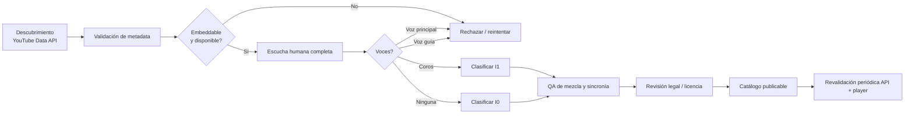
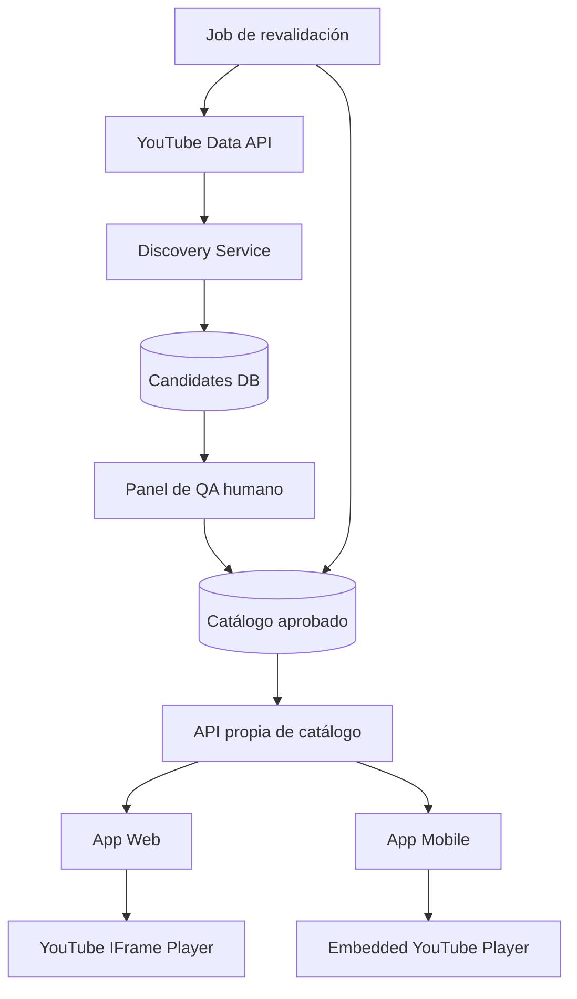

# Investigación profunda: catálogo de karaoke en español en YouTube para una app móvil y web

## Resumen ejecutivo

La idea de construir una base de datos de karaoke en español usando **YouTube como reproductor**, en vez de descargar y redistribuir las pistas, es técnicamente viable, pero hay dos supuestos que conviene corregir desde el inicio.

El primero es que **“karaoke” en el título no significa necesariamente “cero voces”**. Algunas pistas eliminan la voz principal pero conservan coros, voces de acompañamiento, conteos o una voz guía. Por eso, la etiqueta del video sirve para descubrir candidatos, pero no sustituye una prueba de escucha. En esta investigación, los 20 videos incluidos abajo fueron verificados como entradas reales de YouTube y, cuando fue posible, se contrastaron título, proveedor, fecha, duración y popularidad; sin embargo, la condición **“instrumental puro, absolutamente sin voces” debe considerarse pendiente hasta una auditoría auditiva completa**. Ejemplos como “La Bikina”, “Isabel” y “Hasta Que Te Conocí” identifican expresamente sus versiones como producidas por Party Tyme Karaoke. citeturn18search0turn18search2turn18search3

El segundo supuesto que debe descartarse es que **“estar publicado en YouTube” equivale a tener permiso para extraer su audio**. Las políticas de YouTube prohíben a clientes de su API separar, aislar o modificar los componentes de audio o video del contenido de YouTube, prohíben ofrecer descarga/separación de audio y también prohíben reproducirlo mediante un player oculto o en segundo plano. Para esta app, por tanto, la arquitectura jurídicamente y técnicamente más defendible es **guardar IDs y metadatos y reproducir el video mediante el reproductor oficial de YouTube**, sin crear MP3, sin `yt-dlp`, sin proxy de streams y sin extracción de la pista de audio. citeturn24view0turn25view4

Para el catálogo inicial, los proveedores que aparecen con mayor consistencia en la muestra son **PARTY TYME KARAOKE EN ESPAÑOL, Sing King Karaoke y Echoe Entertainment**. Como fuentes comerciales complementarias de referencia destacan KaraFun y KaraokeMedia: KaraFun declara que su material musical es regrabado y que su oferta Pro incluye licencia comercial; KaraokeMedia afirma producir sus propias canciones y comercializa formatos de karaoke y playback. Esto es una señal importante: en el mercado profesional, **la producción de la pista y los derechos para usarla comercialmente son problemas distintos**. citeturn25view3turn24view7

Mi recomendación es que la base de datos no tenga simplemente un campo `karaoke=true`, sino un proceso editorial con al menos cuatro estados:

**DESCUBIERTA → METADATA_OK → AUDIO_VERIFICADO → PUBLICABLE**

y una clasificación de pureza vocal:

**I0 = instrumental puro**, **I1 = sin voz principal pero con coros**, **G = tiene voz guía**, **V = contiene voz principal/rechazar**.

Para calidad, tampoco recomiendo almacenar un “bitrate de YouTube” inventado. La API pública sí permite obtener duración, HD/SD, licencia, posibilidad de embedding, restricciones regionales, vistas y likes, pero los detalles del archivo subido —codec, número de canales y bitrate de audio— solo pueden ser recuperados por el propietario del video. citeturn26view0turn26view3turn26view5turn26view6 YouTube recomienda para archivos fuente AAC-LC u Opus, estéreo, 48 kHz y 384 kbps para una subida estéreo; esos números son **recomendaciones de upload, no el bitrate final que escucha el usuario**. citeturn27view0turn27view2

**Archivo CSV generado con las 20 entradas de esta investigación:**  
[Descargar CSV — karaoke_youtube_espanol_muestra_20.csv](sandbox:/mnt/data/karaoke_youtube_espanol_muestra_20.csv)

## Estándar de calidad y modelo de metadatos

Para una aplicación real conviene separar tres conceptos que a menudo se mezclan: **calidad técnica**, **calidad karaoke** y **calidad/legalidad de la fuente**.

| Dimensión | Criterio propuesto para aprobar | Motivo |
|---|---|---|
| Pureza vocal | I0 preferido: ninguna voz humana cantada perceptible | Es el requisito principal de tu catálogo |
| Coros | I1 puede conservarse, pero debe etiquetarse | Muchos karaokes profesionales mantienen backing vocals |
| Voz guía | Rechazar del catálogo principal | Interfiere con el cantante |
| Duración | ≥ 2:00 y preferiblemente ±10–15 % de la versión de referencia | Descarta previews, fragmentos y falsos karaokes |
| Audio | Preferir reproducción claramente estéreo | Más apropiada para arreglos musicales completos |
| Ruido/distorsión | Sin clipping audible, bombeo, glitches ni ruido excesivo | Impacta directamente la experiencia |
| Balance | Bajo, batería, armonía y melodía de acompañamiento legibles | Una pista técnicamente limpia puede seguir siendo mala para cantar |
| Sincronía | Letra/video y acompañamiento coherentes | Esencial para karaoke |
| Video | Preferir HD cuando esté disponible | La API expone `contentDetails.definition` como `hd` o `sd` citeturn26view0 |
| Embedding | `status.embeddable=true` y prueba real en player | Incluso con embedding habilitado puede haber bloqueos adicionales citeturn26view3 |
| Región | Sin bloqueo en los mercados objetivo | La API expone `regionRestriction.allowed/blocked` citeturn26view1 |
| Proveedor | Productor/canal karaoke identificable | Reduce falsos positivos |
| Licencia | Registrar, nunca inferir | “Publicado en YouTube” no equivale a “libre para reutilizar” |

**Bitrate y estéreo.** Para videos públicos de terceros, recomiendo guardar `audio_bitrate_estimated = null` hasta que exista una fuente legítima que permita medirlo. `fileDetails.audioStreams[].channelCount`, `codec` y `bitrateBps` existen en la API, pero YouTube aclara que `fileDetails` solo puede recuperarlo el propietario del video. citeturn26view5turn26view6 Como estándar para material que tú mismo licencies o recibas directamente de un proveedor, la referencia de upload de YouTube es AAC-LC/Opus, 48 kHz, estéreo y 384 kbps de audio estéreo. citeturn27view2turn27view3

**Duración.** YouTube devuelve `contentDetails.duration` en formato ISO 8601, de modo que la duración debe obtenerse de la API y no extraerse del texto que aparece en una página de resultados. YouTube advierte además que puede existir aproximadamente un segundo de diferencia por transcodificación. citeturn26view0

Para la base de datos recomiendo como mínimo los siguientes grupos de columnas:

| Grupo | Campos |
|---|---|
| Identidad | `video_id`, `title`, `original_artist`, `canonical_song_id` |
| Fuente | `channel_id`, `channel_title`, `youtube_url`, `provider_tier` |
| YouTube | `published_at`, `duration_sec`, `definition`, `embeddable`, `license`, `licensed_content`, `region_restriction` |
| Popularidad | `view_count`, `like_count`, `metrics_observed_at` |
| Musical | `language`, `genre`, `subgenre`, `bpm`, `key`, `key_confidence` |
| Karaoke | `vocal_class`, `lead_vocal_absent`, `backing_vocals`, `guide_vocal`, `lyrics_synced` |
| QA | `audio_quality_score`, `mix_score`, `distortion_score`, `review_status`, `reviewer`, `reviewed_at` |
| Derechos | `license_status`, `rights_source`, `commercial_use_status`, `rights_checked_at` |
| Operación | `active`, `last_youtube_check`, `last_playback_check`, `rejection_reason` |

La API puede entregar directamente título, descripción, canal y fecha de publicación; también miniaturas. citeturn25view0 Puede entregar vistas y likes mediante `statistics.viewCount` y `statistics.likeCount`. Hay un detalle importante para tu analítica: YouTube cambió la definición de `viewCount` el **24 de agosto de 2026**, de manera que no conviene comparar ingenuamente las cifras actuales con series históricas antiguas como si la métrica nunca hubiera cambiado. citeturn26view4

`licensedContent=true` tampoco debe interpretarse como “yo tengo licencia para usarlo”. Ese campo significa que el video fue subido a un canal asociado con un partner de contenido y reclamado por ese partner. citeturn26view1

## Muestra real de pistas en español y archivo CSV

La siguiente es una **muestra de descubrimiento**, no una lista legalmente autorizada ni una certificación acústica definitiva. La existencia, título y asociación con karaoke fueron contrastados con resultados de YouTube/YouTube Music; los conteos de visualizaciones son aproximaciones observadas en la investigación y deben actualizarse por API antes de poner el catálogo en producción. En particular, los videos denominados “Versión Karaoke” siguen necesitando escucha humana para determinar si son I0 o si contienen coros.

| Canción | Artista | Canal/proveedor | Dur. | Fecha | Views aprox. | Estado vocal | Video |
|---|---|---|---:|---|---:|---|---|
| La Bikina | Luis Miguel | Party Tyme | 3:12 | 2021-03-18 | 4.2 M | Prevalidar I0/I1 | [YouTube](https://www.youtube.com/watch?v=wt-pY4mI2rs) citeturn18search0 |
| La Barca | Luis Miguel | Party Tyme | 3:54 | 2022-01-10 | 3.1 M | Prevalidar I0/I1 | [YouTube](https://www.youtube.com/watch?v=wFR0lF24IZ4) citeturn6search1turn6search4 |
| Isabel | Luis Miguel | Party Tyme | N/D | 2024-01-31 | N/D | Prevalidar I0/I1 | [YouTube](https://www.youtube.com/watch?v=IuNKijgr_xQ) citeturn18search2 |
| Hasta Que Te Conocí | Juan Gabriel | Party Tyme | 4:36 | 2024-11-07 | 1.1–1.2 M | Prevalidar I0/I1 | [YouTube](https://www.youtube.com/watch?v=rfwVxgkx_Q8) citeturn18search3turn6search9 |
| Ya Te Olvidé | Rocío Dúrcal | Party Tyme | 3:17 | 2019-12-10 | 6.2 M | Prevalidar I0/I1 | [YouTube](https://www.youtube.com/watch?v=z_mEpL_zl8k) citeturn1search7turn7search18 |
| De Serenata | Rocío Dúrcal | Party Tyme | 3:03 | 2023-12-08 | 13 K | Prevalidar I0/I1 | [YouTube](https://www.youtube.com/watch?v=pSCHrgQcUSw) citeturn19search0turn7search10 |
| Como Tu Mujer | Rocío Dúrcal | Party Tyme | N/D | N/D | 3.8–4.0 M | Prevalidar I0/I1 | [YouTube](https://www.youtube.com/watch?v=q9mxcGGjats) citeturn19search1turn7search22 |
| Luna | Ana Gabriel | Party Tyme | N/D | 2021-06-30 | 2.2 M | Prevalidar I0/I1 | [YouTube](https://www.youtube.com/watch?v=ov-2IoQ1LTI) citeturn14search2turn14search12 |
| Que Bello | La Sonora Dinamita | Party Tyme | N/D | 2023-11-28 | N/D | Prevalidar I0/I1 | [YouTube](https://www.youtube.com/watch?v=z9aZ5vLU_UE) citeturn3search28 |
| Suerte | Shakira | Echoe Entertainment | 3:15 | 2021-06-24 | 25 K | Prevalidar I0/I1 | [YouTube](https://www.youtube.com/watch?v=r9DJTBU7RbE) citeturn9search5turn9search4 |
| Loba | Shakira | Echoe Entertainment | 3:08 | 2021-06-24 | 388 K | Prevalidar I0/I1 | [YouTube](https://www.youtube.com/watch?v=iM32wVU0TnI) citeturn21search4turn9search24 |
| Las De La Intuición | Shakira | Echoe Entertainment | 3:41 | 2021-06-24 | 255 K+ | Prevalidar I0/I1 | [YouTube](https://www.youtube.com/watch?v=kv7iRaVpXYA) citeturn21search0turn21search3 |
| Como La Flor | Selena | Sing King | 3:25 | 2024-01-07 | 8.7 M | Prevalidar I0/I1 | [YouTube](https://www.youtube.com/watch?v=d6mToWZXZKA) citeturn21search1turn9search10 |
| Si Antes Te Hubiera Conocido | KAROL G | Sing King Karaoke | 3:20 | 2024-10-22 | 3.6 M | Prevalidar I0/I1 | [YouTube](https://www.youtube.com/watch?v=crLFRvgs57k) citeturn10search0turn10search1 |
| Si Te Vas | Shakira | Echoe Entertainment | 3:26 | 2021-06-24 | 75–76 K | Prevalidar I0/I1 | [YouTube](https://www.youtube.com/watch?v=lay5lTxgt7o) citeturn9search28turn15search3 |
| Él Me Mintió | Amanda Miguel | Party Tyme | 3:54 | 2019-02-11 | 6.1–6.2 M | Prevalidar I0/I1 | [YouTube](https://www.youtube.com/watch?v=Xkhcws7P204) citeturn22search1turn12search12 |
| Estos Celos | Vicente Fernández | Party Tyme | 3:26 | 2019 aprox. | 5.5 M | Prevalidar I0/I1 | [YouTube](https://www.youtube.com/watch?v=K4HvVN1lVAQ) citeturn13search0turn13search20 |
| Huele A Peligro | Myriam Hernández | Party Tyme | 5:06 | 2019-03-25 | 967–970 K | Prevalidar I0/I1 | [YouTube](https://www.youtube.com/watch?v=xauFGEqElHM) citeturn14search1turn13search6 |
| Como Te Va Mi Amor | Pandora | Party Tyme | 3:59 | 2020 aprox. | 6.0 M | Prevalidar I0/I1 | [YouTube](https://www.youtube.com/watch?v=cgczVlz2usI) citeturn13search3turn13search23 |
| Simplemente Amigos | Ana Gabriel | Party Tyme, indexado | 3:50–3:54 | 2022-01-09 | 321 K aprox. | Confirmar canal + I0/I1 | [YouTube](https://www.youtube.com/watch?v=s6MECNPPgIo) citeturn14search16turn7search23 |

Para algunos registros fue posible localizar también BPM y tonalidad mediante fuentes de análisis musical secundarias: **La Bikina ≈158 BPM, C; Luna ≈91 BPM, A♭; Huele A Peligro ≈77 BPM, G**. Estos valores deben considerarse estimaciones, no metadata oficial de YouTube, y recomiendo recalcularlos a partir de un archivo fuente legalmente licenciado antes de usarlos como información “confirmada”. citeturn4search16turn14search14turn13search26

El CSV completo tiene 18 columnas, incluyendo `video_id`, título, artista, proveedor, URL, duración, fecha, views, likes, idioma, género, BPM, tonalidad, tipo de pista, calidad estimada, licencia, estado de ausencia de voz y observaciones:

**[Descargar el CSV de 20 pistas](sandbox:/mnt/data/karaoke_youtube_espanol_muestra_20.csv)**

Las miniaturas siguientes son ejemplos representativos de videos incluidos en la muestra; son imágenes asociadas a los IDs de YouTube, no una certificación de derechos sobre el material. Los videos correspondientes fueron localizados como versiones karaoke en Party Tyme, Sing King y otros proveedores. citeturn18search0turn18search3turn21search1turn10search0

| Luis Miguel — La Bikina | Juan Gabriel — Hasta Que Te Conocí |
|---|---|
|  |  |

| Selena — Como La Flor | KAROL G — Si Antes Te Hubiera Conocido |
|---|---|
|  |  |

## Taxonomía y plan de validación de calidad

La mejor clasificación para la app no debería organizarse solamente por “género”. Una canción puede ser excelente musicalmente pero inservible si lleva voz guía; otra puede ser instrumental pura pero tener mala sincronización de letra. Recomiendo una taxonomía multidimensional.

**Por género**, una estructura inicial útil para el mercado hispanohablante sería: balada/romántica, bolero, pop latino, rock en español, ranchera/mariachi, banda, norteño/grupero, cumbia, salsa, merengue/tropical, bachata, urbano/reggaetón, vallenato, regional andino/folclórico y otros. Esta estructura coincide razonablemente con la forma en que proveedores profesionales separan categorías como Pop, Ballad, Rock, Ranchera, Banda, Latino, Norteña, Bolero, Cumbia y Grupera. citeturn24view7

**Por pureza vocal**, que para tu proyecto debería ser el filtro más importante:

| Código | Definición | Acción |
|---|---|---|
| `I0` | Instrumental puro; ninguna voz cantada perceptible | Publicar como “Solo música” |
| `I1` | Sin cantante principal, pero contiene coros/background vocals | Publicar solo si el usuario acepta coros |
| `G1` | Contiene voz guía, melodía cantada o frases de ayuda | Excluir del catálogo “solo música” |
| `V1` | Se escucha la voz principal/original | Rechazar |
| `U` | No revisado | Nunca presentarlo al usuario como “sin voz” |

**Por calidad**, propongo `QA`, `QB` y `QR`. `QA` sería limpio, balanceado, completo, sin clipping ni problemas de sincronía; `QB`, usable pero con alguna limitación menor; `QR`, rechazado.

Para evitar que una sola persona apruebe cientos de canciones de manera inconsistente, puede calcularse un score editorial propio, por ejemplo:

\[
Q = 0.35P_v + 0.20A + 0.15M + 0.10S + 0.10C + 0.10F
\]

donde `Pv` es pureza vocal, `A` claridad de audio, `M` calidad de mezcla, `S` sincronización, `C` completitud de la canción y `F` confiabilidad de la fuente. Esto es una propuesta interna de catalogación, **no una métrica de YouTube**, algo importante porque las políticas actuales de YouTube incluyen restricciones adicionales respecto de creación y almacenamiento de métricas derivadas en determinados casos de uso. citeturn25view4

La validación debería realizarse así:



La **prueba de escucha** debe incluir, como mínimo, introducción, primera estrofa, primer coro, puente y outro; para aprobar `I0` conviene escuchar la pista completa al menos una vez. Las zonas donde con mayor frecuencia aparecen voces no deseadas son coros, ad-libs, entrada del segundo coro y final. Una segunda revisión independiente para las canciones más populares reduciría falsos positivos.

La ficha del revisor podría registrar:

| Prueba | Valor |
|---|---|
| Voz principal presente | sí/no |
| Backing vocals/coros | sí/no |
| Voz guía | sí/no |
| Conteo hablado | sí/no |
| Stereo perceptible | sí/no/no determinado |
| Clipping/distorsión | 0–5 |
| Balance instrumental | 0–5 |
| Sincronía letra/música | 0–5 |
| Canción completa | sí/no |
| Intro adecuada para cantar | sí/no |
| Resultado | I0 / I1 / G1 / V1 |
| Confianza | baja / media / alta |

Para una pista de YouTube reproducida exclusivamente mediante el player oficial, **no recomiendo “automatizar la detección de voces” extrayendo el audio del video**: eso entra directamente en conflicto con las prohibiciones de separar o aislar audio de contenido audiovisual de YouTube. citeturn24view0turn25view4 Los modelos como Demucs, MDX-Net u otros separadores de stems sí pueden ser útiles sobre archivos WAV/MP3 que hayas recibido directamente de un proveedor y para los que tengas derechos suficientes, pero no deberían formar parte de un pipeline que ripea YouTube.

## Fuentes prioritarias y automatización respetando los términos de YouTube

La jerarquía de descubrimiento que utilizaría para crecer desde estas 20 canciones hasta miles es:

**Primera prioridad: productores/canales de karaoke reconocibles.** Party Tyme, Sing King y productores con catálogo consistente son preferibles a canales anónimos que suben “instrumentales” aislados. La investigación encontró, por ejemplo, que Party Tyme identifica explícitamente versiones como “producido por Party Tyme Karaoke”. citeturn18search0turn18search2turn18search3

**Segunda prioridad: catálogos profesionales como fuente de referencia.** KaraFun declara que el material musical de su servicio es regrabado y no utiliza la música ni vocalizaciones de la grabación original; además distingue su producto Pro con licencia comercial incluida. citeturn25view3 KaraokeMedia afirma tener más de veinte años en el sector y producir sus propias canciones, y ofrece pistas en varios formatos. citeturn24view7 Son excelentes referencias para detectar qué canciones tienen demanda y para explorar acuerdos directos futuros, aunque un catálogo comprado/licenciado de otra plataforma no debe confundirse automáticamente con derechos para usar su versión de YouTube.

**Tercera prioridad: Creative Commons verificado.** YouTube permite que el uploader marque videos como Creative Commons Attribution. YouTube señala que un video con un Content ID claim no puede marcarse CC BY y que la reutilización de contenido CC requiere cumplir sus términos y atribución. citeturn24view4 Aun así, en música conviene revisar por separado los derechos de la composición subyacente antes de asumir que la etiqueta del video resuelve todos los derechos comerciales.

**Cuarta prioridad: canales independientes.** Solo después de una revisión manual más estricta.

Para extracción de metadata, usa **YouTube Data API v3**, no scraping HTML. Un flujo adecuado sería realizar una búsqueda de descubrimiento y después recuperar los detalles de cada `video_id` mediante `videos.list`, incluyendo `snippet`, `contentDetails`, `status` y `statistics`. La API documenta campos para título, fecha, miniaturas, duración, HD/SD, licencia, embedding, restricciones regionales, vistas y likes. citeturn25view0turn26view0turn26view3turn26view4

Ejemplo conceptual en Python:

```python
import os
from googleapiclient.discovery import build

API_KEY = os.environ["YOUTUBE_API_KEY"]

youtube = build(
    "youtube",
    "v3",
    developerKey=API_KEY,
)

# Descubrimiento: NO descarga el contenido.
search_response = youtube.search().list(
    part="snippet",
    q='karaoke español "versión karaoke"',
    type="video",
    maxResults=25,
).execute()

video_ids = [
    item["id"]["videoId"]
    for item in search_response.get("items", [])
    if item["id"].get("videoId")
]

# Metadata oficial de YouTube.
videos_response = youtube.videos().list(
    part="snippet,contentDetails,status,statistics",
    id=",".join(video_ids),
).execute()

for video in videos_response.get("items", []):
    record = {
        "video_id": video["id"],
        "title": video["snippet"]["title"],
        "channel": video["snippet"]["channelTitle"],
        "published_at": video["snippet"]["publishedAt"],
        "duration_iso8601": video["contentDetails"]["duration"],
        "definition": video["contentDetails"].get("definition"),
        "licensed_content": video["contentDetails"].get("licensedContent"),
        "license": video["status"].get("license"),
        "embeddable": video["status"].get("embeddable"),
        "views": video.get("statistics", {}).get("viewCount"),
        "likes": video.get("statistics", {}).get("likeCount"),
        "thumbnail": (
            video["snippet"]
            .get("thumbnails", {})
            .get("high", {})
            .get("url")
        ),
    }

    # Un video no debería entrar directamente a producción:
    # pasa a la cola de QA manual.
    if record["embeddable"]:
        save_as_candidate(record)
```

La cuota merece planificación. La documentación vigente consultada, actualizada en septiembre de 2026, indica que un proyecto nuevo recibe por defecto un bucket de **100 llamadas diarias de `search.list`**, mientras que otros endpoints comparten por defecto un presupuesto de 10.000 unidades diarias; cada página adicional de resultados consume otra llamada. citeturn24view5 Esto favorece una arquitectura en la que `search.list` se usa para **descubrimiento**, mientras que después trabajas principalmente por `video_id`.

Para veinte mil canciones, no buscaría repetidamente cada tema todos los días. Mantendría un catálogo propio de IDs candidatos y ejecutaría revalidaciones de metadata/embedding de forma programada, respetando las reglas de almacenamiento y métricas aplicables de YouTube. Las políticas de desarrolladores actualizadas el 14 de septiembre de 2026 también prohíben repartir artificialmente un mismo caso de uso entre múltiples proyectos para evadir límites de cuota. citeturn25view4

Para **descargas**, la diferencia es crítica:

```text
YouTube -> NO descargar / NO extraer MP3 / NO separar audio.

Proveedor que te entrega directamente un archivo con licencia ->
sí puedes analizar ese archivo conforme al contrato/licencia.
```

Por ello, **no recomiendo `yt-dlp`, `youtube-dl`, scraping de `googlevideo` ni obtención de URLs directas de los streams** para el catálogo de esta app. Las políticas de YouTube prohíben el uso de tecnologías distintas de sus API Services para acceder o recuperar contenido audiovisual en este contexto y prohíben separar el audio. citeturn24view0

Para un archivo que **sí hayas obtenido legalmente fuera de YouTube**, podrías hacer QA técnico con comandos como:

```bash
# Archivo entregado directamente por un proveedor/licenciante.
ffprobe -v error \
  -show_entries stream=codec_name,codec_type,channels,sample_rate,bit_rate \
  -of json pista_licenciada.wav
```

y:

```bash
# Analizar loudness; no descarga nada desde YouTube.
ffmpeg -i pista_licenciada.wav \
  -filter_complex ebur128=peak=true \
  -f null -
```

BPM y tonalidad pueden estimarse sobre esos archivos autorizados usando Essentia, librosa, aubio o software especializado. Debe conservarse un campo `bpm_confidence`/`key_confidence`, porque las estimaciones automáticas fallan con modulaciones, intros libres, compases ambiguos y canciones con cambios de tonalidad.

## Arquitectura recomendada para la app con YouTube

Para web, el componente correcto es la **YouTube IFrame Player API**. La API permite insertar el reproductor, cargar videos, escuchar eventos y controlar play, pause, stop y volumen. citeturn24view3 En el embed conviene incluir `enablejsapi=1`, `playsinline=1` y el parámetro `origin` con el dominio real; YouTube recomienda `origin` como medida de seguridad frente al control no autorizado del player. citeturn24view3

Una estructura sencilla sería:

```javascript
let player;

function onYouTubeIframeAPIReady() {
  player = new YT.Player("youtube-player", {
    width: "100%",
    videoId: selectedVideoId,
    playerVars: {
      playsinline: 1
    },
    events: {
      onReady: () => {
        // Mostrar controles de karaoke fuera del área del player.
      },
      onStateChange: (event) => {
        // Sincronizar el estado de tu interfaz,
        // sin ocultar ni sustituir controles de YouTube.
      }
    }
  });
}
```

Para móvil, YouTube pide que cuando el reproductor integrado funcione dentro de WebView se usen, donde estén disponibles, tipos proporcionados por el sistema operativo: Android `WebView` o `CustomTabs`; Apple `WKWebView` o `SFSafariViewController`. citeturn24view2

Hay varias restricciones de diseño que influyen directamente en una app de karaoke:

El player debe tener como mínimo **200 × 200 px**; para 16:9 YouTube recomienda al menos 480 × 270 px. citeturn24view2turn24view3 No debes ocultar, modificar ni superponer elementos que interfieran con la UI o controles de YouTube. citeturn24view0turn25view4 Por lo tanto, si la app agrega una letra propia, puntuación, cola de canciones o controles del cantante, el diseño más seguro es colocarlos **al lado o debajo** del player, no encima de él.

El autoplay también tiene restricciones: el reproductor debe ser visible y más de la mitad del player debe estar visible antes de iniciar reproducción automática; una pantalla no debe tener más de un YouTube player reproduciéndose automáticamente a la vez. citeturn24view2

Y para una aplicación de karaoke existe una limitación especialmente importante: **no diseñaría un modo “pantalla apagada / audio continúa”**. YouTube prohíbe el background player cuando el reproductor no está visible en la página, pestaña o pantalla actual. citeturn24view0turn25view4

La arquitectura de datos que propondría sería:



La clave primaria debería ser `youtube_video_id`; una segunda entidad `song` representaría la canción abstracta. Esto permite tener varias versiones karaoke de la misma canción:

```text
song
 ├─ title
 ├─ artist
 ├─ language
 ├─ genre
 └─ canonical metadata
      │
      ├── youtube_version A — Party Tyme — I0 — QA
      ├── youtube_version B — Sing King — I1 — QA
      └── youtube_version C — canal independiente — rejected
```

Así, si un video desaparece, deja de ser embebible o es bloqueado regionalmente, no desaparece la canción de tu catálogo: puedes elegir la siguiente versión aprobada. Esto es especialmente importante porque `status.embeddable=true` no garantiza por sí solo que siempre se pueda reproducir: YouTube señala que un video puede terminar bloqueado en embeds por otras políticas o reclamaciones de terceros. citeturn26view3

## Consideraciones de licencias y derechos para una app comercial

El riesgo principal del proyecto no está en almacenar un título como “La Bikina”; está en **cómo se accede, presenta, monetiza y eventualmente reutiliza la grabación de karaoke**.

YouTube distingue entre su licencia estándar y `creativeCommon`. Los videos CC BY pueden reutilizarse sujeto a los términos de esa licencia y a la atribución correspondiente; YouTube también explica que un video con una reclamación de Content ID no puede marcarse como Creative Commons. citeturn24view4 Sin embargo, una pista karaoke implica normalmente al menos dos capas conceptuales: la **grabación de acompañamiento** y la **composición musical subyacente**. Que un uploader diga poder licenciar su video no debería convertirse automáticamente, sin revisión, en la conclusión de que tu uso comercial internacional de la obra musical está completamente cubierto.

La industria profesional ilustra esa separación. KaraFun afirma que todo su material musical está regrabado, que no utiliza las grabaciones o vocalizaciones originales y que el uso que no sea doméstico/personal requiere autorización; su plan Pro incluye expresamente licencia comercial. citeturn25view3 Eso contradice una intuición peligrosa: **“como no es el máster original, entonces no existen derechos”**. Una regrabación evita depender del máster original, pero no hace desaparecer automáticamente los derechos de la composición.

Para tu diseño concreto, recomiendo que el campo de licencia tenga estados, no un simple booleano:

| Estado | Significado |
|---|---|
| `YT_STANDARD_UNKNOWN` | Video disponible, pero sin permiso adicional documentado |
| `YT_CC_BY` | YouTube reporta Creative Commons; revisar composición y atribución |
| `PROVIDER_PERMISSION` | Existe permiso escrito del productor/proveedor |
| `COMMERCIAL_LICENSE` | Existe licencia contractual para el uso previsto |
| `RESTRICTED` | No utilizar |
| `LEGAL_REVIEW_PENDING` | No publicar comercialmente hasta revisión |

`contentDetails.licensedContent` tampoco sustituye este análisis, porque únicamente indica que el contenido fue reclamado por un partner de YouTube. citeturn26view2

Para la **primera versión del producto**, la estrategia con menor superficie de riesgo es:

**No alojar audio. No descargar audio. No separar audio. No modificarlo. No ocultar el player. No bloquear anuncios. No sustituir los controles de YouTube.** Las políticas de YouTube prohíben expresamente separar los componentes audiovisuales, alterar funcionalidades del player, bloquear publicidad, usar métodos no autorizados para recuperar contenido y permitir descargas. citeturn24view0turn25view4

El valor independiente de la aplicación debería estar en la **curación especializada**: catálogo exclusivamente karaoke, garantía editorial de “sin voz”, filtros por género/BPM/tonalidad/dificultad, favoritos, historial, colas de fiesta, puntuación propia que no modifique el contenido, recomendaciones y gestión de sesiones. Esto también es relevante porque YouTube exige que los servicios basados en su API aporten valor independiente y no sean simplemente una copia masiva de YouTube. citeturn25view4

La conclusión práctica es que **sí construiría esta base de datos**, pero no la llamaría todavía una “biblioteca de instrumentales verificados” hasta completar la escucha. La muestra de 20 videos demuestra que existe suficiente material en español de proveedores consistentes para comenzar un catálogo; la parte difícil no es encontrar videos, sino mantener simultáneamente **pureza vocal, calidad, disponibilidad, embedding y trazabilidad legal**.

La base de datos debería crecer en este orden: primero Party Tyme, Sing King y otros productores reconocidos; después canciones de alta demanda; luego QA auditivo I0/I1; después metadatos musicales; finalmente revisión de derechos por proveedor. Los catálogos profesionales de KaraFun y KaraokeMedia son además útiles como benchmark de géneros, cobertura y estructura comercial. citeturn25view3turn24view7

**Recomendación final de estándar de publicación:** una canción solo aparece con el badge **“Solo música — verificada”** cuando `embeddable=true`, no presenta bloqueo relevante en el territorio, fue escuchada completamente por un revisor, quedó clasificada `I0`, obtuvo calidad `QA` o `QB`, tiene metadata musical suficiente y posee un estado de derechos explícito. Todo lo demás permanece en la cola interna de candidatos. Esto evita que un título de YouTube o un alto número de views se conviertan, erróneamente, en sustitutos de la calidad o de una licencia.

**CSV entregable:** [karaoke_youtube_espanol_muestra_20.csv](sandbox:/mnt/data/karaoke_youtube_espanol_muestra_20.csv)