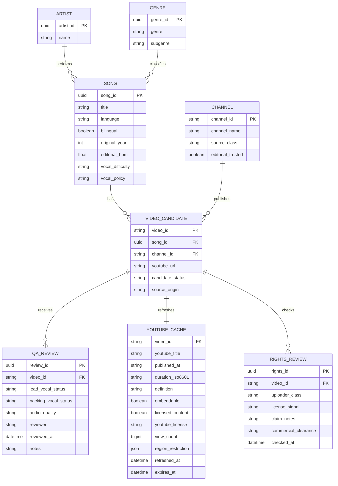
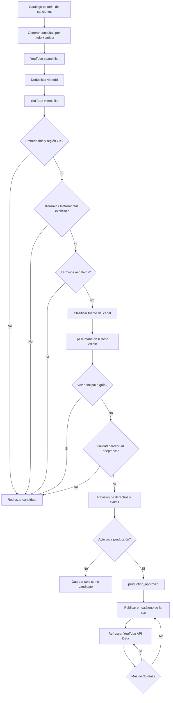

# Investigación de pistas de karaoke en español disponibles en YouTube para una app de karaoke

## Resumen ejecutivo

La investigación confirma que **sí existe un catálogo amplio y suficientemente diverso de pistas de karaoke en español en YouTube como para construir una primera base de datos de producción**, pero hay una distinción crucial entre encontrar un video titulado “Karaoke/Instrumental” y demostrar que cumple simultáneamente con cuatro requisitos: ausencia real de voz principal, calidad audiovisual adecuada, posibilidad de reproducción embebida y situación de derechos suficientemente clara.

Los mejores puntos de partida son tres tipos de fuentes. Primero, **canales oficiales de artistas**, que son la opción de mayor confianza cuando publican explícitamente una versión de karaoke; por ejemplo, el canal oficial de Maná publica “Rayando El Sol (feat. Pablo Alborán) (Karaoke Oficial)” y otras pistas de la misma serie. citeturn27search1turn27search3turn27search4turn27search5 Segundo, **productores especializados de karaoke**. KaraokeMedia afirma producir sus propias canciones, masterizarlas en estudio y ofrecer videos profesionales; Party Tyme mantiene un canal específico en español con versiones karaoke de repertorio latino; y KaraFun afirma que su material musical es regrabado y no utiliza la grabación ni las voces originales. citeturn20search0turn22search0turn21search0turn23search0 Tercero, existen canales especializados y usuarios independientes, útiles para ampliar cobertura pero que requieren un control mucho más estricto.

El entregable principal es una **base inicial de 108 canciones**, con 25 campos por registro y variedad de pop, balada, rock en español, regional/ranchera, salsa, bachata, cumbia/tropical, reguetón y repertorio bilingüe. Incluye título, artista, década, género/subgénero, idioma, BPM aproximado, dificultad vocal estimada, canal, tipo de canal, URL, tipo de URL, duración, fecha, vistas, resolución, bitrate, notas de audio, licencia/claims, tags, estado de verificación, fuente y fecha de revisión:

**[Descargar CSV completo — 108 canciones](sandbox:/mnt/data/karaoke_espanol_youtube_seed_2026-09-15.csv)**

Hay una limitación técnica importante respecto del requisito de **128 kbps o superior**: YouTube Data API documenta el bitrate de los streams de audio dentro de `fileDetails.audioStreams[].bitrateBps`, pero `fileDetails` solo puede consultarlo el propietario del video. Para videos públicos de terceros no se puede certificar mediante Data API que la pista sea ≥128 kbps. De forma similar, la API pública expone normalmente `contentDetails.definition = hd|sd`; el detalle exacto de píxeles de la fuente cargada está en `fileDetails` y también es exclusivo del propietario. citeturn26view0turn26view1turn26view2 Por ello, el CSV marca esos valores como **“no especificado”** cuando no existe evidencia primaria suficiente, en vez de inventarlos.

La segunda conclusión importante es jurídica/técnica: para una app que reproduce YouTube, la arquitectura recomendable es **YouTube Data API para descubrir y mantener metadatos + YouTube IFrame Player para reproducir el video completo**. Las políticas de YouTube prohíben descargar/copiar contenido audiovisual sin autorización, separar o aislar el audio del video, sustituir pistas, ocultar el reproductor para reproducir en segundo plano y hacer scraping de YouTube. citeturn17search3turn17search4turn19search3 En consecuencia, no recomiendo implementar un extractor de audio de YouTube ni ejecutar separación vocal sobre archivos obtenidos de YouTube. La comprobación estricta de “sin voz” debe realizarse mediante revisión humana dentro del reproductor embebido; el análisis automático de stems puede reservarse para masters propios o expresamente licenciados.

Finalmente, **`status.license="youtube"` no debe interpretarse como licencia comercial para la app**, y `contentDetails.licensedContent=true` tampoco: este último únicamente indica que el contenido fue subido a un canal vinculado a un partner de YouTube y reclamado por ese partner. YouTube también aclara que no puede conceder a terceros los derechos sobre contenido que otra persona haya subido. citeturn17search2turn18search2 Una app comercial debería tratar por separado “reproducible mediante YouTube” y “derechos comerciales despejados”.

## Alcance, metodología y nivel de verificación

La investigación combinó documentación primaria actual de YouTube Data API, IFrame Player API, políticas para desarrolladores y ayuda sobre licencias con páginas primarias de proveedores de karaoke y resultados de videos de YouTube. Las referencias técnicas se comprobaron contra documentación de Google/YouTube actualizada hasta septiembre de 2026. citeturn17search0turn17search1turn17search2turn18search0

Se buscó repertorio cuyo idioma principal fuera español, más algunas versiones bilingües. Las palabras de intención consideradas fueron `karaoke`, `instrumental`, `backing track`, `playback`, `pista`, `sin voz`, `instrumental y letra`, `tono original` y variantes. Se dio prioridad a videos asociados con un productor reconocido, un canal oficial o una página profesional que afirmara producir una versión instrumental.

Para no confundir evidencia con inferencia, la base utiliza dos niveles principales:

| Estado | Significado |
|---|---|
| **A / A-** | Se localizó una URL concreta de YouTube y existe alguna evidencia del canal, título, productor, fecha o descripción. **Todavía puede faltar escuchar manualmente toda la pista.** |
| **B** | La canción tiene alta prioridad de repertorio y se dejó una búsqueda de YouTube preparada, pero todavía no se fija un `videoId` definitivo. |

Este matiz es importante. Un título que diga “Karaoke Instrumental” constituye evidencia metadata, pero **no demuestra acústicamente ausencia absoluta de voz**. Puede haber coros, una melodía guía, voces de referencia o fragmentos vocales. Por ejemplo, algunos productos de karaoke permiten activar voces principal/secundaria, por lo que “karaoke” y “sin voz” no deben considerarse sinónimos automáticos. KaraFun, por ejemplo, ofrece controles de voces en su propio producto, aunque también afirma que sus regrabaciones no contienen las voces originales de las grabaciones comerciales. citeturn23search0

Por esa razón recomiendo registrar por separado:

`none` = ningún elemento vocal perceptible;  
`backing_only` = coros pero sin cantante principal;  
`guide` = melodía/vocal guía presente;  
`lead` = voz principal presente;  
`unknown` = no revisado.

Para una app cuyo requisito sea literalmente “solo música, sin voz”, el criterio de producción debería ser **solo `none`**. Si los coros son aceptables, puede habilitarse también `backing_only`.

### Qué significa realmente “calidad” en YouTube

El requisito “preferentemente 128 kbps o superior” no puede utilizarse como filtro universal de Data API para videos ajenos. Aunque el recurso `video` documenta `fileDetails.audioStreams[].bitrateBps`, esos detalles pertenecen al archivo subido y solo son accesibles al dueño del video. citeturn26view1turn26view2

En videos de terceros, las señales públicas que sí pueden automatizarse son mucho más prácticas:

| Señal | ¿Disponible públicamente? | Uso recomendado |
|---|---:|---|
| Duración | Sí, `contentDetails.duration` | Rechazar intros, Shorts, compilaciones, loops |
| HD/SD | Sí, `contentDetails.definition` | Preferir HD |
| ≥720p en búsqueda | Sí, `videoDefinition=high` | Primer pase de descubrimiento |
| Resolución exacta 1080p/2160p del archivo fuente | No para terceros | `no especificado` |
| Bitrate de audio exacto | No para terceros | `no especificado` |
| Embeddable | Sí, `status.embeddable` | Requisito crítico |
| Reproducible fuera de youtube.com | Filtro `videoSyndicated=true` | Requisito crítico |
| Restricciones territoriales | Sí | Validar por mercados |
| Licencia CC/YouTube | Sí, `status.license` | Señal jurídica, no autorización total |
| Claimed por partner | Sí, `licensedContent` | Señal de derechos, no permiso |
| Views | Sí | Popularidad auxiliar, no calidad |
| Descripción/tags | Sí | Detectar “instrumental”, “guía vocal”, etc. |

`videoDefinition=high` restringe los resultados a videos disponibles al menos en HD; YouTube define en este contexto HD como disponibilidad de **al menos 720p**. citeturn17search0 La Data API, sin embargo, reduce `contentDetails.definition` a `hd` o `sd`, por lo que un sistema no debería convertir automáticamente `hd` en “1080p”. citeturn17search2

Otro detalle importante para la base: para terceros, `snippet.publishedAt` es **fecha de publicación**, que puede diferir de la fecha real de carga. citeturn26view0 Por compatibilidad con el requerimiento del proyecto mantuve la columna `upload_date`, pero en un esquema definitivo recomiendo renombrarla a `youtube_published_at`.

## Fuentes prioritarias y hallazgos sobre canales

**KaraokeMedia** resulta particularmente interesante como fuente de descubrimiento porque declara más de veinte años en el sector, producción propia de canciones, videos de calidad profesional, trabajo en la tonalidad real y mastering en estudio propio. citeturn20search0 Además, páginas individuales encontradas durante la investigación describen expresamente productos como instrumental/playback; esto aporta una señal más fuerte que un upload anónimo, aunque la versión comercial de KaraokeMedia y un video de YouTube no deben darse por idénticos sin comprobarlo.

**Party Tyme Karaoke en Español** tiene una ventaja distinta: se localizaron directamente múltiples videos de YouTube con el patrón “(Versión Karaoke)”. Por ejemplo, “Si No Te Hubieras Ido” de Marco Antonio Solís está indexado como una versión de Party Tyme publicada el 11 de diciembre de 2019. citeturn22search0 También está directamente localizada su versión de “PROVENZA” de KAROL G. citeturn21search0 Los resultados del canal muestran además un catálogo amplio de Maná; “Rayando El Sol” supera varios millones de reproducciones en resultados indexados, aunque el valor debe refrescarse antes de almacenarlo porque las métricas cambian. citeturn22search3turn22search5

**KaraFun** aporta una señal especialmente útil para el control de producción: la empresa declara que su material musical se regraba y no utiliza la música ni las voces originales de la grabación, y califica su catálogo como profesional. Su página de “Cali pachanguero”, por ejemplo, identifica la pista como cover de Grupo Niche, duración 04:50 y año 1984. citeturn23search1 Sin embargo, una licencia de uso dentro de KaraFun no debe extrapolarse automáticamente a un video de YouTube o a otro producto. KaraFun ofrece además un plan Pro que anuncia licencia comercial para **su propio servicio**, lo que es conceptualmente distinto de los permisos de un video de YouTube. citeturn23search0

Los **canales oficiales de artistas** deben quedar por encima de los productores genéricos cuando exista una verdadera edición de karaoke. El caso de Maná es especialmente claro: el canal oficial tiene “Rayando El Sol (feat. Pablo Alborán) (Karaoke Oficial)”, “Amor Clandestino (Karaoke Oficial)”, “No Ha Parado De Llover (Karaoke Oficial)” y “El Reloj Cucú (Karaoke Oficial)”. citeturn27search1turn27search3turn27search4turn27search5 Para el ranking de confianza editorial, esos uploads deberían recibir prioridad, siempre verificando después `embeddable`, territorio y presencia de voces.

La jerarquía práctica que propongo es:

**Oficial artista/sello → productor profesional de karaoke → canal especializado estable → usuario individual.**

No utilizaría `viewCount` para decidir esa jerarquía. Los videos antiguos acumulan una ventaja estructural y, además, YouTube cambió el significado operativo de `viewCount` el 24 de agosto de 2026: para todos los formatos una reproducción pasa a contarse cuando el video empieza a reproducirse, incluyendo determinadas formas de autoplay/interacción. citeturn17search2 Por ello, no conviene comparar ingenuamente conteos históricos de diferentes generaciones.

## Catálogo recomendado y base de datos de canciones

La tabla completa contiene **108 candidatos**, desde repertorio de mediados del siglo XX hasta 2020s. Los BPM son **estimaciones editoriales**, no datos proporcionados por YouTube, y deben recalcularse contra el arreglo karaoke definitivo porque una versión puede cambiar tempo, tonalidad, introducción o duración. La dificultad vocal también es una estimación orientativa de producto basada en tesitura probable, saltos, sostén, fraseo y velocidad; no debe presentarse como medición científica.

**[Descargar la tabla CSV completa con 108 canciones y 25 columnas](sandbox:/mnt/data/karaoke_espanol_youtube_seed_2026-09-15.csv)**

Las columnas son:

`id`, `titulo`, `artista_original_o_version_referencia`, `decada`, `genero`, `subgenero`, `idioma_letra`, `bilingue`, `bpm_aprox_editorial`, `dificultad_vocal_estimada`, `canal`, `tipo_canal`, `url_youtube`, `tipo_url`, `duracion_video`, `upload_date`, `view_count`, `resolucion_video`, `bitrate_audio`, `audio_quality_notes`, `licencia_claims`, `tags`, `estado_verificacion`, `fuente_primaria_o_apoyo`, `ultima_revision`.

Cuando un dato no pudo comprobarse responsablemente aparece, según lo pedido, como **`no especificado`**.

Una muestra de los candidatos con URL exacta localizada es:

| Canción | Artista/referencia | Fuente | URL YouTube | Evidencia actual |
|---|---|---|---|---|
| Si No Te Hubieras Ido | Marco Antonio Solís | Party Tyme Karaoke en Español | https://www.youtube.com/watch?v=n5FzZJ0bpug | Versión Karaoke; publicada 2019-12-11. citeturn22search0 |
| Querida | Juan Gabriel | Party Tyme Karaoke en Español | https://www.youtube.com/watch?v=vNfNjG5Q6FU | Versión Karaoke producida por Party Tyme; QA vocal pendiente. |
| Rayando el Sol | Maná | Party Tyme Karaoke en Español | https://www.youtube.com/watch?v=U5TiuzOkJEY | Versión Karaoke; el catálogo del canal contiene el tema y registra millones de vistas en resultados indexados. citeturn22search3turn22search5 |
| Rayando El Sol feat. Pablo Alborán | Maná | Canal oficial | https://www.youtube.com/watch?v=QJaQd525CNM | Etiquetado explícitamente como “Karaoke Oficial”. citeturn27search1 |
| Ahora Quién | Marc Anthony | Party Tyme Karaoke en Español | https://www.youtube.com/watch?v=9mAr1eDTRvo | Versión Karaoke localizada; QA vocal pendiente. |
| Y Hubo Alguien | Marc Anthony | Party Tyme Karaoke en Español | https://www.youtube.com/watch?v=YLS9DKxXxaU | Versión Karaoke localizada; publicación indexada en 2026. |
| Gasolina | Daddy Yankee | Canal karaoke por clasificar | https://www.youtube.com/watch?v=3RlxPnj4SPY | El resultado se presenta como “Instrumental y letra”; descripción indexada con información de gestión de derechos; QA pendiente. |
| Rompe | Daddy Yankee | Canal karaoke por clasificar | https://www.youtube.com/watch?v=k1M3eyjLPrQ | Resultado identificado como “Instrumental Beat Karaoke”; QA pendiente. |
| Despacito | Luis Fonsi ft. Daddy Yankee | Party Tyme Karaoke en Español | https://www.youtube.com/watch?v=QThJlC1W5hQ | Versión Karaoke; una referencia musical indexada para esa versión reporta aprox. 89 BPM y 3:52, pero duración debe obtenerse de API en producción. citeturn22search6 |
| PROVENZA | KAROL G | Party Tyme Karaoke en Español | https://www.youtube.com/watch?v=753dfvomgf4 | Versión Karaoke publicada 2022-06-25. citeturn21search0 |
| Downtown | Anitta & J Balvin | Muramatsu Karaoke | https://www.youtube.com/watch?v=AfRM34GiYVM | Indexado como versión karaoke/instrumental en español; QA pendiente. |
| Evidencias, versión en español | José Augusto | Canal karaoke por clasificar | https://www.youtube.com/watch?v=MxeO1yHfx-k | Versión española de karaoke localizada; QA pendiente. |
| Si Vuelvo a Nacer | BIA / Isabela Souza | Chanson Karaoke | https://www.youtube.com/watch?v=bhwXDj8f6b0 | Cover karaoke en español; QA pendiente. |

Que una URL esté en esta muestra **no significa que ya deba publicarse automáticamente en la app**. La fase A de investigación prueba que existe una candidata relevante; antes del estado `production_approved` debe pasar por consulta actual de Data API y escucha humana en el IFrame.

El repertorio del CSV cubre, entre otros:

| Familia | Ejemplos incluidos |
|---|---|
| Pop / balada | La Incondicional, El Triste, Querida, Amor Eterno, Antología, Corazón Partío, Por Amarte Así, Entra en Mi Vida |
| Rock en español | De Música Ligera, Persiana Americana, Lamento Boliviano, Rayando el Sol, Clavado en un Bar, Afuera, Matador |
| Ranchera / regional | Volver Volver, El Rey, Acá Entre Nos, Costumbres, Así Fue, Secreto de Amor, Adiós Amor |
| Salsa | Vivir Mi Vida, Valió la Pena, Llorarás, Lluvia, El Cantante, Cali Pachanguero, La Vida Es un Carnaval |
| Bachata | Obsesión, Propuesta Indecente, Darte un Beso, Bachata Rosa, Burbujas de Amor |
| Cumbia / tropical | Cómo Te Voy a Olvidar, Nunca Es Suficiente, Como la Flor, Techno Cumbia, Motor y Motivo |
| Reguetón / urbano | Gasolina, Rompe, Despacito, Mi Gente, DÁKITI, Tití Me Preguntó, PROVENZA, TQG |
| Bilingües | Con Calma, Despacito Remix, Mi Gente Remix, Bailando English/Spanish Version, Stand by Me |

La elección de “Cali Pachanguero” es particularmente sólida como candidato de repertorio profesional: KaraFun ofrece una regrabación del tema, la identifica como canción de Grupo Niche, da una duración de 04:50 y declara que su material no utiliza la grabación o voces originales. citeturn23search1 “Amor Eterno” también aparece en su catálogo como karaoke de calidad profesional. citeturn23search0

## Ingestión, filtros automáticos y YouTube Data API

### Descubrimiento

No recomiendo scraping de las páginas HTML de YouTube. Las políticas para desarrolladores prohíben directamente el scraping de YouTube Applications; además, para este caso Data API ya proporciona mecanismos de búsqueda, filtros de embed y metadatos estructurados. citeturn19search3

La búsqueda debería realizarse por canción y artista, lanzando varias consultas focalizadas:

```text
{artista} {titulo} karaoke
{artista} {titulo} instrumental
{artista} {titulo} backing track
{artista} {titulo} playback
{artista} {titulo} pista sin voz
```

Las palabras negativas recomendadas para una segunda pasada son:

```text
"con voz"
"voz guía"
"guía vocal"
"lead vocal"
"guide vocal"
"vocal cover"
"acapella"
"live"
"en vivo"
"reacción"
"tutorial"
```

`search.list` permite los operadores booleanos NOT `-` y OR `|`; la barra vertical debe codificarse como `%7C`. También admite `regionCode` y `relevanceLanguage`. El máximo de una página es 50 resultados. citeturn24view0turn24view1turn24view2

Una consulta REST para Ecuador podría ser:

```http
GET https://www.googleapis.com/youtube/v3/search
    ?part=snippet
    &type=video
    &q=Luis%20Miguel%20La%20Incondicional%20karaoke%7Cinstrumental
    &relevanceLanguage=es
    &regionCode=EC
    &videoEmbeddable=true
    &videoSyndicated=true
    &videoDefinition=high
    &maxResults=25
    &key=API_KEY
```

`videoEmbeddable=true` limita el descubrimiento a videos declarados embebibles, `videoSyndicated=true` a contenido reproducible fuera de youtube.com y `videoDefinition=high` a videos HD. Todos estos filtros requieren `type=video`. citeturn17search0turn24view2

No usaría `videoDuration=medium` como condición obligatoria porque YouTube define esa clase como cuatro a veinte minutos, y eliminaría muchas canciones normales de tres minutos. citeturn17search0 Es mejor consultar la duración exacta después y aplicar en la app un rango propio, por ejemplo 2:00–8:00.

### Enriquecimiento de resultados

Una vez deduplicados los `videoId`, ejecutar:

```http
GET https://www.googleapis.com/youtube/v3/videos
    ?part=snippet,contentDetails,statistics,status,player
    &id=VIDEO_ID_1,VIDEO_ID_2,VIDEO_ID_3
    &hl=es
    &key=API_KEY
```

`videos.list` acepta esos bloques de propiedades y tiene un coste actual de una unidad dentro del sistema de cuota aplicable. `snippet` proporciona, entre otros, canal, título, descripción y tags. citeturn17search1

Los campos que conservaría son:

```text
id

snippet.title
snippet.channelId
snippet.channelTitle
snippet.description
snippet.tags
snippet.publishedAt

contentDetails.duration
contentDetails.definition
contentDetails.licensedContent
contentDetails.regionRestriction

statistics.viewCount

status.license
status.embeddable
status.madeForKids

player.embedHtml
```

`contentDetails.duration` viene en ISO 8601, por ejemplo `PT3M52S`; YouTube advierte que puede existir una diferencia aproximada de un segundo respecto de la reproducción real debido a transcodificación. citeturn17search2

También conviene comprobar `regionRestriction` antes de activar una pista. Un video puede contener una lista explícita de países permitidos o bloqueados. citeturn17search2 Para una app latinoamericana no asumiría que disponibilidad en Ecuador implica disponibilidad en México, Colombia, Argentina o Estados Unidos.

### Reglas automáticas de admisión

En lugar de fabricar un “quality score” usando vistas de YouTube, usaría reglas determinísticas de elegibilidad:

```python
POSITIVE = {
    "karaoke",
    "instrumental",
    "backing track",
    "playback",
    "pista",
    "sin voz",
}

REJECT = {
    "con voz",
    "voz guía",
    "guía vocal",
    "guide vocal",
    "lead vocal",
    "vocal cover",
    "en vivo",
    "live performance",
    "reaction",
    "tutorial",
}

def metadata_gate(video, market="EC"):
    text = " ".join([
        video.title,
        video.description,
        *video.tags
    ]).lower()

    if not video.status.embeddable:
        return "reject:not_embeddable"

    if is_blocked(video.contentDetails.regionRestriction, market):
        return "reject:region"

    if not any(term in text for term in POSITIVE):
        return "reject:not_explicit_karaoke"

    if any(term in text for term in REJECT):
        return "reject:vocal_or_wrong_format"

    duration = iso8601_to_seconds(video.contentDetails.duration)

    if duration < 120 or duration > 480:
        return "review:duration_outlier"

    if video.contentDetails.definition != "hd":
        return "review:sd"

    return "manual_audio_review"
```

No incorporaría las vistas como condición fuerte. Puede guardarse temporalmente `statistics.viewCount` como metadata de YouTube, pero una pista profesional recién publicada podría tener muchas menos vistas que una copia mediocre de hace quince años. Además, la semántica del contador cambió en agosto de 2026. citeturn17search2

### Comprobación de ausencia de voz

Para contenido de terceros alojado en YouTube, el procedimiento seguro es **QA por escucha dentro del IFrame**, no descargar audio y ejecutar separación de stems. YouTube permite controlar reproducción, pausa, volumen y posición mediante su IFrame Player API; el viewport embebido debe tener al menos 200×200 px y para 16:9 recomienda al menos 480×270. citeturn18search1

Pseudocódigo del revisor:

```text
function reviewKaraoke(video):
    abrir video en YouTube IFrame Player visible

    puntos = [
        0:15,
        0:45,
        0.35 * duración,
        0.55 * duración,
        0.75 * duración,
        max(duración - 25, 0)
    ]

    lead = false
    guide = false
    backing = false
    noise = false
    clipping = false

    for t in puntos:
        seekTo(t)
        escuchar 12-20 segundos

        si se oye cantante principal:
            lead = true

        si se oye una voz o melodía cantada que guía al cantante:
            guide = true

        si solo aparecen coros:
            backing = true

        si hay distorsión, hiss fuerte, clipping o artefactos:
            noise = true

    si lead or guide:
        estado = REJECT

    else if backing:
        estado = APPROVE_BACKING_ONLY
        # Rechazar también si la política del producto exige cero voces.

    else if noise or clipping:
        estado = REJECT_QUALITY

    else:
        estado = APPROVE_INSTRUMENTAL

    guardar revisión humana, fecha y revisor
```

Para **archivos propios o cuya licencia permita expresamente descargar/procesar**, sí se puede complementar con análisis acústico:

```python
def validate_owned_master(path):
    """
    SOLO para un archivo que poseemos o tenemos derecho expreso a procesar.
    No descargar videos de YouTube para ejecutar este procedimiento.
    """

    media = ffprobe(path)

    quality = {
        "audio_bitrate_bps": media.audio_bitrate,
        "sample_rate_hz": media.sample_rate,
        "channels": media.channels,
        "video_width": media.width,
        "video_height": media.height,
    }

    # Ejemplo conceptual: modelo de separación/detección vocal.
    vocals, accompaniment = separate_stems(path)

    vocal_ratio = rms(vocals) / max(rms(accompaniment), 1e-9)
    sustained_vocal_segments = detect_sustained_vocal_activity(vocals)

    no_lead_vocal = (
        vocal_ratio < CALIBRATED_THRESHOLD
        and sustained_vocal_segments == 0
    )

    return quality, no_lead_vocal
```

La separación automática anterior **no debería aplicarse a contenido audiovisual recuperado de YouTube**: las políticas de YouTube prohíben separar, aislar o modificar los componentes de audio/video y también prohíben ofrecer descargas de audio separadas. citeturn17search3turn17search4

### Cuotas actuales

Existe un cambio importante respecto de documentación histórica que circula en internet. La calculadora oficial actualizada el 14 de septiembre de 2026 indica que un proyecto nuevo tiene por defecto **100 llamadas diarias de `search.list`**, 100 de `videos.insert` y 10.000 unidades diarias combinadas para los demás endpoints; `search.list` tiene actualmente su propio bucket y cada llamada, incluida una página adicional, consume una llamada de ese bucket. Las cuotas se reinician a medianoche, hora del Pacífico. citeturn18search0

Eso hace recomendable no buscar continuamente cada canción. Una estrategia eficiente sería generar consultas solo para canciones sin candidato, conservar los IDs ya aprobados y refrescar esos videos con `videos.list`, que cuesta una unidad por llamada. citeturn17search1turn18search0

## Modelo de datos y flujo de ingestión

La arquitectura debe separar **metadata editorial que pertenece a la app** —género, BPM, dificultad, clasificación vocal, prioridad— de **API Data de YouTube**, cuya conservación está sujeta a las políticas de YouTube. YouTube permite almacenar temporalmente cantidades limitadas de Non-Authorized API Data durante un máximo de 30 días; después debe borrarse o refrescarse. También exige esfuerzos razonables para mantenerla alineada con los datos actuales. citeturn19search3

Esto sugiere dos capas: una tabla persistente editorial y una caché renovable de YouTube.



El flujo de ingestión recomendado es:



El campo `expires_at` resulta especialmente útil para imponer técnicamente la política de refresco, en lugar de depender de un proceso manual. Las políticas oficiales establecen que Non-Authorized API Data no debe conservarse más de 30 días sin borrarse o actualizarse. citeturn19search3

Para evitar que desaparezca la información editorial al refrescar YouTube, `SONG.editorial_bpm`, `GENRE`, dificultad y QA deben mantenerse separados del objeto API. La propia política de YouTube distingue los datos de la API de información/mediciones independientes de la aplicación y establece restricciones sobre crear métricas derivadas de API Data; por ello evitaría un “YouTube Quality Score” calculado a partir de views, likes u otros datos de YouTube. citeturn19search3

## Derechos, licencias y recomendación para producción

La principal suposición que conviene descartar es que **“está en YouTube y permite embed” equivale a “tenemos los derechos de karaoke”**. Son cosas diferentes.

`status.embeddable=true` significa que el recurso declara que puede insertarse en otro sitio, aunque YouTube advierte que incluso un video configurado como embebible podría no reproducirse posteriormente debido a políticas de plataforma o claims de terceros, incluido Content ID. citeturn17search2 Por eso la aplicación debe soportar fallos y reemplazos de videos.

`contentDetails.licensedContent=true` no es una autorización para el desarrollador: YouTube lo define como contenido subido a un canal ligado a un partner de contenido y reclamado por ese partner. citeturn17search2 Desde el punto de vista de riesgo puede incluso constituir una señal de que existen titulares de derechos activos.

`status.license` solo tiene dos estados documentados: `creativeCommon` y `youtube`. citeturn17search2 Una licencia Creative Commons BY puede permitir ciertos usos sujetos a sus condiciones, y YouTube señala que un video con una reclamación de Content ID no puede marcarse CC BY. YouTube también aclara expresamente que no puede conceder a una aplicación derechos sobre contenido perteneciente a otra persona; esos derechos deben investigarse con los titulares correspondientes. citeturn18search2

Para la aplicación propuesta, la implementación técnicamente más defendible es **reproducir el video mediante el player oficial sin extraer ni alterar su contenido**. Las políticas prohíben eliminar u ocultar funcionalidades del player, bloquear publicidad, separar o modificar audio/video y reproducir mediante un reproductor oculto en segundo plano. citeturn17search3turn17search4

Esto también tiene una consecuencia de producto: la app no debería anunciar que “reproduce únicamente el audio instrumental de YouTube” si técnicamente está ocultando el video o separando el audio. Debería presentarse como una **experiencia de karaoke que reproduce videos de YouTube mediante el reproductor oficial**, añadiendo valor propio mediante catálogo curado, clasificación por género/BPM/dificultad, colas de cantantes, favoritos, búsqueda y controles de sesión que no interfieran con el player. El IFrame Player API es precisamente la interfaz oficial de reproducción embebida. citeturn18search1

Tampoco implementaría un crawler HTML. Además de ser innecesario, la política de YouTube prohíbe directamente hacer scraping de YouTube Applications. citeturn19search3

La ruta de producción que surge de la investigación es, por tanto:

| Fase | Política recomendada |
|---|---|
| Descubrimiento | Data API, nunca scraping |
| Fuente preferente | Canal oficial → KaraokeMedia / Party Tyme / KaraFun u otro productor validado → especialista → usuario |
| Video | `embeddable=true`, sindicalizable fuera de YouTube y disponible en región |
| Resolución | Preferir `videoDefinition=high`; no afirmar “1080p” sin evidencia |
| Bitrate | `no especificado` en videos de terceros; no inventar ≥128 kbps |
| Voz | Escucha humana en IFrame; `none` obligatorio para modo estrictamente instrumental |
| Coros | Campo separado `backing_only`; decidir política de producto |
| Licencia | Registrar `status.license`, `licensedContent` y revisión jurídica como campos distintos |
| Reproducción | IFrame oficial visible |
| Audio | No descargar, extraer, sustituir ni aislar |
| Metadata dinámica | Caché con TTL ≤30 días y refresco |
| Métricas | Views como metadata informativa, no como proxy de calidad |
| Revisión periódica | Revalidar disponibilidad, región, embed, descripción y rights status |

El hallazgo más importante para el diseño de la base es que conviene cambiar la noción de **“canción = URL de YouTube”** por **“canción = entidad editorial con uno o varios candidatos de video”**. Un video puede desaparecer, bloquearse por país, perder capacidad de embed o ser reemplazado por una versión de mayor calidad. El modelo `SONG 1:N VIDEO_CANDIDATE` permite promover automáticamente otro candidato ya revisado sin perder géneros, BPM, dificultad o historial de QA.

Asimismo, no recomendaría prometer al usuario “128 kbps+” basándose en Data API. El propio recurso de video deja claro que bitrate, codecs y resolución exacta del archivo cargado pertenecen a `fileDetails`, información recuperable únicamente por el propietario. citeturn26view0turn26view2 Una especificación técnicamente honesta sería: **“HD preferido, fuente de karaoke profesional priorizada y audio aprobado mediante control auditivo”**; el umbral de 128 kbps puede mantenerse solo para archivos propios/licenciados en los que el backend pueda medir realmente el master.

Finalmente, para convertir las 108 semillas del CSV en un catálogo de producción, el requisito de aceptación debería ser simultáneo: **video exacto localizado + `embeddable` actual + territorio admitido + identificación explícita como karaoke/instrumental + ausencia de voz principal/guía confirmada por escucha + calidad perceptual aprobada + rights status registrado**. Cualquier candidato que no cumpla todos esos puntos debe permanecer en `candidate` o `review`, no en `production_approved`.

**Base entregada:** [karaoke_espanol_youtube_seed_2026-09-15.csv](sandbox:/mnt/data/karaoke_espanol_youtube_seed_2026-09-15.csv)