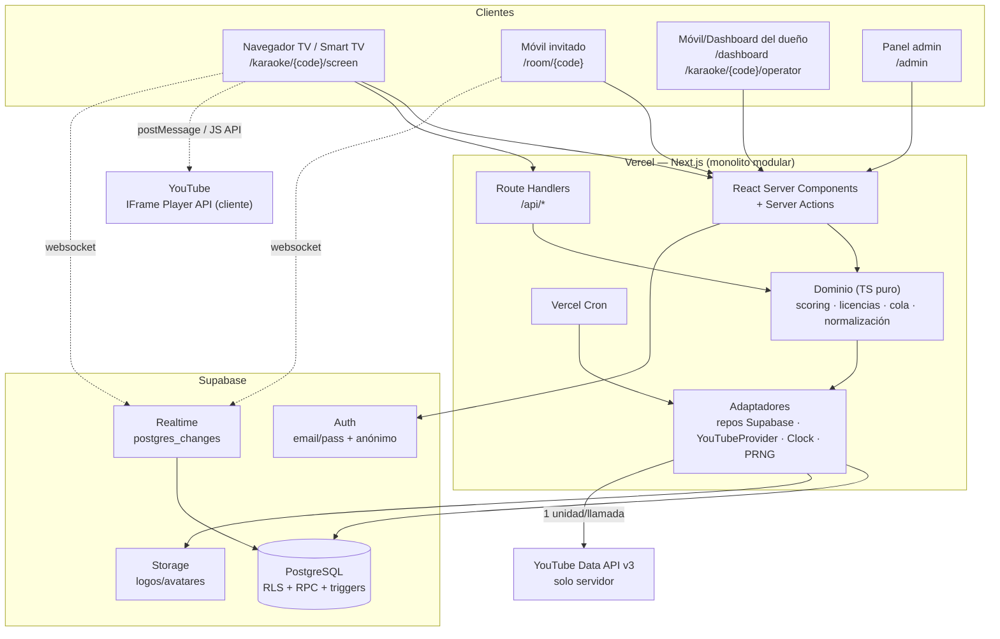
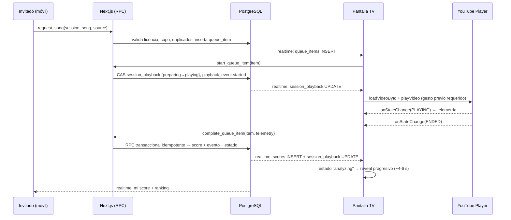

# ARCHITECTURE.md — Plataforma de Karaoke Social sobre YouTube

| Campo | Valor |
|---|---|
| Documento | Arquitectura general del sistema |
| Versión | 0.1 (borrador para revisión) |
| Estado | **Propuesto — no aprobado. No escribir código de producción hasta revisión.** |
| Autor | Arquitecto principal de software |
| Fuentes normativas | `SPEC.md`, `CLAUDE.md` |
| Documentos relacionados | `docs/DATABASE.md`, `docs/YOUTUBE-INTEGRATION.md`, `docs/ADR/`, `ROADMAP.md` |

> **Naturaleza de este documento.** Es una especificación de diseño. Contiene bocetos de esquema SQL,
> firmas de funciones e interfaces TypeScript con valor normativo (definen contratos), pero **no es
> código de producción** y no debe copiarse a `src/` sin pasar por el ciclo de implementación.

---

## 0. Resumen ejecutivo

### 0.1 Qué construimos

Un **monolito modular** en Next.js (App Router) desplegado en Vercel, con Supabase
(PostgreSQL + Auth + Realtime + Storage) como backend, que envuelve al **reproductor embebido
oficial de YouTube** con una capa de producto propia: catálogo curado, búsqueda tolerante,
sesiones con código de sala y QR, cola de participantes, pantalla TV, puntuación recreativa
con motor determinista en servidor, ranking, historial, favoritos y licencias.

El producto que se vende es **el software y la experiencia**, nunca el contenido audiovisual.
YouTube es un proveedor de reproducción reemplazable (§36 de `SPEC.md`).

### 0.2 Hallazgos que obligan a corregir el `SPEC.md`

Estos cinco puntos no son opiniones: son restricciones verificadas contra la documentación
vigente de Google y contra la realidad operativa del producto. Cada uno tiene su ADR.

| # | Hallazgo | Impacto | Corrección propuesta | ADR |
|---|---|---|---|---|
| H1 | `search.list` tiene **su propio cupo de 100 llamadas/día** (bucket independiente, 1 de cuota por llamada). El resto de endpoints comparte 10,000 unidades/día. | Cualquier diseño donde la búsqueda del usuario toque la API de YouTube está muerto: 100 búsquedas diarias se agotan en una sola fiesta. | El catálogo propio es la **única** fuente de búsqueda de usuarios. YouTube solo se usa para curación administrativa y para *harvesting* de listas de reproducción (`playlistItems.list`, 1 unidad). | ADR-0005, ADR-0013 |
| H2 | Las políticas de desarrollador prohíben: *"API Clients must not charge users fees for watching content in an embedded YouTube player."* | El modelo comercial del `SPEC.md` (§6.2, §34) tal como está redactado — "FREE: sesiones limitadas, historial reducido, máximo pequeño de participantes" — se lee como **cobrar por ver contenido de YouTube**. Es un riesgo de cumplimiento y de suspensión de la API key. | El muro de pago debe rodear **funciones de software** (marca, operador, reportes, multi-pantalla, límite de sesiones *simultáneas/organizativas*) y **nunca** el acto de reproducir. Prohibido: cobrar por reproducción, por canción, por minuto, o interrumpir la reproducción con un upsell. Requiere **revisión legal antes de vender**. | ADR-0018 |
| H3 | Overlays: *"You must not display overlays, frames, or other visual elements in front of any part of a YouTube embedded player, including player controls."* Y *"a page or screen must not have more than one YouTube player that automatically plays content simultaneously."* | La pantalla TV no puede superponer animaciones de scoring, chips de "cantando ahora", QR ni barras de progreso sobre el reproductor. Un solo reproductor con autoplay por pantalla. | La TV se compone de **regiones hermanas**, nunca superpuestas: `PlayerStage` (caja 16:9 intocable) + `ShowPanel`. Validado con un test visual automatizado. Las previsualizaciones móviles son *tap-to-play*, jamás autoplay. | ADR-0009 |
| H4 | Los metadatos obtenidos por API key son *Non-Authorized Data*: **máximo 30 días calendario** de almacenamiento, luego hay que borrarlos o volver a obtenerlos. También: no se pueden crear métricas derivadas de API Data sin divulgación explícita. | El catálogo no puede ser un archivo histórico: cada fila tiene fecha de caducidad de metadatos. Y el score nunca puede presentarse como métrica derivada de datos de YouTube. | Columna `song_sources.metadata_fetched_at` + job nocturno de refresco + **ocultado automático** de fuentes con metadatos vencidos (`>30 días`). El score es dato **propio**, y la UI lo declara como tal junto a datos de YouTube. | ADR-0014 |
| H5 | *"API Clients that use the YouTube embedded player must provide identification through the `HTTP Referer` request header"*, y no se debe suprimir con `Referrer-Policy`. | La cabecera de seguridad "por defecto" recomendada en muchos checklists (`Referrer-Policy: no-referrer`) **rompe la integración**. | Política obligatoria: `Referrer-Policy: strict-origin-when-cross-origin`. Prohibido `no-referrer` y `noreferrer`. El error 153 se trata como fallo de identificación, no como fallo de contenido. | ADR-0010 |

### 0.3 Lo que este documento NO resuelve

- Precios definitivos y modelo fiscal (§34 de `SPEC.md` ya dice "validar antes de fijar").
- Marca comercial y dominio definitivos.
- Jurisdicción de constitución de la sociedad.
- Textos legales finales (TdU, Privacidad, FAQ de scoring). Aquí se especifican **requisitos**, no redacción.

### 0.4 Decisiones que requieren tu confirmación antes de implementar

| ID | Decisión abierta | Opciones | Recomendación | ADR |
|---|---|---|---|---|
| **C1** | ¿Aceptas que el muro de pago no puede tocar la reproducción? | (a) aceptar y rediseñar la matriz de planes; (b) mantener el diseño actual y asumir el riesgo | **(a)**. Con (b) el riesgo es perder la API key y el producto entero. | ADR-0018 |
| **C2** | ¿Los invitados usan Supabase Auth anónimo o un token propio? | (a) Auth anónimo; (b) RPC `SECURITY DEFINER` con token propio | **(a)**. Da `auth.uid()` real, RLS uniforme y conversión a cuenta permanente sin migración. | ADR-0004 |
| **C3** | ¿El MVP incluye análisis de actividad vocal por micrófono (Web Audio, solo presencia/energía/continuidad, sin afinación)? | (a) incluirlo en MVP; (b) dejarlo para Fase 2 | **(a), alcance reducido**. Sin señal de audio el score solo depende de reproducción y pausas, que son casi constantes → todos sacan ~85 y la experiencia se muere. Con micrófono obtienes una señal real, honesta y barata. Ver §11.4. | ADR-0019 |
| **C4** | Licencia "Lifetime" con costos recurrentes (Realtime, cómputo, YouTube) | (a) lifetime real; (b) lifetime de la línea de producto con techo de uso; (c) suscripción | **(b)**. Un lifetime financia el día 1 y descapitaliza el año 3. Definir "versión mayor" y techo de pantallas concurrentes. | ADR-0017 |
| **C5** | Modo Commercial sobre reproducción de YouTube | (a) mantener YouTube como fuente principal del tier comercial; (b) tier comercial preparado para contenido licenciado/propio | **(b)** como estrategia, **(a)** como MVP pragmático con advertencia contractual. Ver §19.3. | ADR-0018 |

---

## 1. Arquitectura general del sistema

### 1.1 Vista de contexto



### 1.2 Principio rector

```text
UI (React)                    ← presentación, sin reglas de negocio
  ↓ Server Actions / Route Handlers
Aplicación (casos de uso)     ← orquestación, transacciones, autorización
  ↓
Dominio (TS puro)             ← scoring, licencias, cola, normalización, invariantes
  ↓
Puertos (interfaces)          ← VideoProvider, *Repository, Clock, Entropy, ScoreSignal
  ↓
Adaptadores                   ← Supabase, YouTube Data API, InMemory (tests)
```

**Regla de dependencia (verificable en CI):** `src/domain/**` no puede importar
`next/*`, `react`, `@supabase/*`, `node:*` ni `fetch`. Se valida con
`eslint-plugin-boundaries` **y** con un test que escanea los imports del dominio.
Sin esa regla, "arquitectura por capas" es un dibujo decorativo.

### 1.3 Por qué monolito modular y no microservicios

| Criterio | Monolito modular (elegido) | Microservicios |
|---|---|---|
| Tamaño real del sistema | 1 dominio, ~7 agregados, un solo equipo | 1 dominio partido en N despliegues |
| Latencia ended→resultado | Una transacción local | Saltos de red en el camino crítico |
| Costo operativo | Vercel + Supabase | Orquestación, observabilidad, contratos |
| Riesgo de sobre-ingeniería | Bajo | Alto (`CLAUDE.md` §47 prohíbe sobre-construir) |

La modularidad se logra con **fronteras de importación**, no con red. Si en el futuro
un módulo necesita escalar aparte (p. ej. el worker de refresco de catálogo), se extrae
a `apps/worker` sin reescribir el dominio, porque el dominio ya es puro.

### 1.4 Flujo crítico: de "pedir canción" a "resultado"



**Propiedad de la verdad:** la base de datos. El reproductor es un **sensor y actuador**,
nunca la autoridad. El cliente TV puede mentir; el servidor acota lo que acepta (§13.6).

---

## 2. Frontend

### 2.1 Superficies

| Ruta | Audiencia | Render | Notas |
|---|---|---|---|
| `/` | Visitante | RSC estático + islas | Landing, planes, FAQ, CTA |
| `/login`, `/signup`, `/reset` | Visitante | RSC + Server Actions | Supabase Auth |
| `/dashboard` | Usuario | RSC dinámico | Iniciar/continuar sesión, favoritos, historial, licencia |
| `/songs` | Usuario | RSC + cliente | Explorar catálogo |
| `/karaoke/[code]` | Dueño/operador | RSC | Panel de operación |
| `/karaoke/[code]/screen` | **TV** | RSC + cliente pesado | Fullscreen, 16:9, sin scroll, un solo player |
| `/room/[code]` | Invitado sin cuenta | RSC + cliente | Optimizado a una mano |
| `/j/[token]` | Invitado vía QR | Route Handler → redirect | Canjea token, crea sesión anónima, redirige a `/room/[code]` |
| `/admin/**` | Admin | RSC dinámico | Guard **server-side** en cada segmento |

### 2.2 Separación de responsabilidades

- **RSC** para leer y componer. **Server Actions** para mutaciones iniciadas por el usuario
  autenticado (crear sesión, favorito, cancelar solicitud).
- **Route Handlers** solo donde Server Actions no sirve: telemetría del reproductor
  (necesita URL real para `navigator.sendBeacon` en `pagehide`), webhooks de pago y cron.
- **Cliente** solo para: estado del reproductor, suscripción Realtime, reducer de estado del
  show, animaciones de scoring, formularios optimistas.
- **Prohibido:** cálculo de score, verificación de licencia o validación de cola en el cliente.
  El cliente puede *mostrar* entitlements; el servidor los *decide*.

### 2.3 Patrón de estado en la TV

El cliente TV es una **máquina de estados finitos reconciliada**:

```text
Fuente de verdad: session_playback (servidor) + snapshot RPC
          │
          ├── reducer puro (testeable sin navegador): (estado, evento) → estado
          │
          ├── Realtime: deltas (queue_items, session_playback, scores, participants)
          │
          └── Reconexión: get_session_snapshot() → reconciliación por `revision`
```

Reglas duras:
1. **Snapshot primero, deltas después.** Nunca construir estado solo con deltas.
2. **Idempotencia client-side:** cada delta lleva `revision`; se descarta cualquier delta con
   `revision <= revision_aplicada`.
3. **Degradación:** si el WebSocket cae, *polling* cada 5 s del snapshot. La TV nunca se congela.
4. **Reloj:** todo cálculo de tiempo usa `server_now()` del snapshot + estimación de RTT.
   Nunca `Date.now()` contra timestamps de servidor sin corrección de desfase.

### 2.4 Layout de la pantalla TV (restricción de cumplimiento, no de diseño)

`SPEC.md` §10 y las políticas de YouTube coinciden. Se convierte en invariante arquitectónica:

```text
┌──────────────────────────────────────────────┬───────────────────────┐
│                                              │  CANTANDO AHORA       │
│   PlayerStage  — caja 16:9                   │  Andrés               │
│   <div id="yt-player">                       │                       │
│                                              │  SIGUIENTE            │
│   NADIE dibuja nada encima. Nunca.           │  María — Selena       │
│   Sin position:absolute. Sin ::after.        │                       │
│   Sin pointer-events:none tapando controles. │  COLA                 │
│                                              │  1. Luis              │
│                                              │  2. Ana               │
├──────────────────────────────────────────────┤                       │
│  Barra de estado del show (fuera del stage)  │  QR + código de sala   │
└──────────────────────────────────────────────┴───────────────────────┘
```

**Verificación automatizada (obligatoria en CI):** test Playwright que obtiene el
`boundingBox()` de `#yt-player` y de **todos** los demás elementos visibles, y falla si
cualquier rectángulo interseca el del reproductor. Un `z-index` mal puesto rompe el build,
no la cuenta de Google.

Restricciones adicionales derivadas:
- El reproductor debe medir **≥ 200×200 px**; para 16:9 se recomienda **≥ 480×270 px**.
- Miniaturas que inician reproducción: **≥ 120×70 px**.
- Autoplay: solo se inicia reproducción automática **si el reproductor está visible y más de
  la mitad dentro del viewport**. En la práctica: `cueVideoById()` en espera y `playVideo()`
  únicamente tras un gesto del operador.
- **Un solo reproductor con autoplay por pantalla.** En la TV, exactamente uno.

### 2.5 Diseño y animación

`SPEC.md` §27 pide dark, energético, moderno, social. Reglas de implementación:
- Tokens CSS (color, radio, elevación, tipografía) en un único archivo; nada de hex sueltos.
- Cuatro escalas tipográficas: móvil, desktop, TV-1080p, TV-4K. La TV usa tamaños mínimos
  legibles a 3 m (~24 px equivalentes en 1080p para texto secundario).
- Animaciones **solo** en: transición de cantante, reveal de scoring, actualización de ranking.
  Nada animado permanentemente. Respetar `prefers-reduced-motion`.
- Contraste AA mínimo; el estado nunca se comunica solo por color (acompañar con texto/icono).

---

## 3. Backend

### 3.1 Modelo de ejecución

Todo el backend son **tres formas de invocación sobre la misma capa de dominio**:

| Forma | Cuándo | Autorización |
|---|---|---|
| Server Action | Mutación iniciada por usuario en nuestra UI | Sesión Supabase (cookie httpOnly) + RLS |
| Route Handler | Telemetría del player, webhooks, cron | Token de cliente de sesión / firma del proveedor / `CRON_SECRET` |
| Postgres RPC | **Toda** mutación con invariante | `SECURITY DEFINER` + comprobación explícita + RLS |

**La transacción vive en Postgres, no en TypeScript.** Razón: la cola, la idempotencia del
cierre de canción y la unicidad de posiciones requieren atomicidad real. Hacer `SELECT`
luego `UPDATE` desde serverless permite intercalados y duplicados.

### 3.2 Reglas para funciones `SECURITY DEFINER`

Es el punto donde más proyectos Supabase se rompen. Normas obligatorias:

1. `SET search_path = app, public, pg_temp` **siempre**. Sin esto, un `search_path` hostil
   es ejecución de código.
2. `REVOKE EXECUTE ON FUNCTION ... FROM PUBLIC` y luego `GRANT` explícito. Postgres concede
   `EXECUTE` a `PUBLIC` por defecto: **toda** función nueva nace pública si no se revoca.
3. Autorización explícita dentro de la función (`auth.uid()`, pertenencia a sesión, rol).
   `SECURITY DEFINER` no es autorización.
4. Devuelven `jsonb` con forma estable, o `void` con error. No devuelven secretos.
5. Idempotencia declarativa donde aplique (clave única, `ON CONFLICT DO NOTHING`).
6. Las funciones auxiliares (`app.is_admin()`, `app.is_session_participant()`) van en el
   esquema `app`, **no** en `public`, y se revocan igual.

### 3.3 Rate limiting

Sin estado en memoria (serverless lo invalida). Se implementa en Postgres:

```text
app.check_rate_limit(p_key text, p_window interval, p_limit int) → boolean
  tabla rate_limit_hits (key, window_start, count) con upsert atómico
```

| Endpoint | Ventana | Límite |
|---|---|---|
| `join_session_by_code` (por IP) | 1 min | 8 |
| `request_song` (por participante) | 1 min | 6 |
| `search_songs` (por sesión) | 1 min | 60 |
| `signup` / `login` | 1 h | 10 / 20 |
| `pair_screen` (por IP) | 5 min | 5 |

Complemento: Vercel WAF para límites gruesos por IP. Turnstile **solo** si aparece abuso
medido en registro o join (`CLAUDE.md` §47: no sobre-construir).

### 3.4 Jobs (Vercel Cron)

| Job | Frecuencia | Función |
|---|---|---|
| `refresh_song_sources` | diario 04:00 | `videos.list` en lotes de 50 → actualiza metadatos, `embeddable_status`, duración. Cumple la regla de 30 días y detecta videos rotos. |
| `purge_stale_metadata` | diario 05:00 | Oculta/desactiva fuentes con `metadata_fetched_at < now() - 30 days` que no se pudieron refrescar. |
| `expire_licenses` | diario 06:00 | Transiciona licencias vencidas a `expired` + emite `license_events`. |
| `purge_anonymous_guests` | semanal | Borra usuarios anónimos y participantes sin actividad > 90 días. |
| `purge_playback_events` | mensual | Elimina particiones > 180 días. |
| `rollup_metrics` | diario | Métricas del panel admin y del catálogo (`times_played`, búsquedas sin resultado). |

Todos: idempotentes, con `CRON_SECRET`, con log de resultado en una tabla `job_runs`.

---

## 4. Base de datos

Detalle completo, DDL, enums, políticas RLS y matriz de permisos en **`docs/DATABASE.md`**.

### 4.1 Principios

1. **La base es la fuente de verdad** de usuarios, licencias, catálogo, sesiones,
   participantes, cola, scores, favoritos (`CLAUDE.md` §8).
2. **RLS obligatorio** en toda tabla con datos de usuario. Antes de crear una tabla: definir
   propietario, lectura, inserción, actualización, borrado (`CLAUDE.md` §10).
3. **Enums de Postgres** en lugar de booleanos ambiguos (`CLAUDE.md` §23).
4. **Nada de estado crítico solo en el frontend.**
5. **Migraciones pequeñas y reversibles**, versionadas con Supabase CLI.

### 4.2 Corrección estructural al modelo de `SPEC.md`

`SPEC.md` §12 pone `youtube_video_id`, `youtube_url`, `thumbnail_url`, `duration_seconds`,
`embeddable_status` **en la tabla `songs`**. Eso codifica YouTube dentro del catálogo y hace
imposible lo que `SPEC.md` §16 y §35 exigen ("Selecciona otra versión", "alternativas por
canción", "futuras fuentes").

Se normaliza a:

```text
songs            (canonical: título, artista, género, idioma, dificultad)
   └── 1:N ──▶  song_sources (provider, external_id, url, embeddable_status,
                              duration, thumbnail, metadata_fetched_at, is_primary)
```

Beneficios concretos: varias versiones por canción (karaoke oficial, instrumental, versión
en vivo), fallback automático cuando una falla, y el futuro cambio de proveedor deja de ser
una migración de datos para volverse un `INSERT`. Ver ADR-0006.

---

## 5. Integración con YouTube

Detalle completo en **`docs/YOUTUBE-INTEGRATION.md`**.

### 5.1 División de responsabilidades

| Plano | Tecnología | Dónde corre | Credencial |
|---|---|---|---|
| Reproducción | YouTube IFrame Player API | Navegador (cliente) | Ninguna |
| Metadatos / curación | YouTube Data API v3 | **Solo servidor** | `YOUTUBE_API_KEY` |

`YOUTUBE_API_KEY` **nunca** lleva prefijo `NEXT_PUBLIC_`, nunca llega al bundle, nunca se
importa desde un módulo alcanzable por el cliente. Se protege con `import "server-only"`.

### 5.2 Presupuesto de cuota (dato verificado, no estimado)

| Endpoint | Costo | Cupo | Uso en el sistema |
|---|---|---|---|
| `search.list` | 1 llamada de **bucket propio** | **100/día** | Solo admin, con presupuesto y contador. |
| `videos.list` | 1 unidad (hasta 50 IDs) | 10,000/día compartido | Refresco nocturno + alta de canciones. |
| `playlistItems.list` | 1 unidad (hasta 50) | 10,000/día compartido | **Bootstrap del catálogo.** |
| `channels.list` | 1 unidad | 10,000/día compartido | Verificación de canales de karaoke. |

**Consecuencia dura:** 100 llamadas de búsqueda al día permiten ~3 sesiones de curación
administrativa. Por eso:
- `youtube_quota_ledger` (día, endpoint, unidades, llamadas) con **corte de circuito**:
  al llegar al 80 % del cupo diario, la función falla con un mensaje explícito, no con un
  error de Google a mitad de una fiesta.
- `external_search_cache`: la misma consulta normalizada no se repite dentro de 7 días.
- La búsqueda de usuarios **jamás** toca la API de YouTube.

El bootstrap del catálogo se hace con `playlistItems.list` sobre listas públicas de canales
de karaoke, en lotes de 50 y dentro del bucket de 10,000 unidades, más curación manual y
(después) importación CSV. Es la diferencia entre 100 canciones/semana y 10,000.

### 5.3 Abstracción de proveedor

El dominio no conoce YouTube:

```ts
// docs/YOUTUBE-INTEGRATION.md §2 — contrato normativo
export interface VideoProvider {
  readonly id: ProviderId;                       // 'youtube' | 'licensed' | 'local'
  readonly capabilities: ProviderCapabilities;   // { search, metadata, embeddable, playback }
  search(query: SearchQuery): Promise<VideoCandidate[]>;
  getMetadata(externalId: string): Promise<VideoMetadata>;
  checkAvailability(externalId: string): Promise<Availability>;
  getPlaybackDescriptor(source: SongSource): PlaybackDescriptor;
}
```

`PlaybackDescriptor` es la clave para el futuro: `{ kind: 'youtube_iframe', videoId, params }`
o `{ kind: 'licensed_stream', manifestUrl, licenseId }` o `{ kind: 'local_media', url }`.
El componente de player nunca recibe un `videoId`: recibe un descriptor y delega en el
adaptador. Añadir un proveedor licenciado no toca la UI ni el dominio.

---

## 6. Estrategia de búsqueda de canciones

### 6.1 Regla base

La búsqueda principal consulta **nuestra base de datos**. La API de YouTube es apoyo
administrativo (`CLAUDE.md` §21, `SPEC.md` §13).

### 6.2 Normalización

`app.norm_text(text)` — `lower` → `unaccent` → `NFD`/eliminación de diacríticos →
puntuación a espacio → colapso de espacios → `trim`.

```text
"Maná"        → "mana"
"José José"   → "jose jose"
"Beyoncé"     → "beyonce"
"AC/DC"       → "ac dc"
"Los Prisioneros (live)" → "los prisioneros live"
```

Se almacena en columnas generadas (`normalized_title`, `artists.normalized_name`) creadas
por `app.norm_text`, para que no puedan desincronizarse del campo original.

### 6.3 Ranking por niveles

`app.search_songs(q, genre, language, only_embeddable, limit, offset)` combina:

| Nivel | Señal | Peso |
|---|---|---|
| 1 | Igualdad normalizada exacta de título o artista | 1000 |
| 2 | Prefijo normalizado (`LIKE 'q%'`) | 800 |
| 3 | Todos los tokens presentes (`ILIKE ALL`) | 600 |
| 4 | Similitud trigram (`similarity() * 500`, umbral 0.28) | 0–500 |
| 5 | Empuje por popularidad (`log(1+times_played) * 12`) | 0–~90 |
| 6 | Penalización: sin fuente embebible viva | −400 |
| 7 | Penalización: canción inactiva | excluida |

Índices: `GIN (normalized_title gin_trgm_ops)`, `GIN (artist_name_norm gin_trgm_ops)`,
`btree (genre_id)`, `btree (language)`. Extensiones: `unaccent`, `pg_trgm`.

Con <50,000 canciones, trigram + GIN resuelve en decenas de milisegundos: el objetivo de
`CLAUDE.md` §35 (<500 ms) se cumple con margen, sin necesidad de motor de búsqueda externo.

### 6.4 Retroalimentación operativa

Toda búsqueda se registra en `search_logs` (`query_normalized`, `result_count`, `session_id`
nullable, sin identidad de invitados). El panel admin muestra **"búsquedas sin resultado"**
ordenadas por frecuencia: es el pipeline de curación del catálogo, gratis y basado en demanda
real. Retención 90 días.

### 6.5 Búsqueda tolerante a errores de tipeo

Trigram cubre transposiciones y una letra errada. Para consultas muy cortas (<4 caracteres)
se exige prefijo o token exacto, porque la similitud trigram con 3 caracteres produce ruido
inaceptable. Se documenta como caso de prueba.

---

## 7. Reproductor de karaoke

### 7.1 Componente y contrato

Un único componente propietario de la instancia `YT.Player`:

```ts
// docs/ARCHITECTURE.md §7.1 — contrato normativo
type PlayerEvent =
  | { type: 'ready' }
  | { type: 'state'; state: 'unstarted'|'playing'|'paused'|'buffering'|'cued'|'ended' }
  | { type: 'progress'; positionSeconds: number; durationSeconds: number }
  | { type: 'error'; code: PlayerErrorCode };

interface KaraokePlayerProps {
  descriptor: PlaybackDescriptor;
  onEvent(e: PlayerEvent): void;
  autoplayAfterGesture: boolean;
}
```

Nadie más en la aplicación accede a la instancia de YouTube. El `iframe` se crea **una sola
vez**; los cambios de canción usan `loadVideoById`/`cueVideoById` sobre la misma instancia
(recrear el player produce condiciones de carrera y filtra listeners).

### 7.2 Máquina de estados

```text
idle ──cue──▶ cued ──start(op)──▶ playing ⇄ paused
                                     │
                                     ├─ ended ──▶ analyzing ──▶ result ──▶ idle
                                     └─ error ──▶ fallback ──▶ skipped
```

### 7.3 Política de audio y autoplay

Los navegadores bloquean audio sin gesto previo. La TV muestra un botón **"Iniciar show"**
que (a) satisface la política de autoplay del navegador y (b) da activación de usuario al
documento. El `iframe` se crea con `allow="autoplay; encrypted-media; fullscreen; picture-in-picture"`.

Si tras `playVideo()` el estado no llega a `PLAYING` en 6 s o `getPlayerState()` indica
`unstarted`, se muestra "Toca la pantalla para activar el audio" y se reintenta tras el gesto.
Este caso es frecuente en Smart TV y debe estar previsto desde el diseño, no parchado después.

### 7.4 Anuncios

No se bloquean ni se detectan (haría falta una API que no existe). Consecuencias asumidas:
- Un pre-roll puede reportar una `duration` incorrecta. Regla: la duración se fija en
  `max(duraciones observadas)` y se reinicia solo en `loadVideoById`. Nunca se encoge.
- `PAUSED` sin comando explícito de nuestra UI y con duración < 3 s **no** cuenta como
  interrupción del cantante (probable pausa publicitaria).
- La UI puede mostrar "Publicidad" como estado neutro cuando la duración observada difiere
  mucho de la esperada.

### 7.5 Errores

| Código | Significado | Acción |
|---|---|---|
| 2 | Parámetro inválido / ID malformado | Fuente → `invalid`, siguiente alternativa |
| 5 | Error del reproductor HTML5 | Reintento único; luego siguiente alternativa |
| 100 | Video no encontrado, privado o eliminado | Fuente → `deleted`, siguiente alternativa |
| 101 / 150 | El propietario no permite embeber | Fuente → `blocked`, siguiente alternativa |
| 153 | Falta identificación del cliente / `Referer` | **Error de integración, no de contenido.** Alerta a Sentry: revisar `Referrer-Policy` y `origin` |

Mensaje al usuario (siempre en español, nunca el código crudo):
*"Esta pista no permite reproducción aquí. Probamos otra versión."* Si no hay alternativa:
*"No encontramos una versión reproducible de esta canción. Se pasa al siguiente turno."*

Y en todos los casos: `song_reports` + contador `fail_count` para que el admin lo vea.

---

## 8. Cola de canciones

### 8.1 Modelo de ordenamiento

`SPEC.md` §14 pide `position` y "posiciones únicas". Implementar `position int` única e
incremental obliga a renumerar la cola entera en cada reordenamiento (escritura en cascada,
contención, parpadeo en la TV).

Se usa **clave de orden fraccional**:

```text
queue_items.sort_key numeric NOT NULL      -- orden real, único por sesión
queue_items.position int                   -- solo presentación (1..N), derivado
UNIQUE (session_id, sort_key)
```

Insertar entre A y B → `sort_key = (A.sort_key + B.sort_key) / 2`. Al frente →
`min(sort_key) - 1`. Al final → `max(sort_key) + 1`. Reordenar es **una fila**, no N.
`position` se recalcula en lectura (función de ventana) y se materializa solo si hace falta.

Renormalización: cuando la brecha entre claves adyacentes cae bajo `1e-9` (tras ~50
inserciones sucesivas en el mismo hueco), un job renormaliza la sesión a enteros.

### 8.2 Concurrencia

Toda mutación de cola entra por RPC y toma un lock por sesión:

```sql
PERFORM pg_advisory_xact_lock(hashtextextended(p_session_id::text, 0));
```

Serializa por sesión sin bloquear otras sesiones. Sin esto, dos invitados pidiendo canción
al mismo tiempo producen posiciones duplicadas o `UNIQUE` violado.

### 8.3 Reglas de negocio (validadas en backend, nunca en el cliente)

| Regla | Implementación |
|---|---|
| Máx. N pendientes por participante | `sessions.settings->>'max_pending_per_participant'`, por defecto 3 |
| Sin duplicados accidentales | Mismo participante + misma canción en estado `waiting`/`ready`/`playing` → error claro |
| Solo el dueño/operador reordena y salta | Comprobación de rol en el RPC |
| El invitado solo cancela lo suyo | `participant_id = app.current_participant_id()` |
| Estados explícitos | `waiting \| ready \| playing \| completed \| skipped \| cancelled \| failed` |
| Motivo de salida | `skip_reason`: `unavailable \| operator \| participant \| timeout \| error` |

Se añaden `failed` y `skip_reason` a los estados del `SPEC.md`: sin ellos el historial no
puede distinguir "se saltó" de "no se pudo reproducir", y el admin pierde la señal para
detectar videos rotos.

### 8.4 Fairness (modo Commercial, post-MVP)

`interleave_by_participant`: reordena round-robin para que nadie cante dos veces antes de
que todos canten una. Se activa desde `sessions.settings.fairness_mode`. No entra al MVP,
pero el modelo de datos ya lo soporta porque el orden vive en `sort_key` y no en un contador.

---

## 9. Sistema de usuarios

### 9.1 Tres identidades, un solo mecanismo

| Identidad | Mecanismo | RLS |
|---|---|---|
| Usuario registrado | Supabase Auth email+contraseña | `auth.uid()` |
| Invitado | **Supabase Auth anónimo** (`signInAnonymously`) | `auth.uid()` |
| Operador de pantalla | Cliente de sesión emparejado (`session_clients`) | `auth.uid()` + `client_id` |

Elegir Auth anónimo (en lugar de tokens propios con RPC `SECURITY DEFINER`) es lo que permite
que **RLS sea el control de acceso real** también para invitados, sin hand-roll de
autorización. El invitado obtiene un `auth.uid()` real, una fila en `participants`, y puede
convertirse en cuenta permanente después con `updateUser` **sin migrar datos**. Ver ADR-0004.

### 9.2 Ingreso a la sala

```text
QR  → https://dominio/j/{token}      token 128 bits, en BD solo su hash, revocable
                                        ↓ Route Handler
                                     crea sesión anónima → INSERT participants
                                        ↓ redirect 302
                                     /room/{code}   ← código corto, solo navegación
```

- **Código de sala** (`room_code`): 6 caracteres Crockford base32 sin caracteres ambiguos
  (`0/O`, `1/I/L`). Identifica la sala, **no autoriza**. Se muestra en la TV para escritura
  manual, con rate limit por IP.
- **Token de invitación**: alta entropía, guardado como `sha256(token + pepper)`. El QR lo
  lleva. Regenerable; al regenerar, los QR impresos mueren. Se invalida al terminar la sesión.
- El QR **no** contiene `user_id`, `session_id` interno ni tokens sensibles (`SPEC.md` §22).

Por qué separar código y token: un código de 6 caracteres tiene ~1×10⁹ combinaciones, es
enumerable con paciencia y puede estar en una foto de la fiesta. Servir para *navegar* es
aceptable con rate limit; servir como **única** credencial de escritura no lo es.

### 9.3 Panel de operación y emparejamiento de pantalla

La TV no tiene teclado cómodo. Flujo:

```text
TV: /karaoke/{code}/screen → muestra código de emparejamiento de 6 dígitos (TTL 5 min)
Dueño (móvil, autenticado) → /karaoke/{code} → "Vincular pantalla" → ingresa código
→ INSERT session_clients(kind='screen', paired_by=owner) → TV queda autorizada
```

Sin este paso, cualquiera con el token de invitación podría manejar la reproducción de la TV.
**Simplificación admitida para el MVP mínimo:** el dueño abre la TV en su propio navegador ya
autenticado y la pantalla hereda su sesión. El emparejamiento entra en el Sprint 4. Se
documenta la deuda y el riesgo (un invitado no puede controlar el show hasta entonces).

### 9.4 Roles

| Rol | Ámbito | Cómo se otorga |
|---|---|---|
| `user` | Global (`profiles.role`) | Por defecto |
| `commercial` | Global | Derivado de licencia activa, no editado a mano |
| `admin` | Global | Manual, auditado |
| `singer` / `cohost` / `operator` | Por sesión (`participants.role`) | Dueño de la sesión |

`CLAUDE.md` §13 es explícito: el rol **no** determina la licencia. `role = 'user'` con
`license.type = 'home_lifetime'` es un estado válido y normal. La autorización de funciones
se resuelve por **entitlements**, nunca por rol ni por comparación de tipo de licencia.

---

## 10. Sistema de pago / licencia

### 10.1 Modelo

```text
plans (catálogo comercial)  ──1:N──▶  plan_features (matriz de entitlements)
   │
   └──◀ licenses (instancia por usuario)  ──1:N──▶ license_events (auditoría)
                    │
                    ├──▶ license_seats (ocupación concurrente de pantallas)
                    └──◀ orders ──◀ payment_events (idempotentes, por proveedor)
```

### 10.2 Entitlements como única puerta

```ts
// docs/ARCHITECTURE.md §10.2 — contrato normativo
interface Entitlements {
  maxConcurrentScreens: number;
  maxParticipantsPerSession: number;
  maxActiveSessions: number;
  maxSongsInCatalog: number | 'unlimited';
  customBranding: boolean;
  operatorMode: boolean;
  reports: boolean;
  persistentSessions: boolean;
  historyRetentionDays: number;
  scoringEngine: 'standard' | 'enhanced';
}

function canUseFeature(e: Entitlements, f: FeatureKey): boolean;
```

Prohibido en toda la base de código:

```ts
if (license.type === 'commercial_lifetime') { ... }   // ← NO
if (e.customBranding) { ... }                          // ← SÍ
```

Se verifica con una regla de lint (`no-restricted-syntax`) sobre `license.type ===` fuera de
`src/domain/licensing/**`. Sin esa regla, la lógica se dispersa en 40 condicionales en 3 meses.

### 10.3 Resolución de entitlements

```text
1. Overrides por usuario   (licenses.limits)        ← máxima prioridad
2. plan_features del plan de la licencia activa
3. Defaults del plan 'free'
```

Se resuelve **siempre en servidor**. El cliente recibe una copia de solo lectura para
mostrar/ocultar UI; esa copia **nunca** autoriza. Toda mutación vuelve a comprobar en el RPC.
Resultado cacheado en `React.cache` por request (no en el cliente, no en `localStorage`).

### 10.4 Cumplimiento en el diseño de planes (hallazgo H2)

| Función | ¿Puede ser de pago? | Motivo |
|---|---|---|
| Reproducir un video en el player embebido | **NO** | Prohibido por políticas de desarrollador de YouTube |
| Ver la cola, el ranking, el historial | **NO** | Es parte del acto de reproducir |
| Marca/logo del local, nombre del evento | Sí | Función de software |
| Modo operador, reportes, historial de noches | Sí | Función de software |
| Pantallas concurrentes, participantes por sesión | Sí | Función de software |
| Retención de historial extendida | Sí | Función de software |
| **Límite de "sesiones"** | **Zona gris** | Si se lee como "paga para poder cantar más veces", choca con H2. Redactar como límite de *eventos organizados*, no de reproducciones, y nunca interrumpir un show en curso. |

Acción requerida: **revisión legal antes de vender**, y redacción de términos que separen
explícitamente "licencia de software" de "derechos musicales" (`SPEC.md` §5.3, §34).

### 10.5 Pagos

MVP: **activación manual** desde `/admin` (`SPEC.md` §7). Aun así, el modelo se diseña
agnóstico al proveedor desde el día uno, porque migrar de "manual" a "Stripe" después suele
costar una reescritura:

- `orders` (usuario, plan, monto, moneda, estado, provider, `external_order_id`)
- `payment_events` (`provider`, `external_event_id` **UNIQUE**, payload, procesado_at) →
  idempotencia de webhooks por clave única, no por lógica.
- `activate_license_from_order(order_id)` RPC: crea/extiende licencia + `license_events` +
  `admin_audit_log`, todo en una transacción.
- Proveedores previstos: Stripe, PayPhone, Mercado Pago, transferencia manual. La interfaz
  `PaymentProvider` en el dominio expone `createCheckout`, `verifyWebhook`, `parseEvent`.

### 10.6 Límite de dispositivos: cambio de enfoque

`SPEC.md` §6.4 pide tabla de dispositivos registrados. El *fingerprinting* de dispositivos es
frágil, invasivo y genera soporte ("me bloqueó porque borré las cookies"). Además, el activo
que realmente se monetiza es **cuántas pantallas reproducen a la vez**, no cuántos navegadores
existen.

Decisión: limitar **pantallas concurrentes** mediante `license_seats` con latido y TTL de
90 s. `user_devices` se conserva como información de soporte (etiqueta, último uso), sin poder
de bloqueo. Ver ADR-0011. Resultado: menos fricción, menos soporte, mismo control económico.

---

## 11. Sistema de puntuación al terminar la canción

### 11.1 Dónde se calcula

**En el servidor.** `CLAUDE.md` §19 prohíbe el número aleatorio generado en la UI, y un score
calculado en el cliente es trivialmente falsificable. El RPC `complete_queue_item` calcula el
score dentro de la misma transacción que cierra el turno.

### 11.2 Idempotencia (requisito explícito de `CLAUDE.md` §18)

```text
scores.queue_item_id UNIQUE
complete_queue_item(p_queue_item_id, p_telemetry):
  ├─ lock sobre el queue_item
  ├─ si status = 'completed' → devolver el score existente (no recalcular)
  ├─ validar actor (screen client o dueño de la sesión)
  ├─ validar ventana de reproducción contra playback_events
  ├─ calcular score con motor determinista
  └─ INSERT score ON CONFLICT (queue_item_id) DO NOTHING
```

`ended` dos veces, reconexión de la TV, doble clic del operador y reintento de red producen
**un** score. Es el invariante más importante del sistema: un duplicado corrompe el ranking.

### 11.3 Motor determinista

```ts
// docs/ARCHITECTURE.md §11.3 — contrato normativo
interface ScoreInputs {
  completionRatio: number;      // 0..1 — posición final / duración esperada
  interruptionCount: number;    // pausas explícitas, saltos hacia atrás
  endedNaturally: boolean;
  participantPriorScores: number[];
  streakCount: number;
  songDifficulty: 1 | 2 | 3 | 4 | 5;
  audienceBoost: 0 | 1 | 2;     // fase 2: aplausos
  voiceActivity?: VoiceActivity; // fase 2 (ver §11.4)
  entropy: EntropySource;       // PRNG sembrado — NUNCA Math.random()
}

interface ScoreResult {
  total: number;                // 50..100
  rhythm: number;
  energy: number;
  interpretation: number;
  tier: 'under' | 'normal' | 'good' | 'excellent' | 'exceptional';
  messageKey: string;
  engineVersion: number;
  seedHash: string;
}
```

- **Seed determinista:** `HMAC-SHA256(SCORING_SECRET, session_id ‖ participant_id ‖
  song_source_id ‖ attempt_no)`. Repetible para pruebas y auditoría; impredecible para el
  usuario. `Math.random()` prohibido por lint en todo el repositorio salvo `domain/scoring/entropy`.
- **Coherencia total ↔ subpuntajes:** se calcula `total` primero y los subpuntajes se derivan
  como `clamp(total + δᵢ)` con `|δᵢ| ≤ 4`, extraídos del mismo PRNG. Así nunca aparece
  "Ritmo 51 / Energía 99 / Total 93" (`SPEC.md` §17.5). Los subpuntajes **no** son mediciones
  independientes y el código lo documenta.
- **Distribución calibrada, no adivinada:** el índice de desempeño se muestrea de una
  distribución asimétrica con parámetros configurables (media objetivo ~0.72) y se mapea a
  la banda objetivo:

| Banda | Rango | Frecuencia objetivo |
|---|---|---|
| Bajo | 50–69 | < 3 % (solo abandono real) |
| Normal | 70–79 | ~25 % |
| Bueno | 80–89 | ~40 % |
| Excelente | 90–96 | ~28 % |
| Excepcional | 97–100 | ~4 % |

- **Test de distribución en CI:** 100,000 simulaciones con semillas fijas, verificando que
  cada banda cae dentro de ±3 puntos porcentuales de su objetivo y que 97+ no supera el 6 %.
  Es la diferencia entre "creemos que la curva está bien" y "la curva está medida". Un 100
  debe ser raro; si el test no lo demuestra, el motor está mal.
- **Abandono penaliza de verdad:** `completionRatio < 0.5` acota el `total` a ≤ 69. La única
  señal honesta disponible en el MVP sin micrófono (terminar vs. abandonar) debe dominar.
- **Auditoría:** se persisten `engine_version`, `seed_hash` e `inputs` (jsonb). Permite
  recalcular un score histórico si se descubre un sesgo, sin romper el ranking ya mostrado.

### 11.4 El problema de fondo del scoring (crítica al `SPEC.md`)

`SPEC.md` §17.2 enumera como señales "porcentaje completado, pausas, abandono, historial,
dificultad, racha". Si lo analizas con honestidad: **un cantante que no toca nada completa la
canción siempre**. Esas señales son casi constantes, así que toda la varianza vendría del
PRNG — exactamente el "número aleatorio" que `CLAUDE.md` §19 prohíbe.

Es un problema de producto, no de código. Tres salidas:

| Opción | Varianza real | Honestidad | Costo | Veredicto |
|---|---|---|---|---|
| (a) Solo telemetría de reproducción + PRNG sembrado | Baja | Media: se siente arbitrario tras 3 canciones | Bajo | Fallback |
| (b) **(a) + Web Audio: actividad vocal (presencia, energía, continuidad, tiempo cantado)** | **Alta y real** | **Alta: mides algo que existe** | Medio (~1 sprint) | **Recomendado** |
| (c) Aplausos de la audiencia desde el móvil | Alta y real | Alta | Bajo | Complemento opcional |

La opción **(b)** es `SPEC.md` §17.8 / Fase 2, y **recomiendo adelantarla al MVP**. Sin pitch
detection no se afirma afinación, así que no viola ninguna restricción: se mide *actividad
vocal*, que es un hecho verificable y comunicable ("cantaste el 87 % de la canción con
energía sostenida"). El `ScoringService` se diseña con proveedores de señal enchufables
(`ScoreSignalProvider`) para que añadir el micrófono no toque la UI ni el contrato de salida.

Nota de permisos: el micrófono exige `getUserMedia` y permiso explícito. En la TV, el permiso
se pide una vez al iniciar el show. Si se deniega, el motor opera en modo (a) y **la UI no
miente**: simplemente no menciona métricas vocales.

### 11.5 Presentación

Secuencia obligatoria (`CLAUDE.md` §19, `SPEC.md` §17.6), 4–6 s totales:
`analyzing` → revelado progresivo de subpuntajes → contador animado → mensaje → actualización
de ranking. Frases permitidas: "Analizando interpretación…", "Evaluando ritmo…",
"Midiendo energía…", "Calculando resultado…".

**Prohibido en la experiencia principal:** "simulado", "aleatorio", "score falso", "demo".
**Prohibido en toda la aplicación:** "Afinación 96 %", "Notas correctas 93 %", "Precisión
melódica" mientras no exista pitch detection real. Son afirmaciones técnicas falsas y, además,
publicidad engañosa.

**Obligatorio en FAQ y términos:** declarar que la puntuación recreativa de la versión
inicial no es una medición profesional de afinación vocal. Debe haber un enlace visible a esa
FAQ desde la pantalla de resultado (requisito de transparencia de `CLAUDE.md` §19 y §17.7 del
`SPEC.md`).

### 11.6 Integridad

- El score nunca se calcula a partir de API Data de YouTube (prohibido crear métricas derivadas,
  hallazgo H4). Se calcula de telemetría **propia** de la sesión.
- Si el score se muestra junto a datos de YouTube (título, canal), la UI declara que el score
  es nuestro. Etiqueta discreta: *"Puntuación de {appName}"*.
- `complete_queue_item` valida contra `playback_events`: exige un evento `started` y un
  intervalo transcurrido real ≥ `min(30 s, 0.3 × duración)`. Un cliente que mienta solo puede
  inflar unos pocos puntos de telemetría, no fabricar un 100 desde cero.

---

## 12. Historial y favoritos

### 12.1 Historial

Tres niveles, uno por audiencia:

| Nivel | Fuente | Audiencia |
|---|---|---|
| Turno | `queue_items` + `scores` + `playback_events` | Operador y admin |
| Sesión | `karaoke_sessions` + `session_leaderboard` (vista) | Dueño de la sesión |
| Historial | agregación por usuario/participante | Dueño de la cuenta |

`session_leaderboard` es una **vista** sobre `scores` (`rank() over (partition by session_id
order by max(total) desc)`), no una tabla mantenida por triggers. Con decenas de scores por
sesión, la vista es trivial y elimina toda una clase de bugs de desincronización. Se
materializa solo si la medición lo exige.

Retención por plan (`historyRetentionDays`): 30 días en `free`, ilimitado en planes de pago.
La purga es un job, no un `DELETE` en un request.

### 12.2 Favoritos

`user_favorites (user_id, song_id, created_at)` con PK compuesta. Solo usuarios registrados
(`SPEC.md` §20). El invitado anónimo **no** ve el botón de favoritos: al no tener identidad
permanente, guardarlos crearía datos basura. Si el invitado se convierte en cuenta
permanente, sus favoritos empiezan a existir en ese momento.

Consideración de producto: en una fiesta, el invitado quiere recordar la canción que cantó.
Solución real: al convertir su cuenta anónima en permanente, hereda el historial de
participaciones por `user_id`. Es un beneficio de conversión, no una función del MVP.

---

## 13. Seguridad

### 13.1 Superficie y modelo de amenaza

| Amenaza | Vector | Control |
|---|---|---|
| Acceso a datos de otra sesión/usuario | PostgREST directo con anon key | **RLS exhaustivo** + suite de pruebas pgTAP en CI |
| Escalada de privilegios | Función `SECURITY DEFINER` sin comprobación | `search_path` fijo, `REVOKE FROM PUBLIC`, autorización explícita, revisión obligatoria |
| Manipulación del ranking | Cliente reporta score/estado falsos | Score calculado en servidor; CAS por `revision`; validación de ventana temporal |
| Toma de control del show | Invitado abre la ruta de pantalla | `session_clients` emparejado por el dueño |
| Robo de cuota de YouTube | Key filtrada o abusada | Server-only, restricción por IP en Google Cloud, ledger con corte de circuito |
| Fuerza bruta de código de sala | Enumeración de `room_code` | Rate limit por IP + código solo navega, no autoriza |
| Abuso de registro/join | Bots | Rate limit + Turnstile bajo demanda |
| Fuga de secretos | `SUPABASE_SERVICE_ROLE_KEY` en bundle | `import "server-only"`, escaneo de secretos en CI (`gitleaks`) |
| XSS vía nickname | Nickname de invitado | Validación (longitud, charset), escape por React, **nunca** `dangerouslySetInnerHTML` |
| SSRF / inyección por URL de video | Admin pega URL arbitraria | Parseo estricto del ID de YouTube con regex; el proveedor jamás recibe una URL del cliente |
| CSRF | Cookies de sesión | `SameSite=Lax` + verificación de `Origin`/`Sec-Fetch-Site` en Server Actions y Route Handlers; ninguna mutación por `GET` |

### 13.2 RLS: matriz resumida

Detalle y políticas completas en `docs/DATABASE.md` §6. Reglas de diseño:

- `profiles`: cada usuario lee/edita el suyo. `role` y `status` **no** son editables por el
  usuario (política de columna / trigger).
- `licenses`, `license_events`, `orders`: lectura del propietario; **escritura solo admin**.
  El usuario no puede activarse una licencia.
- `karaoke_sessions`: el dueño todo; los invitados solo leen sesiones donde son participantes.
- `queue_items`: el invitado inserta solo para su sesión y con `participant_id` propio; el
  dueño/operador gestiona todo.
- `song_sources`, `songs`, `artists`, `genres`: lectura pública controlada; escritura solo admin.
- `scores`: lectura para los miembros de la sesión; inserción **solo** vía RPC (sin política
  de `INSERT` directa).
- Tablas internas (`youtube_quota_ledger`, `admin_audit_log`, `payment_events`, `job_runs`):
  sin políticas para `authenticated` → inaccesibles por PostgREST, solo vía `SECURITY DEFINER`.

### 13.3 Cabeceras HTTP

```text
Content-Security-Policy:
  default-src 'self';
  frame-src https://www.youtube.com https://www.youtube-nocookie.com;
  connect-src 'self' https://*.supabase.co wss://*.supabase.co;
  img-src 'self' data: https://i.ytimg.com https://*.supabase.co;
  script-src 'self' 'nonce-…' https://www.youtube.com https://s.ytimg.com;
  style-src 'self' 'unsafe-inline';
  object-src 'none'; base-uri 'self'; form-action 'self'; frame-ancestors 'none'
Referrer-Policy: strict-origin-when-cross-origin   ← OBLIGATORIO (hallazgo H5)
Strict-Transport-Security: max-age=63072000; includeSubDomains; preload
X-Content-Type-Options: nosniff
Permissions-Policy: camera=(), geolocation=(), microphone=(self)
Cross-Origin-Opener-Policy: same-origin-allow-popups   ← permite el popup del player
```

Notas: `microphone=(self)` solo si se aprueba C3. `frame-ancestors 'none'` no interfiere con el
iframe saliente. Nunca `X-Frame-Options: DENY` sobre el propio player (es un iframe anidado,
no nuestro documento).

### 13.4 Secretos y variables de entorno

```text
NEXT_PUBLIC_SUPABASE_URL=
NEXT_PUBLIC_SUPABASE_ANON_KEY=          # pública por diseño; su seguridad depende de RLS
SUPABASE_SERVICE_ROLE_KEY=              # SOLO servidor. Nunca en bundle, nunca en localStorage
YOUTUBE_API_KEY=                        # SOLO servidor
SCORING_SECRET=                         # SOLO servidor
INVITE_TOKEN_PEPPER=                    # SOLO servidor
CRON_SECRET=                            # SOLO servidor
NEXT_PUBLIC_APP_URL=
NEXT_PUBLIC_APP_NAME=
NEXT_PUBLIC_YOUTUBE_EMBED_HOST=         # www.youtube.com | www.youtube-nocookie.com
```

Regla dura: el `service_role` **no** se usa para servir requests de usuario. Se prefiere el
cliente con RLS; el service role se reserva para jobs y webhooks, donde no existe `auth.uid()`.

### 13.5 Pruebas de seguridad en CI (no negociables)

1. **Suite pgTAP de RLS:** para cada tabla, un test "usuario A no puede leer/escribir datos de
   usuario B" y "invitado no puede escribir en sesión ajena". Es el único control que detecta
   una política mal escrita antes de producción.
2. **Test de bypass de función:** verificar que `anon` no puede ejecutar RPCs que requieren
   sesión (`EXECUTE` denegado).
3. **Test de secretos:** el bundle del cliente no contiene `SERVICE_ROLE` ni `YOUTUBE_API_KEY`.
4. **Test de overlays del player** (§2.4).
5. `pnpm audit` + Dependabot.

### 13.6 Integridad del estado de reproducción

El cliente TV es un actor no confiable por definición. Controles:

- Solo un `session_client` con `kind='screen'` puede invocar `set_playback_state` y
  `complete_queue_item` para su sesión.
- **CAS por revisión:** `UPDATE ... WHERE revision = p_expected_revision`. Un cliente con
  estado viejo no puede retroceder la máquina de estados.
- Transiciones válidas validadas en el RPC (no se pasa de `idle` a `completed`).
- Telemetría acotada: `position ≤ duration * 1.05`, `duration` dentro de ±20 % de la duración
  conocida, descarte de valores negativos o no finitos.
- Los eventos se registran en `playback_events` con `idempotency_key` única.

---

## 14. Escalabilidad

### 14.1 Objetivos cuantitativos

| Métrica | Objetivo MVP | Techo de diseño |
|---|---|---|
| Sesiones concurrentes | 50 | 2,000 |
| Participantes por sesión | 30 | 200 |
| Pantallas por sesión | 1–2 | 4 |
| Latencia de búsqueda p95 | < 200 ms (objetivo real; `CLAUDE.md` pide < 500) | — |
| Latencia Realtime p95 (mutación → TV) | < 800 ms | < 1.5 s |
| Latencia `ended` → score visible | < 1.5 s + animación | — |
| Disponibilidad mensual | 99.5 % | 99.9 % |

### 14.2 Dónde están los cuellos de botella reales

1. **Cupo de YouTube (el límite duro).** 100 búsquedas/día y 10,000 unidades/día no escalan
   con usuarios. Mitigación: catálogo-first, `playlistItems.list`, caché, ledger con corte.
   Si el volumen crece, la salida es **clave de API por inquilino comercial** o proveedor
   licenciado — no "pagar más cuota" (no existe autoservicio de cuota).
2. **Conexiones Realtime.** Cada TV + cada móvil = 1 conexión. Supabase limita conexiones
   concurrentes por plan. Mitigación: **un canal por sesión** con deltas mínimos, no un canal
   por usuario; *heartbeat* de presencia con TTL corto; degradación a polling del snapshot.
3. **Escritura amplificada de Realtime.** `postgres_changes` sobre tablas calientes se
   amplifica. Mitigación: solo 4 tablas publicadas (`queue_items`, `session_playback`,
   `scores`, `participants`), filtradas por `session_id=eq.X`, y **telemetría de alta
   frecuencia NO se publica** (se escribe en `playback_events` y se agrega).
4. **Lecturas N+1.** La TV hace **una** llamada: `get_session_snapshot()` devuelve un `jsonb`
   con sesión + playback + cola + participantes + top-5 del ranking. Los deltas llegan por
   Realtime. Prohibido en el cliente: bucles de `fetch` por cada item de la cola.
5. **Crecimiento de `playback_events`.** Tabla de mayor volumen. **Particionada por mes**
   desde el día uno (`PARTITION BY RANGE (at)`), retención 180 días. Cambiar a particiones
   después de tener 50 M de filas es un proyecto; hacerlo al inicio es gratis.
6. **Pool de conexiones.** Serverless × Postgres = agotamiento de conexiones. Supabase usa
   Supavisor (transaction mode). Regla: **RPC de transacción corta**, sin transacciones
   abiertas mientras se espera I/O externo (nunca llamar a YouTube dentro de una transacción).

### 14.3 Camino de escalado (por orden de necesidad)

1. Índices y `EXPLAIN ANALYZE` de las 5 consultas calientes. (Semanas 1-8)
2. Snapshot RPC en vez de múltiples consultas. (Sprint 4)
3. Particionado de `playback_events` + rollups diarios de métricas. (Sprint 6)
4. Réplica de lectura para reportes del admin (no para el camino crítico). (Fase 4)
5. `apps/worker` separado para jobs de catálogo si el cron de Vercel queda corto. (Fase 4)
6. Caché en CDN para portadas de catálogo (`i.ytimg.com` + `next/image` remoto). (Sprint 3)

Lo que **no** se hace hasta que los datos lo exijan: motor de búsqueda externo, cola de
mensajes, cache distribuida, microservicios, Kubernetes.

### 14.4 Costos como restricción de arquitectura

Con licencias "lifetime", el costo por sesión es permanente. Decisiones que lo contienen:
- Score en la base, no en un servicio de ML aparte.
- Catálogo servido desde Postgres, sin motor extra.
- Realtime solo en 4 tablas.
- YouTube Data API es gratis dentro del cupo: el límite es de cuota, no de factura.
- `rollup_metrics` diario en vez de consultas analíticas en vivo.

---

## 15. Modelo de datos (resumen)

Detalle completo en **`docs/DATABASE.md`**. 24 tablas:

| Grupo | Tablas |
|---|---|
| Identidad | `profiles`, `user_devices` |
| Licencias | `plans`, `plan_features`, `licenses`, `license_events`, `license_seats`, `orders`, `payment_events` |
| Catálogo | `artists`, `genres`, `songs`, `song_sources`, `song_reports` |
| Sesiones | `karaoke_sessions`, `session_invites`, `session_clients`, `participants`, `session_playback` |
| Cola y juego | `queue_items`, `scores`, `playback_events` |
| Social | `user_favorites` |
| Operación | `search_logs`, `admin_audit_log`, `rate_limit_hits`, `youtube_quota_ledger`, `external_search_cache`, `job_runs` |

Vistas: `session_leaderboard`, `song_catalog` (canción + fuente primaria viva + artista + género).

---

## 16. APIs internas

### 16.1 Criterio

Todo pasa por **RPC de Postgres** para las mutaciones con invariantes, porque la transacción
y la autorización pertenecen a la base. Las Server Actions y Route Handlers son transporte.

### 16.2 Catálogo de RPCs

**Sesión y acceso**

| RPC | Actor | Función |
|---|---|---|
| `create_session(name, mode, settings)` | Autenticado | Crea sesión + código + invitación + playback inicial. Valida `maxActiveSessions` |
| `get_session_snapshot(p_code text)` | Participante / dueño | Snapshot `jsonb` completo + `server_now()` |
| `join_session_by_token(p_token text)` | Anónimo autenticado | Canjea invitación, crea participante, devuelve `room_code` |
| `join_session_by_code(p_code, p_nickname)` | Anónimo autenticado | Ingreso manual con rate limit |
| `rotate_session_invite(session_id)` | Dueño | Nuevo token; invalida el anterior |
| `set_session_status(session_id, status)` | Dueño | `active \| paused \| finished` |
| `pair_screen(session_id, code, device_label)` | Dueño | Autoriza un cliente TV |
| `heartbeat_client(client_id)` | Cliente | Renueva seat + `last_seen_at` |

**Cola**

| RPC | Actor | Función |
|---|---|---|
| `request_song(session_id, song_id, source_id?)` | Participante | Valida cupo, duplicado, licencia; inserta con `sort_key` |
| `cancel_queue_item(item_id)` | Participante (propio) | Estado → `cancelled` |
| `reorder_queue_item(item_id, before_id?, after_id?)` | Dueño/operador | Recalcula `sort_key` |
| `skip_current(session_id, reason)` | Dueño/operador | Cierra turno con `skip_reason` |
| `promote_queue_item(item_id)` | Dueño/operador | Mueve al frente |

**Reproducción**

| RPC | Actor | Función |
|---|---|---|
| `start_queue_item(item_id)` | Screen client | `preparing→playing`, evento `started`, CAS por revisión |
| `set_playback_state(session_id, state, revision, position, duration)` | Screen client | CAS optimista |
| `complete_queue_item(item_id, telemetry jsonb)` | Screen client | **Idempotente.** Cierra turno, calcula y persiste score |
| `report_playback_error(item_id, code, detail)` | Screen client | Marca fuente, activa fallback, registra reporte |

**Catálogo**

| RPC | Actor | Función |
|---|---|---|
| `search_songs(q, genre, language, limit, offset)` | Participante / autenticado | Ranking por niveles (§6.3) + registro en `search_logs` |
| `get_song_by_id(song_id)` | Autenticado | Canción + fuentes vivas |
| `report_song_source(source_id, reason)` | Participante | Reporte de pista rota |

**Admin** (todas verifican `app.is_admin()` y escriben en `admin_audit_log`)

`admin_upsert_song`, `admin_upsert_song_source`, `admin_deactivate_source`,
`admin_import_playlist`, `admin_assign_license`, `admin_revoke_license`,
`admin_suspend_user`, `admin_metrics`, `admin_quota_status`.

**Jobs** (`service_role` únicamente): `job_refresh_song_sources`, `job_purge_stale_metadata`,
`job_expire_licenses`, `job_purge_anonymous_guests`, `job_rollup_metrics`.

### 16.3 Contrato de errores

Los RPC devuelven errores con **código estable + mensaje en español para el usuario**; nunca
exponen detalles internos (`CLAUDE.md` §31).

```ts
// docs/ARCHITECTURE.md §16.3 — contrato normativo
type AppErrorCode =
  | 'SESSION_NOT_ACTIVE' | 'SESSION_FULL' | 'NOT_A_PARTICIPANT'
  | 'QUEUE_LIMIT_REACHED' | 'DUPLICATE_REQUEST' | 'ITEM_NOT_CANCELLABLE'
  | 'SONG_UNAVAILABLE' | 'LICENSE_INACTIVE' | 'FEATURE_NOT_ENTITLED'
  | 'SCREEN_LIMIT_REACHED' | 'RATE_LIMITED' | 'STALE_REVISION'
  | 'QUOTA_EXHAUSTED' | 'INTERNAL';
```

`RATE_LIMITED` → "Demasiados intentos, espera unos segundos."
`SONG_UNAVAILABLE` → "Esta pista no permite reproducción aquí. Prueba otra versión."
`QUOTA_EXHAUSTED` → "El buscador de YouTube alcanzó su límite de hoy. El catálogo sigue disponible."

### 16.4 HTTP

| Ruta | Método | Uso |
|---|---|---|
| `/api/sessions/[id]/playback/events` | POST | Telemetría del player (`sendBeacon`) |
| `/api/sessions/[id]/playback/state` | POST | Estado + latido |
| `/api/webhooks/stripe` | POST | Pago (fase 4) |
| `/api/webhooks/payphone` | POST | Pago (fase 4) |
| `/api/cron/[job]` | POST | Cron con `CRON_SECRET` |
| `/api/health` | GET | Sonda de salud (BD + versión) |

Ninguna ruta de API acepta `role`, `user_id` ni `score` desde el cuerpo de la petición.

---

## 17. Estructura del repositorio

```text
/
├── CLAUDE.md
├── SPEC.md
├── ROADMAP.md
├── README.md
├── .env.example
├── package.json
├── pnpm-workspace.yaml            # solo si se extrae apps/worker (fase 4)
├── next.config.ts
├── tailwind.config.ts
├── eslint.config.mjs              # incluye reglas de frontera de capas
├── docs/
│   ├── ARCHITECTURE.md
│   ├── DATABASE.md
│   ├── YOUTUBE-INTEGRATION.md
│   └── ADR/
│       ├── README.md
│       └── 0001-…md … 0018-…md
├── supabase/
│   ├── config.toml
│   ├── migrations/                # NNNNNNNNNNNNNN_descripcion.sql
│   ├── functions/                 # Edge Functions (solo si son imprescindibles)
│   ├── seed.sql                   # datos demo (pocos, reales)
│   └── tests/                     # pgTAP: RLS, permisos de funciones
├── src/
│   ├── app/
│   │   ├── (marketing)/           # /, /precios, /faq, /legal
│   │   ├── (auth)/                # /login, /signup, /reset
│   │   ├── (app)/dashboard/
│   │   ├── (app)/songs/
│   │   ├── (app)/favorites/
│   │   ├── (app)/history/
│   │   ├── karaoke/[code]/        # operador
│   │   ├── karaoke/[code]/screen/ # TV
│   │   ├── room/[code]/           # invitado
│   │   ├── j/[token]/route.ts     # canje de QR
│   │   ├── admin/
│   │   └── api/
│   ├── features/
│   │   ├── auth/  catalog/  sessions/  participants/
│   │   ├── queue/ scoring/  licenses/  admin/
│   │   └── <feature>/application/  # casos de uso
│   ├── domain/                    # TS puro, sin dependencias de framework
│   │   ├── scoring/
│   │   ├── licensing/
│   │   ├── queue/
│   │   ├── sessions/
│   │   └── shared/                # Result, errores, normalización
│   ├── ports/                     # interfaces (contratos)
│   ├── adapters/
│   │   ├── supabase/
│   │   ├── youtube/
│   │   └── testing/               # implementaciones en memoria
│   ├── components/
│   │   ├── ui/                    # shadcn/ui
│   │   ├── player/                # KaraokePlayer + PlayerStage
│   │   ├── songs/  queue/  ranking/  tv/
│   ├── lib/
│   │   ├── supabase/  env/  security/  realtime/  i18n/
│   ├── types/
│   └── styles/
├── tests/
│   ├── e2e/                       # Playwright (flujo crítico + overlay)
│   └── fixtures/
└── scripts/
    ├── calibrate-scoring.ts       # mide la distribución del motor
    └── seed-catalog.ts            # bootstrap desde playlists de YouTube
```

Reglas de frontera (verificadas por lint en CI):
- `src/domain/**` → prohibido `next/*`, `react`, `@supabase/*`, `node:*`.
- `src/components/**` → prohibido importar de `src/adapters/**`.
- `src/features/*/application/**` → es el único lugar que orquesta dominio + puertos.
- Nada importa desde `src/app/**`.

---

## 18. Stack tecnológico recomendado

### 18.1 Elegido

| Capa | Tecnología | Motivo | Alternativas descartadas |
|---|---|---|---|
| Framework | **Next.js 15 (App Router) + React 19** | RSC, Server Actions, un solo despliegue, SEO de landing | Remix (menos ecosistema), Vite+API aparte (dos despliegues) |
| Lenguaje | **TypeScript estricto** | `strict`, `noUncheckedIndexedAccess` | JS (descartado) |
| Estilos | **Tailwind CSS 4** | Velocidad, consistencia, tokens | CSS Modules (más lento iterar) |
| Componentes | **shadcn/ui** sobre Radix | Accesible por defecto, se posee el código | MUI (pesado, estética corporativa) |
| Estado servidor | **RSC + Server Actions** | Menos cliente, menos bugs | — |
| Estado cliente | **Zustand** (máquina del show) + **TanStack Query** (catálogo) | Predecible y testeable sin navegador | Redux (excesivo) |
| Formularios | **react-hook-form + zod** | Validación compartida cliente/servidor | — |
| BD | **PostgreSQL (Supabase)** | RLS, RPC, particiones, trigram | Firebase (sin RLS/SQL), PlanetScale (sin RLS) |
| Auth | **Supabase Auth** (email/pass + anónimo) | Cumple `CLAUDE.md` §12; permite invitados con `auth.uid()` | Auth.js (invitados anónimos cuestan más) |
| Realtime | **Supabase Realtime** (`postgres_changes`) | Sin infraestructura extra | Pusher/Ably (costo + vendor), SSE propio (más código) |
| Storage | **Supabase Storage** | Solo logos/avatares (`SPEC.md` §7) | — |
| Reproducción | **YouTube IFrame Player API** | Única vía permitida | Cualquier extracción: **prohibida** |
| Metadatos | **YouTube Data API v3** (solo servidor) | Oficial y suficiente | Scraping: prohibido |
| Hosting | **Vercel** | Cron, edge, integración Next | — |
| Validación | **zod** | Un esquema, dos usos | — |
| Email | **Resend** | Recuperación de contraseña | — |
| Errores | **Sentry** (cliente + servidor) | Necesario para errores del player en dispositivos reales | — |
| Tests | **Vitest** + **Testing Library** + **Playwright** + **pgTAP** | Unitaria, componente, E2E, RLS | Jest (más lento/config) |
| QR | `qrcode` | — | API externa de QR (dependencia innecesaria) |
| Lint | ESLint 9 + Prettier + `eslint-plugin-boundaries` | Hace cumplir la arquitectura | — |
| Paquetes | **pnpm** | Rápido, estricto | npm (menos estricto) |

### 18.2 Rechazado explícitamente

| Opción | Por qué no |
|---|---|
| Cualquier librería de descarga de YouTube (`ytdl`, `pytube` y similares) | Viola TdU de YouTube. `CLAUDE.md` §5. Riesgo de retirada del producto. |
| `youtube-nocookie` como única opción | No elimina la obligación de divulgar cookies, y añade riesgo de compatibilidad con el JS API. Se deja como **configuración**, no como decisión. |
| Supabase Edge Functions (Deno) para lógica de negocio | Duplica el dominio en dos runtimes. Solo para webhooks que requieran baja latencia o verificación de firma aislada. |
| Motor de búsqueda externo (Algolia/Meilisearch) | Innecesario con <50 k canciones; añade costo y sincronización. |
| Microservicios | Complejidad sin problema que la justifique (`CLAUDE.md` §47). |
| Zustand global para datos de servidor | Duplica la fuente de verdad. Zustand solo para la máquina del show. |
| PWA en MVP | `SPEC.md` §29 lo declara no obligatorio. La arquitectura no lo impide. |

---

## 19. Riesgos técnicos y legales

Escala: Probabilidad (P) y Impacto (I) de 1 a 5. **Riesgo = P × I**.

### 19.1 Riesgos de cumplimiento (los más graves)

| # | Riesgo | P | I | R | Mitigación | Estado |
|---|---|---|---|---|---|---|
| R1 | **Cobrar por ver contenido de YouTube** viola las políticas de desarrollador → suspensión de la API key | 4 | 5 | **20** | Rediseñar la matriz de planes (§10.4). Nunca cobrar por reproducción ni por canción. Revisión legal previa a la venta. | **Abierto — requiere decisión C1** |
| R2 | Uso en local comercial = comunicación pública no licenciada | 4 | 5 | **20** | Advertencia contractual explícita: la licencia de software **no** sustituye licencias musicales, de comunicación pública ni obligaciones del establecimiento. En Ecuador: SAYCE (autores) y SOPROFON (productores). No vender "modo comercial" como solución legal integral. | Abierto |
| R3 | Superar los 30 días de almacenamiento de metadatos de API | 3 | 4 | 12 | `metadata_fetched_at` + job de refresco + ocultado automático a los 30 días. Test que verifica que ninguna fuente visible excede el límite. | Diseñado |
| R4 | Suprimir `Referer` por una cabecera de seguridad mal elegida → error 153 y degradación del embed | 3 | 3 | 9 | `strict-origin-when-cross-origin` obligatorio; prohibido `no-referrer`; monitoreo de errores 153. | Diseñado |
| R5 | Overlay sobre el player → incumplimiento de políticas | 3 | 4 | 12 | Regiones hermanas + test Playwright de intersección de rectángulos en CI. | Diseñado |
| R6 | Catálogo construido por *harvesting* de listas ajenas interpretado como competencia desleal o uso no autorizado | 2 | 4 | 8 | Usar solo API oficial, atribuir canal y enlace, permitir al titular solicitar retiro, refrescar cada 30 días. Revisión legal. | Abierto |
| R7 | Marca: usar "YouTube" en el nombre del producto o en la publicidad | 3 | 4 | 12 | Prohibido en marca y dominio. Respetar las directrices de marca de YouTube al mostrar la fuente. Nombre interno configurable (`SPEC.md` §37). | Diseñado |
| R8 | Afirmar análisis vocal inexistente = publicidad engañosa | 3 | 4 | 12 | Etiquetas prohibidas en código y copy. Declaración obligatoria en FAQ. Lint de copy sobre la lista negra de términos. | Diseñado |

### 19.2 Riesgos técnicos

| # | Riesgo | P | I | R | Mitigación |
|---|---|---|---|---|---|
| R9 | **Cupo de 100 búsquedas/día** agotado por mal diseño o abuso interno | 4 | 4 | **16** | Catálogo-first; `youtube_quota_ledger` con corte al 80 %; `search.list` limitado a admin; caché de 7 días; alerta diaria de consumo |
| R10 | Video no embebible aparece en la cola y rompe el show | 4 | 3 | 12 | `embeddable_status` verificado; fallback automático a fuente alterna; `skip_reason`; reporte de usuarios; refresco nocturno |
| R11 | Autoplay bloqueado por el navegador en Smart TV | 4 | 4 | **16** | Botón "Iniciar show" (gesto obligatorio), `allow="autoplay"`, detección de estado y mensaje de activación. **Probar en hardware real: Tizen, webOS, Android TV, Fire TV, Chrome/Safari.** |
| R12 | Anuncios (pre-roll/mid-roll) corrompen la medición de duración y el score | 4 | 3 | 12 | `max(duración observada)`; no penalizar pausas < 3 s; estado "Publicidad"; validación de `completionRatio` contra la duración conocida |
| R13 | `ended` duplicado genera dos scores y corrompe el ranking | 3 | 4 | 12 | `UNIQUE (queue_item_id)` + RPC idempotente + CAS por revisión |
| R14 | Realtime con latencia o desconexión en red de local | 3 | 4 | 12 | Snapshot + deltas con `revision`; polling de respaldo a 5 s; indicador de conexión visible para el operador |
| R15 | Coma flotante de `sort_key` se agota tras muchas reinserciones | 2 | 2 | 4 | Renormalización al detectar brecha < 1e-9 |
| R16 | RLS mal escrita expone datos entre sesiones | 3 | 5 | **15** | Suite pgTAP obligatoria en CI; revisión manual de toda política nueva; sin políticas en tablas internas |
| R17 | Función `SECURITY DEFINER` sin `search_path` fijo | 3 | 5 | **15** | Regla de código + plantilla de migración + test que verifica `proconfig` de todas las funciones |
| R18 | Migración destructiva en producción | 3 | 5 | **15** | Migraciones pequeñas, revisadas, con plan de reversión; backup antes de migrar; nunca `DROP COLUMN` en el mismo release que deja de usarla |
| R19 | Costo de infraestructura crece con licencias lifetime | 3 | 3 | 9 | Score en BD, Realtime acotado, sin servicios de ML, rollups diarios |
| R20 | Inasistencia de señal de audio: el score se siente arbitrario y el producto pierde gracia | 4 | 3 | 12 | Decisión C3: análisis de actividad vocal en MVP; test de calibración de distribución |
| R21 | Latencia del embed por red del local (buffering largo) | 3 | 3 | 9 | `cueVideoById` anticipado del siguiente turno; indicador de buffering; mensaje de reintento |
| R22 | Búsqueda lenta al crecer el catálogo | 2 | 2 | 4 | Índices GIN trigram; `EXPLAIN ANALYZE` de las consultas calientes; pg_trgm suficiente hasta ~100 k filas |

### 19.3 El riesgo estratégico que hay que decir en voz alta

**El tier Commercial sobre YouTube es el punto más frágil del plan.** Un bar que pone música
en un local hace comunicación pública; la licencia de software no lo cubre, y las políticas de
YouTube no permiten que la aplicación cobre por esa reproducción. Combinado, el "modo
commercial" no debería prometerse como una solución llave en mano sobre YouTube.

Recomendación de arquitectura (no de negocio): construir la abstracción de proveedor
**ahora** (§5.3) y tratar YouTube como el proveedor por defecto del tier Home. Cuando exista
demanda comercial real, conectar un proveedor de contenido licenciado o el contenido propio
del local — y ese es el día en que el tier Commercial se vuelve defendible y vendible sin
letra pequeña. El costo de prepararlo hoy es un `INSERT` y un adaptador; el costo de no
hacerlo es reescribir el núcleo.

---

## 20. Roadmap del MVP

Roadmap detallado con criterios de salida, gates de validación y estimaciones en
**`ROADMAP.md`**. Resumen:

| Fase | Contenido | Criterio de salida |
|---|---|---|
| **F0. Cumplimiento y viabilidad** | Prueba real de embeddings, medición de cuota, opinión legal, calibración del motor de scoring, decisión C1–C5 | Veredicto escrito: se puede o no se puede vender con este modelo |
| **F1. Fundación** | Next.js + TS + Tailwind, Supabase, migraciones, RLS + pgTAP, Auth (email + anónimo), profiles, layout, `.env.example` | `build` verde, suite RLS verde, login funcional |
| **F2. Catálogo y admin** | artists, genres, songs, song_sources, admin CRUD, bootstrap por playlist, `search_songs`, búsquedas sin resultado | 300 canciones reproducibles, búsqueda p95 < 200 ms |
| **F3. Sesiones e invitados** | Sesiones, códigos, invitaciones, QR, participantes anónimos, Realtime base | Un invitado entra por QR y aparece en la sesión |
| **F4. Cola y TV** | Cola con `sort_key`, reordenamiento, pantalla TV, `KaraokePlayer`, emparejamiento de pantalla | Test de overlay verde; `ended` cierra el turno correctamente |
| **F5. Scoring y ranking** | `ScoringService` con seed, RPC idempotente, animación, ranking, historial | Test de distribución verde; los 15 criterios de `SPEC.md` §33 pasan |
| **F6. Favoritos, licencias y límites** | Favoritos, entitlements, pantallas concurrentes, activación manual, historial | Licencia `free` bloquea correctamente; `home_lifetime` habilita |
| **F7. Comercial y polish** | Marca del local, modo operador, reportes, métricas, accesibilidad, responsive TV real | Piloto con 20 usuarios reales y 10 sesiones completas |

**No se escribe código de producción hasta que F0 cierre y esta arquitectura sea aprobada.**

---

## Anexo A — SLOs y señales de observabilidad

| Señal | Objetivo | Alerta |
|---|---|---|
| `search_songs` p95 | < 200 ms | > 500 ms durante 5 min |
| Mutación → TV (Realtime) p95 | < 800 ms | > 2 s |
| `ended` → score persistido p95 | < 1.5 s | > 3 s |
| Errores de player 101/150 | < 2 % de turnos | > 5 % |
| Errores 153 (identificación) | 0 | > 0 en 1 h |
| `complete_queue_item` duplicado evitado | > 0 nunca debería verse como doble score | cualquier score duplicado |
| Consumo de cuota YouTube | < 60 % diario | > 80 % → corte de circuito |
| Sesiones activas | — | caída > 50 % en 15 min |
| Fuentes con metadatos > 29 días | 0 | > 0 |

## Anexo B — Glosario

| Término | Significado preciso |
|---|---|
| **Sesión** | Una noche o evento de karaoke. Entidad raíz del juego. |
| **Participante** | Persona en una sesión. Puede no tener cuenta permanente. |
| **Turno** | Un `queue_item`: una canción pedida por un participante. |
| **Fuente** | `song_source`: una referencia reproducible concreta (video, stream, archivo). Una canción puede tener varias. |
| **Pantalla** | Cliente que reproduce y gobierna el estado del show (`session_clients.kind='screen'`). |
| **Entitlement** | Capacidad concedida por plan + licencia + overrides. La única puerta de autorización de funciones. |
| **Score** | Resultado recreativo calculado en servidor. **No** es una medición de afinación vocal. |
| **PRNG sembrado** | Generador pseudoaleatorio determinista basado en un seed estable. Reemplaza a `Math.random()`. |
| **API Data** | Datos obtenidos de YouTube Data API. Sujeto a la regla de 30 días. |

## Anexo C — Verificaciones pendientes antes de implementar

Estas afirmaciones provienen de documentación consultada y deben revalidarse antes de F1,
porque Google las modifica con frecuencia:

1. Costo y cupo de `search.list` (100/día, bucket propio) y de `videos.list`/`playlistItems.list`
   (1 unidad, 10,000/día) — revalidar en la calculadora de cuota oficial.
2. Regla de **30 días calendario** para *Non-Authorized Data* (metadatos obtenidos por API key).
3. Prohibición de **cobrar por ver contenido** en un player embebido.
4. Prohibición de **overlays** sobre cualquier parte del reproductor.
5. Requisito de identificación por **`HTTP Referer`** y recomendación de
   `strict-origin-when-cross-origin`.
6. Regla de **un solo reproductor con reproducción automática por pantalla** y umbral de
   visibilidad > 50 %.
7. Tamaños mínimos: reproductor **200×200** (recomendado 480×270); miniaturas reproductoras
   **120×70**.
8. Requisito de enlace visible a los **TdU de YouTube** y contenido obligatorio de la
   **política de privacidad** (mencionar YouTube API Services, enlazar la política de privacidad
   de Google, divulgar almacenamiento en el dispositivo y publicidad de terceros).
9. Significado exacto del **error 153** del reproductor.
10. Límites de conexiones concurrentes de Realtime del plan de Supabase contratado.

## Anexo D — Convenciones de documentación

- Todo ADR sigue la plantilla de `docs/ADR/README.md`.
- Toda decisión con consecuencia irreversible requiere ADR **antes** de implementar.
- `docs/*.md` se actualiza en el mismo pull request que el cambio de arquitectura.
- Los bocetos de código en documentos se marcan como normativos (contrato) o ilustrativos.
