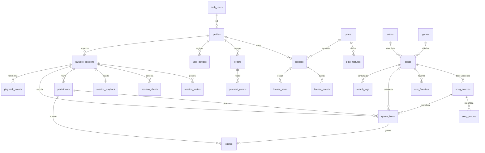

# DATABASE.md — Modelo de datos, RLS y migraciones

| Campo | Valor |
|---|---|
| Documento | Diseño de base de datos |
| Versión | 0.1 (borrador para revisión) |
| Estado | **Propuesto — no aprobado. No aplicar migraciones hasta revisión.** |
| Motor | PostgreSQL 15+ (Supabase) |
| Referencias | `docs/ARCHITECTURE.md`, `docs/YOUTUBE-INTEGRATION.md`, `CLAUDE.md` §8–§10, §23 |

> Los bloques SQL de este documento son **especificación de diseño** (contratos de esquema),
> no migraciones listas para aplicar. La implementación los traducirá a migraciones pequeñas
> y reversibles en `supabase/migrations/`.

---

## 1. Principios

1. **La base es la fuente de verdad** de usuarios, licencias, catálogo, sesiones, participantes,
   cola, scores y favoritos (`CLAUDE.md` §8). Ningún estado crítico vive solo en el frontend.
2. **RLS en toda tabla con datos de usuario.** Antes de crear una tabla se define: propietario,
   quién lee, quién inserta, quién actualiza, quién borra (`CLAUDE.md` §10).
3. **Enums de Postgres**, no booleanos ambiguos (`CLAUDE.md` §23).
4. **Transacciones donde viven los invariantes:** cola, idempotencia del cierre de turno y
   unicidad de orden se resuelven en `plpgsql`, no en TypeScript.
5. **Toda modificación pasa por migración versionada.** Nunca se edita producción a mano
   (`CLAUDE.md` §9).
6. **Todo dato obtenido de YouTube tiene fecha de caducidad** (§12 de este documento, hallazgo H4
   de `ARCHITECTURE.md`).

### 1.1 Convenciones

| Convención | Regla |
|---|---|
| Nombres | `snake_case`, tablas en plural, sin prefijos húngaros |
| Claves primarias | `uuid` con `gen_random_uuid()` (excepto tablas de alto volumen: `bigint identity`) |
| Marcas de tiempo | `timestamptz not null default now()`, siempre UTC |
| Borrado | *Soft delete* solo donde el negocio lo requiere (`active boolean`, `revoked_at`). Sin `deleted_at` genérico: obliga a filtrar en todas las consultas y se olvida |
| Enumeraciones | Tipo `enum` de Postgres, nunca `text` libre ni `boolean` |
| Nombres de índice | `ix_<tabla>__<columnas>` · únicos: `uq_...` · parciales: sufijo `_<condición>` |
| Nombres de política | `<tabla>_<acción>_<sujeto>` (p. ej. `queue_items_insert_own_participant`) |
| Esquemas | `public` (expuesto por PostgREST) y `app` (helpers internos, **no** expuesto) |
| Helpers | `app.*`, `security definer`, `search_path` fijo, `execute` revocado de `public` |

### 1.2 Esquema `app`

Los helpers de autorización **no** van en `public`: PostgREST expone todo lo que esté en
`public`, y una función de autorización expuesta es una invitación a abusar de ella.

```sql
create schema if not exists app;

revoke all on schema app from public;
grant usage on schema app to authenticated, service_role;

-- Todas las funciones de app.* siguen esta plantilla:
--   security definer
--   set search_path = app, public, pg_temp
--   revoke execute on function ... from public, anon
--   grant execute on function ... to authenticated
```

---

## 2. Extensiones

```sql
create extension if not exists pg_trgm;    -- búsqueda tolerante (§9)
create extension if not exists unaccent;   -- normalización de tildes
create extension if not exists pgcrypto;   -- gen_random_uuid, digest
-- NO se habilita: pg_net, http, dblink (superficie innecesaria)
```

### 2.1 Trampa de `unaccent` en columnas generadas

`unaccent(text)` **no** es `IMMUTABLE`, por lo que Postgres la rechaza en columnas generadas.
Se necesita un envoltorio inmutable explícito:

```sql
-- Normativo: base de toda la búsqueda tolerante.
create or replace function app.immutable_unaccent(p_text text)
returns text
language sql
immutable
parallel safe
strict
set search_path = app, public, pg_temp
as $$
  select public.unaccent('public.unaccent'::regdictionary, p_text)
$$;

create or replace function app.norm_text(p_text text)
returns text
language sql
immutable
parallel safe
set search_path = app, public, pg_temp
as $$
  select nullif(
    regexp_replace(
      regexp_replace(
        lower(app.immutable_unaccent(coalesce(p_text, ''))),
        '[^a-z0-9 ]+', ' ', 'g'      -- puntuación → espacio
      ),
      '\s+', ' ', 'g'                 -- colapsa espacios
    ),
    ''
  )
$$;
```

Casos de prueba obligatorios (unitarios, en `supabase/tests/`):

| Entrada | Salida esperada |
|---|---|
| `Maná` | `mana` |
| `José José` | `jose jose` |
| `AC/DC` | `ac dc` |
| `Beyoncé` | `beyonce` |
| `  Los   Prisioneros  ` | `los prisioneros` |
| `Ñandú` | `nandu` |
| `Héroes del Silencio (Live)` | `heroes del silencio live` |
| `""` / `null` | `null` |

---

## 3. Enumeraciones

```sql
-- Identidad y cuentas
create type user_role        as enum ('user', 'commercial', 'admin');
create type account_status   as enum ('active', 'suspended', 'deleted');

-- Licencias (§6 del SPEC)
create type license_type     as enum (
  'free', 'home_lifetime',
  'commercial_monthly', 'commercial_annual', 'commercial_lifetime',
  'founder_lifetime'
);
create type license_status   as enum ('active', 'trial', 'expired', 'suspended', 'cancelled');
create type license_source   as enum ('manual', 'stripe', 'payphone', 'mercadopago', 'transfer');
create type license_event    as enum (
  'created', 'activated', 'extended', 'suspended', 'reactivated',
  'expired', 'cancelled', 'plan_changed', 'seat_granted', 'seat_denied'
);
create type order_status     as enum ('pending', 'paid', 'failed', 'refunded', 'cancelled');

-- Sesiones (§9 del SPEC)
create type session_status   as enum ('draft', 'active', 'paused', 'finished', 'cancelled');
create type session_mode     as enum ('home', 'commercial', 'practice');
create type invite_kind      as enum ('qr', 'manual');
create type client_kind      as enum ('screen', 'controller', 'operator');
create type participant_role as enum ('singer', 'cohost', 'operator');
create type participant_status as enum ('active', 'left', 'removed');

-- Máquina de estados del show (§7.2 de ARCHITECTURE.md)
create type playback_state   as enum ('idle', 'preparing', 'playing', 'paused', 'analyzing', 'result');

-- Cola (§14 del SPEC + extensiones justificadas)
create type queue_status     as enum (
  'waiting', 'ready', 'playing', 'completed', 'skipped', 'cancelled', 'failed'
);
create type skip_reason      as enum ('unavailable', 'operator', 'participant', 'timeout', 'error');

-- Catálogo y fuentes
create type source_provider  as enum ('youtube', 'licensed', 'local_upload');
create type embeddable_status as enum (
  'unknown', 'embeddable', 'blocked', 'private', 'deleted', 'region_blocked', 'invalid'
);

-- Juego
create type score_tier       as enum ('under', 'normal', 'good', 'excellent', 'exceptional');

-- Telemetría
create type playback_event_kind as enum (
  'requested', 'started', 'paused', 'resumed', 'seeked', 'ended',
  'errored', 'skipped', 'completed'
);
create type song_report_reason as enum (
  'unavailable', 'wrong_song', 'bad_quality', 'not_karaoke', 'other'
);

-- Operación
create type job_status       as enum ('running', 'succeeded', 'failed', 'skipped');
create type audit_action     as enum (
  'license.assign', 'license.revoke', 'license.suspend', 'user.suspend', 'user.activate',
  'song.create', 'song.update', 'song.deactivate', 'song_source.update',
  'song_source.deactivate', 'catalog.import_playlist', 'plan.change', 'settings.update'
);
```

**Extensiones al `SPEC.md` y su justificación:**

| Enum | Valor añadido | Por qué |
|---|---|---|
| `queue_status` | `failed` | Sin él, el historial no distingue "se saltó" de "no se pudo reproducir", y el admin pierde la señal para detectar videos rotos |
| `skip_reason` | todo el enum | Trazabilidad operativa; alimenta el reporte de pistas problemáticas |
| `embeddable_status` | `region_blocked`, `invalid` | Casos reales distintos que exigen respuestas distintas |
| `playback_state` | `analyzing`, `result` | La animación de scoring es una fase del show, no un estado del reproductor; separarlas evita confundir estado de YouTube con estado de la aplicación |
| `license_type` | `commercial_annual` | `SPEC.md` §6.2 menciona anual; el enum debe cubrirlo desde el inicio |

---

## 4. Diagrama de relaciones



---

## 5. Tablas

### 5.1 Identidad

```sql
create table public.profiles (
  user_id       uuid primary key references auth.users(id) on delete cascade,
  display_name  text not null check (char_length(display_name) between 1 and 60),
  country       char(2),                                    -- ISO 3166-1 alpha-2, opcional
  role          user_role not null default 'user',
  status        account_status not null default 'active',
  is_anonymous  boolean not null default false,             -- espejo de auth.users.is_anonymous
  locale        text not null default 'es-EC',
  created_at    timestamptz not null default now(),
  updated_at    timestamptz not null default now()
);

create index ix_profiles__status on public.profiles (status) where status <> 'active';
create index ix_profiles__anonymous_purge on public.profiles (created_at) where is_anonymous;
```

Notas:
- `user_id` referencia `auth.users`: Supabase Auth es el único sistema de contraseñas
  (`CLAUDE.md` §12).
- `is_anonymous` se mantiene por trigger desde `auth.users`. Es necesario para el job de purga
  y para no mostrar funciones de cuenta permanente a invitados.
- **`role` y `status` no son editables por el usuario.** Se impide con política de columna
  (§6.3), no confiando en la UI.

```sql
create table public.user_devices (
  id            uuid primary key default gen_random_uuid(),
  user_id       uuid not null references public.profiles(user_id) on delete cascade,
  label         text not null default 'Dispositivo',        -- texto libre del usuario
  user_agent    text,
  first_seen_at timestamptz not null default now(),
  last_seen_at  timestamptz not null default now()
);

create index ix_user_devices__user on public.user_devices (user_id, last_seen_at desc);
```

**Decisión de diseño (ADR-0011):** `user_devices` es **información de soporte**, no un control
de acceso. El límite de licencia se aplica sobre **pantallas concurrentes** (`license_seats`),
no sobre huellas de dispositivo. El *fingerprinting* es frágil e invasivo, y genera tickets de
soporte cuando el usuario borra cookies o usa modo incógnito.

### 5.2 Planes, licencias y pagos

```sql
create table public.plans (
  code          text primary key,                            -- 'free', 'home_lifetime', ...
  name          text not null,
  license_type  license_type not null,
  price_cents   integer check (price_cents >= 0),
  currency      char(3) not null default 'USD',
  billing_period text check (billing_period in ('one_time', 'monthly', 'annual')),
  is_public     boolean not null default true,
  sort_order    smallint not null default 0,
  active        boolean not null default true,
  created_at    timestamptz not null default now()
);

-- Matriz de entitlements: la ÚNICA fuente de verdad de qué habilita cada plan.
create table public.plan_features (
  plan_code     text not null references public.plans(code) on delete cascade,
  feature_key   text not null,                               -- 'customBranding', 'maxConcurrentScreens', ...
  value         jsonb not null,                              -- bool | number | string
  primary key (plan_code, feature_key)
);
```

`plan_features` es la pieza que hace posible `canUseFeature(...)` en lugar de
`if (license === 'commercial_lifetime')` por toda la aplicación (`CLAUDE.md` §15, §16).
Añadir un plan nuevo = `INSERT`, no un despliegue de código.

```sql
create table public.licenses (
  id              uuid primary key default gen_random_uuid(),
  user_id         uuid not null references public.profiles(user_id) on delete cascade,
  plan_code       text not null references public.plans(code),
  license_type    license_type not null,                     -- desnormalizado para consultas y reportes
  status          license_status not null default 'active',
  source          license_source not null default 'manual',
  starts_at       timestamptz not null default now(),
  ends_at         timestamptz,                               -- null = sin vencimiento (lifetime)
  max_screens     smallint not null default 1 check (max_screens between 1 and 50),
  max_participants_per_session smallint not null default 8 check (max_participants_per_session between 1 and 500),
  limits          jsonb not null default '{}'::jsonb,        -- overrides puntuales por usuario
  notes           text,
  created_at      timestamptz not null default now(),
  updated_at      timestamptz not null default now(),
  -- Invariante: una sola licencia activa/trial por usuario.
  -- Se implementa con índice único parcial, no con lógica de aplicación.
  constraint ck_licenses_period check (ends_at is null or ends_at > starts_at)
);

create unique index uq_licenses__one_active_per_user
  on public.licenses (user_id)
  where status in ('active', 'trial');

create index ix_licenses__expiry on public.licenses (ends_at) where status in ('active', 'trial');
```

**Invariante clave:** `uq_licenses__one_active_per_user`. Sin él, dos activaciones manuales
simultáneas producen dos licencias activas y el código de resolución de entitlements se vuelve
no determinista. La base lo impide, no el código.

```sql
create table public.license_events (
  id          bigint generated always as identity primary key,
  license_id  uuid not null references public.licenses(id) on delete cascade,
  event       license_event not null,
  actor_id    uuid references public.profiles(user_id),       -- null = sistema (job)
  data        jsonb not null default '{}'::jsonb,
  created_at  timestamptz not null default now()
);

create index ix_license_events__license on public.license_events (license_id, created_at desc);

-- Ocupación concurrente de pantallas (reemplaza al fingerprinting de dispositivos).
create table public.license_seats (
  id           uuid primary key default gen_random_uuid(),
  license_id   uuid not null references public.licenses(id) on delete cascade,
  session_id   uuid not null,                                 -- FK diferida a karaoke_sessions
  client_id    uuid not null,                                 -- session_clients.id
  kind         client_kind not null,
  acquired_at  timestamptz not null default now(),
  last_seen_at timestamptz not null default now()
);

create unique index uq_license_seats__client on public.license_seats (client_id);
create index ix_license_seats__license_live on public.license_seats (license_id, last_seen_at desc);
```

El `seat` caduca por inactividad (TTL 90 s, barrido por job) en lugar de liberarse
explícitamente. Un navegador de TV que se apaga de golpe nunca envía "me voy"; el TTL resuelve
el caso sin lógica de desconexión frágil.

```sql
create table public.orders (
  id                uuid primary key default gen_random_uuid(),
  user_id           uuid not null references public.profiles(user_id) on delete restrict,
  plan_code         text not null references public.plans(code),
  status            order_status not null default 'pending',
  amount_cents      integer not null check (amount_cents >= 0),
  currency          char(3) not null default 'USD',
  provider          license_source not null default 'manual',
  external_order_id text,
  paid_at           timestamptz,
  created_at        timestamptz not null default now(),
  updated_at        timestamptz not null default now()
);

create unique index uq_orders__external on public.orders (provider, external_order_id)
  where external_order_id is not null;

-- Idempotencia de webhooks: la clave única hace el trabajo, no la lógica.
create table public.payment_events (
  id                bigint generated always as identity primary key,
  provider          license_source not null,
  external_event_id text not null,
  order_id          uuid references public.orders(id) on delete set null,
  payload           jsonb not null,
  processed_at      timestamptz,
  error             text,
  received_at       timestamptz not null default now()
);

create unique index uq_payment_events__provider_event
  on public.payment_events (provider, external_event_id);
```

**Sin política de `INSERT`/`SELECT` para `authenticated`** en `payment_events`: inaccesible por
PostgREST. Solo `service_role` y RPC `SECURITY DEFINER`.

### 5.3 Catálogo

```sql
create table public.artists (
  id              uuid primary key default gen_random_uuid(),
  name            text not null check (char_length(name) between 1 and 160),
  normalized_name text generated always as (app.norm_text(name)) stored,
  image_url       text,
  active          boolean not null default true,
  created_at      timestamptz not null default now(),
  updated_at      timestamptz not null default now()
);

create unique index uq_artists__normalized on public.artists (normalized_name);
create index ix_artists__name_trgm on public.artists using gin (normalized_name gin_trgm_ops);
create index ix_artists__active on public.artists (active) where active;

create table public.genres (
  id         smallint generated always as identity primary key,
  name       text not null,
  slug       text not null,
  sort_order smallint not null default 0,
  active     boolean not null default true,
  created_at timestamptz not null default now()
);

create unique index uq_genres__slug on public.genres (slug);
```

`artists.normalized_name` es **columna generada**: no puede desincronizarse del `name`, a
diferencia de un campo mantenido por trigger o por aplicación.

```sql
create table public.songs (
  id                  uuid primary key default gen_random_uuid(),
  title               text not null check (char_length(title) between 1 and 300),
  normalized_title    text generated always as (app.norm_text(title)) stored,
  artist_id           uuid references public.artists(id) on delete set null,
  genre_id            smallint references public.genres(id) on delete set null,
  language            char(2),                                -- 'es', 'en', 'pt', ...
  difficulty          smallint not null default 3 check (difficulty between 1 and 5),
  active              boolean not null default true,
  times_played        integer not null default 0,             -- rollup diario, no contador en vivo
  created_by          uuid references public.profiles(user_id) on delete set null,
  created_at          timestamptz not null default now(),
  updated_at          timestamptz not null default now()
);

create index ix_songs__title_trgm on public.songs using gin (normalized_title gin_trgm_ops);
create index ix_songs__artist on public.songs (artist_id) where active;
create index ix_songs__genre_language on public.songs (genre_id, language) where active;
create unique index uq_songs__title_artist on public.songs (normalized_title, artist_id);
```

`uq_songs__title_artist` evita el duplicado clásico: dos administradores (o dos importaciones)
añadiendo "Como la Flor" de Selena. El catálogo cura la canción una vez; las versiones viven
en `song_sources`.

```sql
-- Corrección estructural al SPEC (ADR-0006): una canción tiene N fuentes reproducibles.
create table public.song_sources (
  id                  uuid primary key default gen_random_uuid(),
  song_id             uuid not null references public.songs(id) on delete cascade,
  provider            source_provider not null default 'youtube',
  external_id         text not null,                          -- videoId de YouTube, etc.
  canonical_url       text not null,                          -- enlace de vuelta a la fuente
  channel_title       text,                                   -- atribución obligatoria (§ YOUTUBE-INTEGRATION)
  title_snapshot      text,                                   -- título del video en la fuente
  thumbnail_url       text,
  duration_seconds    integer check (duration_seconds > 0),
  embeddable_status   embeddable_status not null default 'unknown',
  region_blocked      text[],                                 -- códigos ISO si aplica
  content_rating      jsonb,                                  -- youtubeRating, madeForKids, etc.
  is_primary          boolean not null default false,
  priority            smallint not null default 100,           -- orden de fallback
  active              boolean not null default true,
  fail_count          smallint not null default 0,
  last_error_code     text,
  metadata_fetched_at timestamptz,                            -- ← gobierna la regla de 30 días
  verified_at         timestamptz,
  created_at          timestamptz not null default now(),
  updated_at          timestamptz not null default now(),
  constraint ck_song_sources__youtube_external
    check (provider <> 'youtube' or external_id ~ '^[A-Za-z0-9_-]{11}$')
);

-- Una sola fuente primaria por canción.
create unique index uq_song_sources__one_primary
  on public.song_sources (song_id) where is_primary;

-- Una misma referencia no puede registrarse dos veces.
create unique index uq_song_sources__provider_external
  on public.song_sources (provider, external_id);

create index ix_song_sources__song_live
  on public.song_sources (song_id, priority)
  where active and embeddable_status = 'embeddable';

-- Índice de cumplimiento: encuentra de inmediato las fuentes cuyos metadatos vencieron.
create index ix_song_sources__metadata_stale
  on public.song_sources (metadata_fetched_at)
  where active and provider = 'youtube';
```

**`ck_song_sources__youtube_external`** valida el formato del `videoId` en la base. Es la
segunda línea de defensa (la primera es el parseo en el servidor) contra inyección de URL:
el dominio nunca acepta una URL arbitraria del usuario.

```sql
create table public.song_reports (
  id          bigint generated always as identity primary key,
  source_id   uuid not null references public.song_sources(id) on delete cascade,
  session_id  uuid,
  reporter_id uuid references public.profiles(user_id) on delete set null,
  reason      song_report_reason not null,
  detail      text check (char_length(detail) <= 500),
  resolved_at timestamptz,
  created_at  timestamptz not null default now()
);

create index ix_song_reports__open on public.song_reports (source_id, created_at desc)
  where resolved_at is null;
```

### 5.4 Sesiones

```sql
create table public.karaoke_sessions (
  id          uuid primary key default gen_random_uuid(),
  owner_id    uuid not null references public.profiles(user_id) on delete cascade,
  name        text not null check (char_length(name) between 1 and 120),
  room_code   text not null,                                  -- 6 chars Crockford base32
  status      session_status not null default 'draft',
  mode        session_mode not null default 'home',
  settings    jsonb not null default '{}'::jsonb,
              -- { max_pending_per_participant: 3, allow_duplicate_song: false,
              --   fairness_mode: 'fifo'|'round_robin', scoring_enabled: true,
              --   allow_guest_control: false }
  theme       jsonb not null default '{}'::jsonb,             -- marca del local (Commercial)
  started_at  timestamptz,
  ended_at    timestamptz,
  created_at  timestamptz not null default now(),
  updated_at  timestamptz not null default now(),
  constraint ck_sessions__room_code check (room_code ~ '^[0-9A-HJKMNP-TV-Z]{6}$'),
  constraint ck_sessions__period check (ended_at is null or started_at is null or ended_at >= started_at)
);

-- El código identifica; no autoriza. Único solo entre sesiones vivas:
-- permite reutilizar códigos antiguos sin colisión histórica.
create unique index uq_sessions__room_code_live
  on public.karaoke_sessions (room_code)
  where status in ('draft', 'active', 'paused');

create index ix_sessions__owner on public.karaoke_sessions (owner_id, created_at desc);
create index ix_sessions__live on public.karaoke_sessions (status, updated_at desc)
  where status in ('active', 'paused');
```

**Alfabeto Crockford base32** (`0-9A-HJKMNP-TV-Z`, 32 símbolos, sin `I`, `L`, `O`, `U`): evita
la confusión clásica al dictar un código en una fiesta ruidosa (`0`/`O`, `1`/`I`/`L`).
6 caracteres → 32⁶ ≈ 1.07 × 10⁹ combinaciones. Suficiente para *navegar* con rate limit,
insuficiente como credencial de escritura — de ahí la separación código/token.

```sql
create table public.session_invites (
  id          uuid primary key default gen_random_uuid(),
  session_id  uuid not null references public.karaoke_sessions(id) on delete cascade,
  kind        invite_kind not null default 'qr',
  token_hash  text not null,                                  -- sha256(token || pepper): NUNCA el token
  expires_at  timestamptz not null,
  revoked_at  timestamptz,
  created_by  uuid references public.profiles(user_id) on delete set null,
  created_at  timestamptz not null default now()
);

create unique index uq_session_invites__token_hash on public.session_invites (token_hash);
create index ix_session_invites__session_live on public.session_invites (session_id)
  where revoked_at is null;
```

El token en claro **nunca** se almacena: si alguien obtiene un volcado de la base, no puede
entrar a las fiestas en curso. Se guarda solo el hash con *pepper* del servidor.

```sql
create table public.session_clients (
  id             uuid primary key default gen_random_uuid(),
  session_id     uuid not null references public.karaoke_sessions(id) on delete cascade,
  user_id        uuid not null references public.profiles(user_id) on delete cascade,
  kind           client_kind not null,
  device_label   text,
  pairing_code_hash text,                                     -- solo mientras está sin emparejar
  pairing_expires_at timestamptz,
  paired_at      timestamptz,
  paired_by      uuid references public.profiles(user_id) on delete set null,
  last_seen_at   timestamptz not null default now(),
  revoked_at     timestamptz,
  created_at     timestamptz not null default now()
);

create index ix_session_clients__session on public.session_clients (session_id, kind)
  where revoked_at is null;

-- Un solo cliente de pantalla activo por sesión en el MVP.
create unique index uq_session_clients__one_screen
  on public.session_clients (session_id)
  where kind = 'screen' and revoked_at is null;
```

`uq_session_clients__one_screen` implementa directamente la restricción de YouTube de **un
solo reproductor con reproducción automática por pantalla**: si ya hay una pantalla activa, la
segunda debe desplazar a la primera explícitamente (o ser rechazada). No se resuelve con
coordinación en el cliente, que es donde falla.

```sql
create table public.participants (
  id           uuid primary key default gen_random_uuid(),
  session_id   uuid not null references public.karaoke_sessions(id) on delete cascade,
  user_id      uuid not null references public.profiles(user_id) on delete cascade,
  nickname     text not null check (char_length(nickname) between 1 and 24),
  avatar_seed  text not null default encode(gen_random_bytes(4), 'hex'),
  color        text check (color ~ '^#[0-9a-fA-F]{6}$'),
  role         participant_role not null default 'singer',
  status       participant_status not null default 'active',
  joined_at    timestamptz not null default now(),
  last_seen_at timestamptz not null default now()
);

create unique index uq_participants__session_user on public.participants (session_id, user_id);
create unique index uq_participants__session_nickname
  on public.participants (session_id, app.norm_text(nickname)) where status = 'active';
create index ix_participants__session on public.participants (session_id, joined_at);
```

`uq_participants__session_user` es lo que permite que un invitado recargue la página o vuelva
a escanear el QR sin duplicarse en la cola ni en el ranking.

Sin información personal: solo `nickname`. Nada de teléfono, email ni nombre real de invitados
(`SPEC.md` §15, `CLAUDE.md` §25).

```sql
-- Estado autoritativo del show: una fila por sesión.
create table public.session_playback (
  session_id            uuid primary key references public.karaoke_sessions(id) on delete cascade,
  state                 playback_state not null default 'idle',
  current_queue_item_id uuid,                                 -- FK diferida (evita ciclo)
  revision              integer not null default 0,           -- CAS optimista
  started_at            timestamptz,                          -- inicio del turno actual
  ended_at              timestamptz,
  accumulated_pause_ms  integer not null default 0,
  updated_by_client_id  uuid references public.session_clients(id) on delete set null,
  updated_at            timestamptz not null default now()
);

create index ix_playback__state_live on public.session_playback (state, updated_at desc)
  where state not in ('idle', 'result');
```

`revision` habilita el **compare-and-swap** que impide que un cliente con estado obsoleto
retroceda la máquina de estados (dos TV abiertas, reconexión, pestaña dormida). Sin este
contador, la última escritura gana y el show se corrompe de forma no reproducible.

`current_queue_item_id` se declara como FK diferida o se omite como FK y se valida en el RPC,
porque `queue_items` referencia `karaoke_sessions` y `session_playback` también: es un ciclo.
Se prefiere **validar en el RPC** y documentarlo, antes que introducir una FK diferible que
complica las migraciones.

```sql
-- Cola. Orden real por sort_key fraccional (ADR-0007).
create table public.queue_items (
  id             uuid primary key default gen_random_uuid(),
  session_id     uuid not null references public.karaoke_sessions(id) on delete cascade,
  song_id        uuid not null references public.songs(id) on delete restrict,
  song_source_id uuid references public.song_sources(id) on delete set null,
  participant_id uuid not null references public.participants(id) on delete cascade,
  sort_key       numeric(20, 10) not null,
  status         queue_status not null default 'waiting',
  skip_reason    skip_reason,
  attempt_no     smallint not null default 1,
  requested_at   timestamptz not null default now(),
  ready_at       timestamptz,
  started_at     timestamptz,
  finished_at    timestamptz,
  constraint ck_queue__sort_key_finite check (sort_key = sort_key and sort_key <> 'Infinity'::numeric),
  constraint ck_queue__finished_consistency
    check (finished_at is null or status in ('completed', 'skipped', 'cancelled', 'failed'))
);

create unique index uq_queue_items__session_sort on public.queue_items (session_id, sort_key);
create index ix_queue_items__pending
  on public.queue_items (session_id, status, sort_key)
  where status in ('waiting', 'ready');
create index ix_queue_items__participant_pending
  on public.queue_items (participant_id, status)
  where status in ('waiting', 'ready', 'playing');
-- Anti-duplicado: un participante no repite la misma canción mientras esté pendiente.
create unique index uq_queue_items__no_duplicate_pending
  on public.queue_items (participant_id, song_id)
  where status in ('waiting', 'ready', 'playing');
```

**`uq_queue_items__no_duplicate_pending`** implementa la regla "evitar duplicados accidentales"
del `SPEC.md` §14 como invariante de base. Es la diferencia entre una regla de negocio y una
regla que no se puede violar ni con dos peticiones concurrentes.

Estrategia de `sort_key`:

| Operación | Cálculo |
|---|---|
| Insertar al final | `coalesce(max(sort_key), 0) + 1` |
| Insertar al frente | `coalesce(min(sort_key), 0) - 1` |
| Insertar entre A y B | `(A.sort_key + B.sort_key) / 2` |
| Renormalizar | Job cuando `B - A < 1e-9` → reasigna enteros por orden actual |

Reordenar la cola escribe **una fila**. Con `position int` habría que renumerar N. En una
sesión con 20 canciones y 15 invitados reordenando, la diferencia es entre 1 y 20 escrituras
por gesto, más el parpadeo visual de la TV.

### 5.5 Juego

```sql
create table public.scores (
  id              uuid primary key default gen_random_uuid(),
  session_id      uuid not null references public.karaoke_sessions(id) on delete cascade,
  participant_id  uuid not null references public.participants(id) on delete cascade,
  song_id         uuid not null references public.songs(id) on delete restrict,
  queue_item_id   uuid not null references public.queue_items(id) on delete cascade,
  total           smallint not null check (total between 0 and 100),
  rhythm          smallint not null check (rhythm between 0 and 100),
  energy          smallint not null check (energy between 0 and 100),
  interpretation  smallint not null check (interpretation between 0 and 100),
  tier            score_tier not null,
  message_key     text not null,
  engine_version  smallint not null,
  seed_hash       text not null,                              -- trazabilidad, no secreto reversible
  inputs          jsonb not null,                             -- señales usadas (auditoría/recálculo)
  is_retro        boolean not null default false,             -- true si el turno no terminó naturalmente
  created_at      timestamptz not null default now()
);

-- INVARIANTE MÁS IMPORTANTE DEL SISTEMA: un score por turno (CLAUDE.md §18).
create unique index uq_scores__queue_item on public.scores (queue_item_id);

create index ix_scores__session_ranking on public.scores (session_id, total desc);
create index ix_scores__participant on public.scores (participant_id, created_at desc);
```

`uq_scores__queue_item` es lo que hace idempotente el cierre de turno. `ended` duplicado,
reconexión, doble clic del operador o reintento de red producen **un solo** score. Es un
invariante de base de datos, no una verificación en el código que alguien puede olvidar.

`seed_hash` guarda `sha256(seed)` (no el seed), suficiente para auditar y reproducir el cálculo
con el `SCORING_SECRET`, sin filtrar el secreto si la base se ve comprometida.

```sql
-- Telemetría: tabla de mayor volumen → particionada por mes desde el día uno.
create table public.playback_events (
  id                bigint generated always as identity,
  session_id        uuid not null,
  queue_item_id     uuid,
  participant_id    uuid,
  client_id         uuid,
  kind              playback_event_kind not null,
  at                timestamptz not null default now(),
  position_seconds  numeric(8,2),
  duration_seconds  numeric(8,2),
  payload           jsonb not null default '{}'::jsonb,
  idempotency_key   text,
  primary key (id, at)
) partition by range (at);

create index ix_playback_events__session on public.playback_events (session_id, at desc);
create index ix_playback_events__item on public.playback_events (queue_item_id, at);
create unique index uq_playback_events__idem
  on public.playback_events (idempotency_key, at) where idempotency_key is not null;
```

Particionar al inicio es gratis; hacerlo con 50 millones de filas es un proyecto de semanas.
La PK incluye `at` porque una tabla particionada por rango exige que la clave de partición
forme parte de la clave primaria.

**La telemetría de alta frecuencia no se publica por Realtime.** Se escribe aquí y se agrega;
publicarla amplificaría el tráfico a todos los móviles de la fiesta sin aportarles nada.

### 5.6 Social y operación

```sql
create table public.user_favorites (
  user_id    uuid not null references public.profiles(user_id) on delete cascade,
  song_id    uuid not null references public.songs(id) on delete cascade,
  created_at timestamptz not null default now(),
  primary key (user_id, song_id)
);

create index ix_user_favorites__song on public.user_favorites (song_id);

create table public.search_logs (
  id               bigint generated always as identity primary key,
  query_raw        text not null check (char_length(query_raw) <= 200),
  query_normalized text,
  result_count     integer not null default 0,
  session_id       uuid,
  created_at       timestamptz not null default now()
);

create index ix_search_logs__misses on public.search_logs (query_normalized, created_at desc)
  where result_count = 0;
create index ix_search_logs__recent on public.search_logs (created_at desc);

create table public.admin_audit_log (
  id          bigint generated always as identity primary key,
  actor_id    uuid references public.profiles(user_id) on delete set null,
  action      audit_action not null,
  entity_type text not null,
  entity_id   text,
  before      jsonb,
  after       jsonb,
  ip          inet,
  user_agent  text,
  created_at  timestamptz not null default now()
);

create index ix_admin_audit__actor on public.admin_audit_log (actor_id, created_at desc);
create index ix_admin_audit__entity on public.admin_audit_log (entity_type, entity_id, created_at desc);

create table public.rate_limit_hits (
  key          text not null,
  window_start timestamptz not null,
  count        integer not null default 0,
  primary key (key, window_start)
);

create table public.youtube_quota_ledger (
  day       date not null,
  endpoint  text not null,
  calls     integer not null default 0,
  units     integer not null default 0,
  primary key (day, endpoint)
);

create table public.external_search_cache (
  query_normalized text primary key,
  provider         source_provider not null,
  results          jsonb not null,
  fetched_at       timestamptz not null default now(),
  expires_at       timestamptz not null
);

create index ix_external_search_cache__expiry on public.external_search_cache (expires_at);

create table public.job_runs (
  id          bigint generated always as identity primary key,
  job_name    text not null,
  status      job_status not null,
  started_at  timestamptz not null default now(),
  finished_at timestamptz,
  items_processed integer not null default 0,
  detail      jsonb not null default '{}'::jsonb,
  error       text
);

create index ix_job_runs__name on public.job_runs (job_name, started_at desc);
```

`search_logs` **no** guarda identidad de invitados: solo la consulta normalizada, el número de
resultados y la sesión (que ya es un dato del evento, no de la persona). Suficiente para el
reporte de curación, mínimo en privacidad.

---

## 6. Row Level Security

### 6.1 Reglas generales

1. `alter table ... enable row level security;` **y** `force row level security;` en toda tabla
   de `public` (la segunda protege también al propietario de la tabla).
2. Sin política = sin acceso. Las tablas internas (`payment_events`, `youtube_quota_ledger`,
   `job_runs`, `rate_limit_hits`, `admin_audit_log`, `external_search_cache`) **no reciben
   ninguna política** para `authenticated`: quedan inaccesibles por PostgREST.
3. Escritura de catálogo y licencias: **solo** `app.is_admin()`.
4. El rol global **nunca** se lee del JWT del cliente para decidir: se lee de
   `public.profiles` (server-controlled, auditable) mediante `app.is_admin()`.
5. El invitado es un usuario `authenticated` (Auth anónimo), así que las políticas usan
   `auth.uid()` de forma uniforme, sin ramas especiales.

### 6.2 Funciones auxiliares

```sql
create or replace function app.current_user_id()
returns uuid language sql stable
set search_path = app, public, pg_temp
as $$ select auth.uid() $$;

create or replace function app.is_admin()
returns boolean language sql stable security definer
set search_path = app, public, pg_temp
as $$
  select exists (
    select 1 from public.profiles p
    where p.user_id = auth.uid()
      and p.role = 'admin'
      and p.status = 'active'
  )
$$;

-- Sesiones donde el usuario actual es participante activo.
create or replace function app.is_session_member(p_session_id uuid)
returns boolean language sql stable security definer
set search_path = app, public, pg_temp
as $$
  select exists (
    select 1 from public.participants pa
    where pa.session_id = p_session_id
      and pa.user_id = auth.uid()
      and pa.status = 'active'
  )
$$;

create or replace function app.is_session_owner(p_session_id uuid)
returns boolean language sql stable security definer
set search_path = app, public, pg_temp
as $$
  select exists (
    select 1 from public.karaoke_sessions s
    where s.id = p_session_id and s.owner_id = auth.uid()
  )
$$;

create or replace function app.current_participant_id(p_session_id uuid)
returns uuid language sql stable security definer
set search_path = app, public, pg_temp
as $$
  select pa.id from public.participants pa
  where pa.session_id = p_session_id
    and pa.user_id = auth.uid()
    and pa.status = 'active'
  limit 1
$$;

-- Cliente de pantalla emparejado y activo del usuario actual.
create or replace function app.is_screen_client(p_session_id uuid)
returns boolean language sql stable security definer
set search_path = app, public, pg_temp
as $$
  select exists (
    select 1 from public.session_clients c
    where c.session_id = p_session_id
      and c.user_id = auth.uid()
      and c.kind = 'screen'
      and c.revoked_at is null
      and c.paired_at is not null
      and c.last_seen_at > now() - interval '90 seconds'
  )
$$;

-- Plantilla obligatoria para toda función de app.*
revoke execute on function app.is_admin() from public, anon;
grant  execute on function app.is_admin() to authenticated, service_role;
-- (repetir para cada función)
```

### 6.3 Políticas por tabla

**`profiles`** — cada usuario ve y edita lo suyo; `role` y `status` son intocables.

```sql
alter table public.profiles enable row level security;
alter table public.profiles force row level security;

create policy profiles_select_own on public.profiles
  for select to authenticated using (user_id = auth.uid() or app.is_admin());

create policy profiles_update_own on public.profiles
  for update to authenticated
  using (user_id = auth.uid())
  with check (user_id = auth.uid());

create policy profiles_insert_self on public.profiles
  for insert to authenticated with check (user_id = auth.uid());

-- Escalada de privilegios: el usuario no puede cambiarse role ni status.
-- Se restringe por columna: RLS no distingue columnas, así que se revoca el UPDATE
-- amplio y se concede por columna.
revoke update on public.profiles from authenticated;
grant  update (display_name, country, locale) on public.profiles to authenticated;
```

Esta es la técnica correcta y con frecuencia olvidada: **RLS filtra filas, no columnas**.
`role = 'admin'` autoconcedido es la escalada de privilegios más común en proyectos Supabase.
Se cierra con `GRANT UPDATE (columnas)`.

**`licenses`, `license_events`, `orders`** — el usuario lee; solo el admin escribe.

```sql
alter table public.licenses enable row level security;
alter table public.licenses force row level security;

create policy licenses_select_own on public.licenses
  for select to authenticated using (user_id = auth.uid() or app.is_admin());

-- Sin política de INSERT/UPDATE/DELETE para authenticated:
-- la activación ocurre por RPC SECURITY DEFINER (admin) o por job.
```

Sin política de escritura, ni siquiera un bug en una Server Action puede activar una licencia
desde una sesión de usuario.

**`karaoke_sessions`**

```sql
alter table public.karaoke_sessions enable row level security;
alter table public.karaoke_sessions force row level security;

create policy sessions_select_member_or_owner on public.karaoke_sessions
  for select to authenticated
  using (owner_id = auth.uid() or app.is_session_member(id) or app.is_admin());

create policy sessions_insert_owner on public.karaoke_sessions
  for insert to authenticated with check (owner_id = auth.uid());

create policy sessions_update_owner on public.karaoke_sessions
  for update to authenticated
  using (owner_id = auth.uid())
  with check (owner_id = auth.uid());

create policy sessions_delete_owner on public.karaoke_sessions
  for delete to authenticated using (owner_id = auth.uid());
```

**`participants`** — lectura para los miembros de la misma sesión; escritura solo de lo propio
o por el dueño.

```sql
alter table public.participants enable row level security;
alter table public.participants force row level security;

create policy participants_select_session on public.participants
  for select to authenticated
  using (user_id = auth.uid() or app.is_session_member(session_id) or app.is_admin());

create policy participants_insert_self on public.participants
  for insert to authenticated
  with check (
    user_id = auth.uid()
    and exists (
      select 1 from public.karaoke_sessions s
      where s.id = session_id and s.status in ('active', 'paused')
    )
  );

create policy participants_update_self on public.participants
  for update to authenticated
  using (user_id = auth.uid())
  with check (user_id = auth.uid());

create policy participants_update_owner on public.participants
  for update to authenticated
  using (app.is_session_owner(session_id))
  with check (app.is_session_owner(session_id));

revoke update on public.participants from authenticated;
grant  update (nickname, avatar_seed, color, last_seen_at, status) on public.participants to authenticated;
```

El `INSERT` exige que la sesión esté **activa**: no se puede poblar de participantes una sesión
terminada ni una en borrador.

**`queue_items`** — el corazón de las reglas del `SPEC.md` §14.

```sql
alter table public.queue_items enable row level security;
alter table public.queue_items force row level security;

create policy queue_select_session on public.queue_items
  for select to authenticated
  using (app.is_session_member(session_id) or app.is_session_owner(session_id) or app.is_admin());

-- El invitado solo puede crear solicitudes para sí mismo, en sesión activa, en estado waiting.
create policy queue_insert_own_participant on public.queue_items
  for insert to authenticated
  with check (
    participant_id = app.current_participant_id(session_id)
    and status = 'waiting'
    and exists (
      select 1 from public.karaoke_sessions s
      where s.id = session_id and s.status = 'active'
    )
  );

-- El invitado solo cancela lo suyo.
create policy queue_update_own_cancel on public.queue_items
  for update to authenticated
  using (participant_id = app.current_participant_id(session_id))
  with check (
    participant_id = app.current_participant_id(session_id)
    and status in ('waiting', 'ready', 'cancelled')
  );

-- El dueño/operador administra toda la cola de su sesión.
create policy queue_update_owner on public.queue_items
  for update to authenticated
  using (app.is_session_owner(session_id))
  with check (app.is_session_owner(session_id));

create policy queue_delete_owner on public.queue_items
  for delete to authenticated using (app.is_session_owner(session_id));

-- En la práctica TODA mutación pasa por RPC. Estas políticas son la red de seguridad
-- por si alguien llama a PostgREST directamente.
```

Nota importante: las políticas de `queue_items` **no** pueden expresar "no confiar en la
posición enviada por el cliente" ni "respetar el cupo de pendientes". Eso vive en el RPC
`request_song`, que es transaccional. RLS es la red de seguridad, no la lógica de negocio.

**`scores`** — lectura para la sesión, **escritura solo por RPC**.

```sql
alter table public.scores enable row level security;
alter table public.scores force row level security;

create policy scores_select_session on public.scores
  for select to authenticated
  using (app.is_session_member(session_id) or app.is_session_owner(session_id) or app.is_admin());

-- SIN política de INSERT/UPDATE/DELETE: el score se crea exclusivamente en
-- complete_queue_item() (SECURITY DEFINER). Es la garantía de que ninguna
-- sesión de usuario puede fabricar un score.
```

**`song_sources`, `songs`, `artists`, `genres`** — lectura controlada, escritura solo admin.

```sql
alter table public.songs enable row level security;
alter table public.songs force row level security;

create policy songs_select_catalog on public.songs
  for select to authenticated using (active or app.is_admin());

create policy songs_write_admin on public.songs
  for all to authenticated
  using (app.is_admin()) with check (app.is_admin());

-- Regla de cumplimiento de 30 días: no exponer fuentes con metadatos vencidos.
alter table public.song_sources enable row level security;
alter table public.song_sources force row level security;

create policy song_sources_select_live on public.song_sources
  for select to authenticated
  using (
    app.is_admin()
    or (
      active
      and embeddable_status = 'embeddable'
      and metadata_fetched_at > now() - interval '30 days'
    )
  );

create policy song_sources_write_admin on public.song_sources
  for all to authenticated
  using (app.is_admin()) with check (app.is_admin());
```

**La regla de 30 días se aplica en RLS**, no solo en un job. Así, aunque el job falle dos
semanas, el sistema deja de servir metadatos vencidos automáticamente. Es defensa en
profundidad para un requisito de cumplimiento.

**`user_favorites`**

```sql
alter table public.user_favorites enable row level security;
alter table public.user_favorites force row level security;

create policy favorites_all_own on public.user_favorites
  for all to authenticated
  using (user_id = auth.uid()) with check (user_id = auth.uid());
```

**`session_playback`** — lectura para la sesión, escritura por RPC de la pantalla.

```sql
alter table public.session_playback enable row level security;
alter table public.session_playback force row level security;

create policy playback_select_session on public.session_playback
  for select to authenticated
  using (app.is_session_member(session_id) or app.is_session_owner(session_id) or app.is_admin());

-- Escritura solo vía set_playback_state()/start_queue_item()/complete_queue_item().
-- No existe política de UPDATE: el CAS por `revision` y las transiciones válidas
-- se aplican en el RPC, no en RLS.
```

**`session_invites`, `session_clients`**

```sql
alter table public.session_invites enable row level security;
alter table public.session_invites force row level security;

-- El invitado nunca lee el token ni su hash: el canje ocurre en el servidor.
create policy invites_select_owner on public.session_invites
  for select to authenticated
  using (app.is_session_owner(session_id) or app.is_admin());

alter table public.session_clients enable row level security;
alter table public.session_clients force row level security;

create policy clients_select_own_or_owner on public.session_clients
  for select to authenticated
  using (user_id = auth.uid() or app.is_session_owner(session_id) or app.is_admin());
```

**`playback_events`** — lectura para la sesión (ranking/historial de turno); inserción solo por
servidor.

```sql
alter table public.playback_events enable row level security;
alter table public.playback_events force row level security;

create policy playback_events_select_session on public.playback_events
  for select to authenticated
  using (app.is_session_member(session_id) or app.is_session_owner(session_id) or app.is_admin());

-- Inserción exclusivamente vía Route Handler con service_role o RPC:
-- el cliente no escribe telemetría arbitraria en la tabla.
```

**`search_logs`** — sin acceso de lectura para usuarios; inserción vía RPC `search_songs`.

### 6.4 Matriz resumen

| Tabla | SELECT | INSERT | UPDATE | DELETE |
|---|---|---|---|---|
| `profiles` | propio / admin | propio | propio (columnas limitadas) | — |
| `user_devices` | propio | propio | propio (label) | propio |
| `plans`, `plan_features` | público (autenticado) | admin | admin | admin |
| `licenses` | propio / admin | admin (RPC) | admin (RPC) | admin |
| `license_events` | propio / admin | admin (RPC) | — | — |
| `license_seats` | admin | servidor (RPC) | servidor (RPC) | servidor |
| `orders` | propio / admin | servidor | servidor | — |
| `payment_events` | — | servidor | servidor | — |
| `artists`, `genres` | autenticado (activos) | admin | admin | admin |
| `songs` | autenticado (activos) | admin | admin | admin |
| `song_sources` | autenticado (vivos y ≤30 d) | admin | admin | admin |
| `song_reports` | admin | participante | admin | admin |
| `karaoke_sessions` | dueño / miembro / admin | dueño | dueño | dueño |
| `session_invites` | dueño / admin | dueño (RPC) | dueño (RPC) | dueño |
| `session_clients` | propio / dueño | servidor (RPC) | servidor | dueño |
| `participants` | miembro / dueño | propio (sesión activa) | propio / dueño | dueño |
| `session_playback` | miembro / dueño | servidor | **solo RPC** | — |
| `queue_items` | miembro / dueño | propio (RPC) | propio (cancelar) / dueño | dueño |
| `scores` | miembro / dueño | **solo RPC** | — | — |
| `playback_events` | miembro / dueño | servidor | — | job |
| `user_favorites` | propio | propio | — | propio |
| `search_logs` | admin | RPC | — | job |
| `admin_audit_log` | admin | RPC (admin) | — | — |
| `rate_limit_hits` | — | RPC | RPC | job |
| `youtube_quota_ledger` | admin | servidor | servidor | — |
| `external_search_cache` | — | admin (RPC) | admin | job |
| `job_runs` | admin | servidor | servidor | — |

---

## 7. RPC críticos (bocetos normativos)

### 7.1 `request_song` — validación de cola en backend

```sql
create or replace function public.request_song(
  p_session_id uuid,
  p_song_id    uuid,
  p_source_id  uuid default null
) returns jsonb
language plpgsql
security definer
set search_path = app, public, pg_temp
as $$
declare
  v_uid        uuid := auth.uid();
  v_participant uuid;
  v_session    public.karaoke_sessions;
  v_limit      int;
  v_pending    int;
  v_source     uuid;
  v_sort_key   numeric(20,10);
  v_item_id    uuid;
begin
  if v_uid is null then
    raise exception 'NOT_AUTHENTICATED' using errcode = 'P0001';
  end if;

  -- 1. Serializa las mutaciones de esta sesión sin bloquear otras sesiones.
  perform pg_advisory_xact_lock(hashtextextended(p_session_id::text, 0));

  select * into v_session from public.karaoke_sessions where id = p_session_id;
  if not found or v_session.status <> 'active' then
    raise exception 'SESSION_NOT_ACTIVE' using errcode = 'P0001';
  end if;

  v_participant := app.current_participant_id(p_session_id);
  if v_participant is null then
    raise exception 'NOT_A_PARTICIPANT' using errcode = 'P0001';
  end if;

  -- 2. Cupo de pendientes por participante (configurable, SPEC §14).
  v_limit := coalesce((v_session.settings->>'max_pending_per_participant')::int, 3);
  select count(*) into v_pending
    from public.queue_items
   where participant_id = v_participant
     and status in ('waiting', 'ready', 'playing');
  if v_pending >= v_limit then
    raise exception 'QUEUE_LIMIT_REACHED' using errcode = 'P0001';
  end if;

  -- 3. Fuente: la primaria viva si no se especifica (o fallback por prioridad).
  v_source := coalesce(p_source_id, (
    select ss.id from public.song_sources ss
     where ss.song_id = p_song_id
       and ss.active
       and ss.embeddable_status = 'embeddable'
       and ss.metadata_fetched_at > now() - interval '30 days'
     order by ss.is_primary desc, ss.priority asc
     limit 1
  ));
  if v_source is null then
    raise exception 'SONG_UNAVAILABLE' using errcode = 'P0001';
  end if;

  -- 4. Orden: al final de la cola.
  select coalesce(max(sort_key), 0) + 1 into v_sort_key
    from public.queue_items
   where session_id = p_session_id
     and status in ('waiting', 'ready', 'playing');

  -- 5. El índice único parcial rechaza duplicados pendientes.
  insert into public.queue_items (session_id, song_id, song_source_id, participant_id, sort_key)
  values (p_session_id, p_song_id, v_source, v_participant, v_sort_key)
  returning id into v_item_id;

  insert into public.playback_events (session_id, queue_item_id, participant_id, kind)
  values (p_session_id, v_item_id, v_participant, 'requested');

  return jsonb_build_object('queue_item_id', v_item_id, 'sort_key', v_sort_key);
exception
  when unique_violation then
    raise exception 'DUPLICATE_REQUEST' using errcode = 'P0001';
end;
$$;

revoke execute on function public.request_song(uuid, uuid, uuid) from public, anon;
grant  execute on function public.request_song(uuid, uuid, uuid) to authenticated;
```

Patrón a replicar en todos los RPC:
`auth.uid()` → `advisory lock` por sesión → validar estado de sesión → validar actor →
validar cupo/límite → resolver fuente → mutar → registrar evento → devolver `jsonb`.
Y siempre con `revoke execute from public, anon` antes del `grant`.

### 7.2 `complete_queue_item` — idempotencia y score en servidor

```sql
create or replace function public.complete_queue_item(
  p_item_id   uuid,
  p_telemetry jsonb
) returns jsonb
language plpgsql
security definer
set search_path = app, public, pg_temp
as $$
declare
  v_item      public.queue_items;
  v_existing  public.scores;
  v_score     jsonb;
  v_actor_ok  boolean;
begin
  -- 1. Ya existe → devolver el mismo score. IDEMPOTENCIA (CLAUDE.md §18).
  select * into v_existing from public.scores where queue_item_id = p_item_id;
  if found then
    return jsonb_build_object('already_completed', true, 'score_id', v_existing.id);
  end if;

  select * into v_item from public.queue_items where id = p_item_id for update;
  if not found then
    raise exception 'ITEM_NOT_FOUND' using errcode = 'P0001';
  end if;

  -- 2. Solo la pantalla emparejada o el dueño de la sesión pueden cerrar el turno.
  v_actor_ok := app.is_screen_client(v_item.session_id) or app.is_session_owner(v_item.session_id);
  if not v_actor_ok then
    raise exception 'FORBIDDEN' using errcode = 'P0001';
  end if;

  -- 3. Validación de la ventana de reproducción contra la telemetría registrada.
  --    Un cliente que mienta solo puede mover unos puntos, no fabricar un 100.
  --    (detalle de umbrales en ARCHITECTURE.md §11.6)

  -- 4. Cálculo del score: SIEMPRE en servidor, con seed determinista (§11.3).
  v_score := app.compute_performance_score(v_item, p_telemetry);

  insert into public.scores (
    session_id, participant_id, song_id, queue_item_id,
    total, rhythm, energy, interpretation, tier, message_key,
    engine_version, seed_hash, inputs, is_retro
  ) values (
    v_item.session_id, v_item.participant_id, v_item.song_id, p_item_id,
    (v_score->>'total')::smallint, (v_score->>'rhythm')::smallint,
    (v_score->>'energy')::smallint, (v_score->>'interpretation')::smallint,
    (v_score->>'tier')::score_tier, v_score->>'messageKey',
    (v_score->>'engineVersion')::smallint, v_score->>'seedHash',
    v_score->'inputs', coalesce((v_score->>'isRetro')::boolean, false)
  )
  on conflict (queue_item_id) do nothing
  returning id into v_existing.id;

  update public.queue_items
     set status = 'completed', finished_at = now()
   where id = p_item_id and status = 'playing';

  update public.session_playback
     set state = 'analyzing', revision = revision + 1, ended_at = now(), updated_at = now()
   where session_id = v_item.session_id;

  insert into public.playback_events (session_id, queue_item_id, participant_id, kind)
  values (v_item.session_id, p_item_id, v_item.participant_id, 'completed');

  return jsonb_build_object('already_completed', false, 'score', v_score);
end;
$$;
```

Nota de diseño: `app.compute_performance_score` concentra el motor de scoring **en la base**,
de modo que ninguna ruta de aplicación puede saltárselo. La implementación mantiene el
algoritmo en un único lugar auditable y `engine_version` permite evolucionarlo.

### 7.3 `app.consume_youtube_quota` — corte de circuito de cuota

```sql
create or replace function app.consume_youtube_quota(
  p_endpoint text,
  p_calls    int,
  p_units    int,
  p_daily_limit int default 10000,
  p_endpoint_limit int default null
) returns boolean
language plpgsql security definer
set search_path = app, public, pg_temp
as $$
declare
  v_used_units int;
  v_used_calls int;
begin
  insert into public.youtube_quota_ledger (day, endpoint, calls, units)
  values ((now() at time zone 'utc')::date, p_endpoint, p_calls, p_units)
  on conflict (day, endpoint)
    do update set calls = youtube_quota_ledger.calls + excluded.calls,
                  units = youtube_quota_ledger.units + excluded.units;

  select units, calls into v_used_units, v_used_calls
    from public.youtube_quota_ledger
   where day = (now() at time zone 'utc')::date and endpoint = p_endpoint;

  if v_used_units > p_daily_limit * 0.8 then
    return false;   -- corte de circuito antes de agotar la cuota real
  end if;
  if p_endpoint_limit is not null and v_used_calls > p_endpoint_limit * 0.8 then
    return false;   -- caso crítico: search.list (100/día)
  end if;
  return true;
end;
$$;
```

El corte al 80 % deja margen para operaciones imprescindibles y convierte un fallo opaco de
Google (`quotaExceeded` a mitad de una fiesta) en un error de negocio explícito y accionable.

---

## 8. Vistas

```sql
-- Ranking de la sesión. Vista, no tabla con triggers: elimina toda una clase de bugs
-- de desincronización y es trivial a esta escala.
create or replace view public.session_leaderboard
with (security_invoker = true)   -- respeta la RLS del consultante
as
select
  s.session_id,
  s.participant_id,
  p.nickname,
  max(s.total)                              as best_score,
  round(avg(s.total))::smallint             as avg_score,
  count(*)                                  as songs_sung,
  rank() over (partition by s.session_id order by max(s.total) desc, count(*) desc) as position
from public.scores s
join public.participants p on p.id = s.participant_id
group by s.session_id, s.participant_id, p.nickname;
```

`security_invoker = true` es **obligatorio** en Supabase: sin él, la vista se ejecuta con los
permisos de su propietario y **puentea la RLS** de las tablas subyacentes. Es un error clásico
que expone datos entre usuarios.

```sql
-- Catálogo listo para mostrar: canción + fuente primaria viva + artista + género.
create or replace view public.song_catalog
with (security_invoker = true)
as
select
  so.id                as song_id,
  so.title,
  so.normalized_title,
  ar.name              as artist_name,
  g.name               as genre_name,
  so.language,
  so.difficulty,
  so.times_played,
  ss.id                as source_id,
  ss.provider,
  ss.external_id,
  ss.canonical_url,
  ss.channel_title,
  ss.thumbnail_url,
  ss.duration_seconds
from public.songs so
join public.artists ar on ar.id = so.artist_id
left join public.genres g on g.id = so.genre_id
join lateral (
  select * from public.song_sources x
   where x.song_id = so.id
     and x.active
     and x.embeddable_status = 'embeddable'
     and x.metadata_fetched_at > now() - interval '30 days'
   order by x.is_primary desc, x.priority asc
   limit 1
) ss on true
where so.active;
```

---

## 9. Búsqueda

```sql
create or replace function public.search_songs(
  p_query    text,
  p_genre_id smallint default null,
  p_language char(2)  default null,
  p_limit    int default 30,
  p_offset   int default 0
) returns table (
  song_id uuid, title text, artist_name text, genre_name text,
  source_id uuid, external_id text, thumbnail_url text, duration_seconds int,
  score real
)
language plpgsql
security definer
set search_path = app, public, pg_temp
as $$
declare
  v_norm text := app.norm_text(p_query);
begin
  return query
  with candidates as (
    select
      so.id, so.title, ar.name as artist_name, g.name as genre_name,
      ss.id as source_id, ss.external_id, ss.thumbnail_url, ss.duration_seconds,
      so.normalized_title, ar.normalized_name,
      case
        when so.normalized_title = v_norm or ar.normalized_name = v_norm then 1000
        when so.normalized_title like v_norm || '%' or ar.normalized_name like v_norm || '%' then 800
        when so.normalized_title like '%' || v_norm || '%'
          or ar.normalized_name like '%' || v_norm || '%' then 600
        else 0
      end
      + (greatest(similarity(so.normalized_title, v_norm),
                  similarity(ar.normalized_name, v_norm)) * 500)::int
      + (ln(1 + so.times_played) * 12)::int as rank_score
    from public.songs so
    join public.artists ar on ar.id = so.artist_id
    left join public.genres g on g.id = so.genre_id
    join lateral (
      select * from public.song_sources x
       where x.song_id = so.id and x.active
         and x.embeddable_status = 'embeddable'
         and x.metadata_fetched_at > now() - interval '30 days'
       order by x.is_primary desc, x.priority asc limit 1
    ) ss on true
    where so.active
      and (p_genre_id is null or so.genre_id = p_genre_id)
      and (p_language is null or so.language = p_language)
      and (
        so.normalized_title like '%' || v_norm || '%'
        or ar.normalized_name like '%' || v_norm || '%'
        or similarity(so.normalized_title, v_norm) > 0.28
        or similarity(ar.normalized_name, v_norm) > 0.28
      )
  )
  select c.id, c.title, c.artist_name, c.genre_name,
         c.source_id, c.external_id, c.thumbnail_url, c.duration_seconds,
         c.rank_score::real
  from candidates c
  order by c.rank_score desc, c.title asc
  limit least(p_limit, 50) offset greatest(p_offset, 0);

  -- Registro para el reporte de curación (sin identidad de invitados).
  insert into public.search_logs (query_raw, query_normalized, result_count, session_id)
  select left(p_query, 200), v_norm, count(*), null
  from (
    select 1 from public.songs so
     where so.active and (
       so.normalized_title like '%' || v_norm || '%'
       or similarity(so.normalized_title, v_norm) > 0.28)
  ) x;
end;
$$;
```

Umbrales y su justificación:

| Parámetro | Valor | Razón |
|---|---|---|
| `similarity > 0.28` | Umbral de corte | Por debajo, "mana" empieza a traer "nana", "mona", etc. |
| Consultas < 4 caracteres | Solo prefijo o coincidencia exacta | Con 3 caracteres la similitud trigram produce ruido inaceptable |
| `ln(1 + times_played) * 12` | Empuje por popularidad | Lineal en el logaritmo: 100 reproducciones no aplastan a una canción nueva y buena |
| `limit ≤ 50` | Techo duro | Evita que un `limit` malicioso genere una consulta costosa |

---

## 10. Índices justificados

| Índice | Consulta que sirve |
|---|---|
| `ix_songs__title_trgm` | Búsqueda tolerante por título (la consulta más frecuente del producto) |
| `ix_artists__name_trgm` | Búsqueda por artista ("mana" → Maná) |
| `ix_queue_items__pending` | Snapshot de la cola de la TV (índice parcial: solo lo pendiente) |
| `ix_queue_items__participant_pending` | Cupo de pendientes por participante en `request_song` |
| `uq_queue_items__session_sort` | Unicidad de orden + `ORDER BY sort_key` |
| `uq_scores__queue_item` | Idempotencia del cierre + `JOIN` para detectar duplicados |
| `ix_scores__session_ranking` | Ranking de la sesión |
| `ix_song_sources__song_live` | Resolver la fuente a reproducir (índice parcial: solo lo vivo) |
| `ix_song_sources__metadata_stale` | Job de refresco de 30 días |
| `ix_playback_events__session` | Auditoría de un turno |
| `ix_search_logs__misses` | Reporte "búsquedas sin resultado" (índice parcial) |
| `uq_licenses__one_active_per_user` | Resolución determinista de entitlements |

Consulta de verificación obligatoria antes de cerrar el Sprint 2:

```sql
explain (analyze, buffers)
select * from public.search_songs('mana', null, null, 30, 0);
-- Objetivo: Execution Time < 50 ms con 10,000 canciones cargadas.
```

---

## 11. Particionado y retención

| Tabla | Estrategia | Retención |
|---|---|---|
| `playback_events` | `PARTITION BY RANGE (at)`, partición mensual, creada por job | 180 días |
| `search_logs` | Sin particionar al inicio (volumen bajo) | 90 días |
| `admin_audit_log` | Sin particionar | Permanente (es auditoría) |
| `rate_limit_hits` | Sin particionar | 7 días |
| `youtube_quota_ledger` | Sin particionar | 400 días |
| `job_runs` | Sin particionar | 90 días |
| `external_search_cache` | Sin particionar | `expires_at` (máx. 7 días) |
| `karaoke_sessions`, `queue_items`, `scores` | Sin particionar | Mientras el usuario exista (historial) |

Creación de particiones: el job mensual crea la partición del mes siguiente. Sin él, el primer
día de cada mes las inserciones fallan — es un fallo silencioso clásico que se descubre en
producción un día 1.

```sql
-- Ejemplo normativo de creación adelantada
create table if not exists public.playback_events_2026_02
  partition of public.playback_events
  for values from ('2026-02-01') to ('2026-03-01');
```

---

## 12. Cumplimiento de la regla de 30 días

Requisito (ver `docs/YOUTUBE-INTEGRATION.md` §6): los metadatos obtenidos por API key son
*Non-Authorized Data* y solo pueden almacenarse **30 días calendario**.

Tres capas de defensa:

1. **Columna de control:** `song_sources.metadata_fetched_at`, obligatoria al insertar una
   fuente de YouTube (`check (provider <> 'youtube' or metadata_fetched_at is not null)`).
2. **Job nocturno:** `job_refresh_song_sources` refresca en lotes de 50 (1 unidad por llamada).
   Lo que no se puede refrescar, se desactiva. `job_purge_stale_metadata` hace la limpieza final.
3. **RLS:** `song_sources_select_live` oculta automáticamente cualquier fuente con metadatos
   de más de 30 días, **aunque el job haya fallado durante semanas**.

Prueba obligatoria en CI:

```sql
-- Ninguna fuente visible puede tener metadatos vencidos.
select count(*) from public.song_sources
 where active
   and provider = 'youtube'
   and metadata_fetched_at < now() - interval '30 days';
-- Resultado esperado: 0 en el contexto de un usuario autenticado no-admin.
```

---

## 13. Migraciones

### 13.1 Convención

```text
supabase/migrations/
  20260101120000_extensions_and_app_schema.sql
  20260101120100_enums.sql
  20260101120200_identity_profiles_devices.sql
  20260101120300_plans_licenses_payments.sql
  20260101120400_catalog_artists_genres_songs.sql
  20260101120500_catalog_song_sources.sql
  20260101120600_sessions_participants.sql
  20260101120700_queue_scores.sql
  20260101120800_playback_events_partitioned.sql
  20260101120900_operations_logs.sql
  20260101121000_helpers_and_rls.sql
  20260101121100_rls_policies.sql
  20260101121200_rpc_session.sql
  20260101121300_rpc_queue.sql
  20260101121400_rpc_playback_scoring.sql
  20260101121500_rpc_admin_jobs.sql
  20260101121600_views.sql
  20260101121700_seed_plans_and_genres.sql
```

### 13.2 Reglas

1. **Una migración, un propósito.** Revisable en menos de 5 minutos.
2. **Nunca `DROP COLUMN` en el mismo release que deja de usarla.** Primero se deja de escribir,
   después se elimina en un release posterior.
3. **Reversibilidad:** cuando el cambio es destructivo, se incluye el SQL de reversión en el
   comentario de cabecera.
4. **RLS en la misma migración que la tabla.** Una tabla sin RLS es un incidente esperando.
5. **Nada de datos reales en migraciones.** Los datos semilla van en `supabase/seed.sql`.
6. **`alter table ... force row level security`** en toda tabla nueva de `public`.
7. **`revoke execute ... from public, anon`** para toda función nueva.
8. Prohibido editar una migración ya aplicada en producción. Se corrige con una nueva.

### 13.3 Prueba de que ninguna función nace pública

```sql
-- Debe devolver 0 filas.
select p.proname
from pg_proc p
join pg_namespace n on n.oid = p.pronamespace
where n.nspname in ('public', 'app')
  and p.prosecdef                              -- security definer
  and (p.proconfig is null                    -- sin search_path fijo
       or not exists (select 1 from unnest(p.proconfig) c where c like 'search_path=%'))
  and has_function_privilege('anon', p.oid, 'execute');   -- ejecutable por anon
```

---

## 14. Datos semilla (`supabase/seed.sql`)

`CLAUDE.md` §40: pocos ejemplos, no cientos de URLs ficticias.

```text
plans:        free, home_lifetime, commercial_monthly, commercial_annual,
              commercial_lifetime, founder_lifetime
plan_features: matriz completa de entitlements por plan (la fuente de verdad)
genres:       Pop, Rock, Baladas, Latino, Rancheras
artists:      ~10 artistas reales y verificables
songs:        ~15 canciones con una fuente de YouTube verificada y embebible
              (curadas a mano, comprobadas con videos.list antes de comprometerlas)
profiles:     1 admin de desarrollo + 1 usuario demo
licenses:     1 free + 1 home_lifetime (para probar entitlements en los tests)
```

El seed **no** inventa `videoId`. Cada fuente semilla se obtiene con `videos.list` y se verifica
`embeddable_status = 'embeddable'` en el momento de crearla. Un seed con IDs inventados produce
una demo que falla en la primera reproducción, que es la peor primera impresión posible.

---

## 15. Pruebas de base de datos (pgTAP)

Obligatorias en CI. Es el único control que detecta una política RLS mal escrita antes de
producción (`ARCHITECTURE.md` §13.5).

```text
supabase/tests/
  00_helpers_test.sql          -- norm_text, inmutabilidad, casos con tildes
  01_rls_profiles_test.sql     -- A no lee B; A no puede cambiarse role ni status
  02_rls_licenses_test.sql     -- usuario no puede INSERT/UPDATE su licencia
  03_rls_sessions_test.sql     -- extraño no lee sesión ajena
  04_rls_queue_test.sql        -- invitado no cancela turno ajeno; no inserta en sesión ajena
  05_rls_scores_test.sql       -- nadie inserta scores directamente
  06_rls_admin_test.sql        -- no-admin no lee audit_log ni quota_ledger
  07_functions_privileges.sql  -- anon no ejecuta RPC de sesión
  08_rls_views_test.sql        -- vistas con security_invoker respetan RLS
  09_compliance_30_days.sql    -- fuentes vencidas invisibles para no-admin
```

Casos mínimos que deben existir (uno por línea):

| # | Caso | Resultado esperado |
|---|---|---|
| 1 | Usuario B hace `select * from profiles where user_id = A` | 0 filas |
| 2 | Usuario A hace `update profiles set role='admin' where user_id=A` | Error de permiso |
| 3 | Usuario A hace `insert into licenses (user_id, plan_code, license_type) values (A,'home_lifetime','home_lifetime')` | Error de permiso |
| 4 | Invitado de sesión X hace `select * from queue_items where session_id = Y` | 0 filas |
| 5 | Invitado intenta `update queue_items set status='cancelled'` en turno ajeno | 0 filas afectadas |
| 6 | Cualquier usuario hace `insert into scores (...)` | Error de permiso |
| 7 | No-admin hace `select * from admin_audit_log` | 0 filas |
| 8 | `anon` ejecuta `request_song(...)` | Error de permiso |
| 9 | Invitado consulta `song_sources` con `metadata_fetched_at` de hace 45 días | 0 filas |
| 10 | Dos `request_song` concurrentes del mismo participante y canción | 1 éxito, 1 `DUPLICATE_REQUEST` |
| 11 | Dos `complete_queue_item` sobre el mismo turno | 1 score, el segundo devuelve `already_completed=true` |
| 12 | `request_song` en sesión `finished` | `SESSION_NOT_ACTIVE` |
| 13 | `request_song` superando el cupo de pendientes | `QUEUE_LIMIT_REACHED` |
| 14 | Todos los `security definer` tienen `search_path` y no son ejecutables por `anon` | 0 filas en la consulta de §13.3 |

---

## 16. Consultas calientes (a vigilar con `EXPLAIN ANALYZE`)

| Consulta | Frecuencia | Índice que la sostiene |
|---|---|---|
| `get_session_snapshot` | Cada carga de TV y cada reconexión | `ix_queue_items__pending`, `ix_scores__session_ranking` |
| `search_songs` | Cada búsqueda de invitado | `ix_songs__title_trgm`, `ix_artists__name_trgm` |
| Fuente a reproducir | Cada inicio de turno | `ix_song_sources__song_live` |
| Cupo de pendientes | Cada solicitud | `ix_queue_items__participant_pending` |
| Ranking de sesión | Cada score nuevo (Realtime lo empuja) | `ix_scores__session_ranking` |
| `/admin` métricas | Bajo demanda | `rollup_metrics` (tabla agregada, no consulta analítica en vivo) |

El panel de métricas del admin **no** consulta `playback_events` en vivo: lee agregados
generados por `job_rollup_metrics`. Consultar una tabla particionada de millones de filas para
pintar tres contadores es la forma más rápida de degradar el panel que más se usa en soporte.
